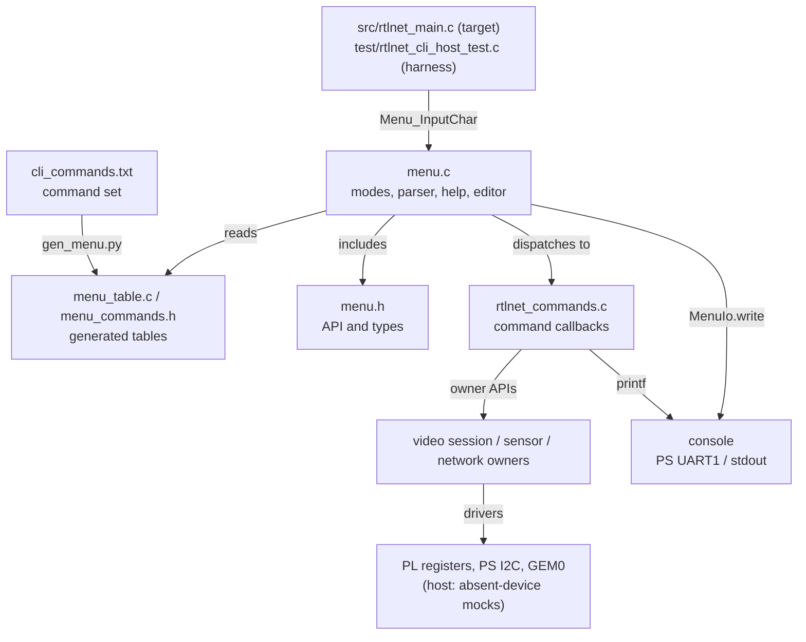
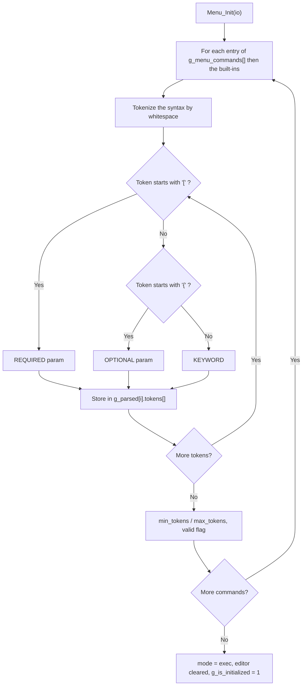
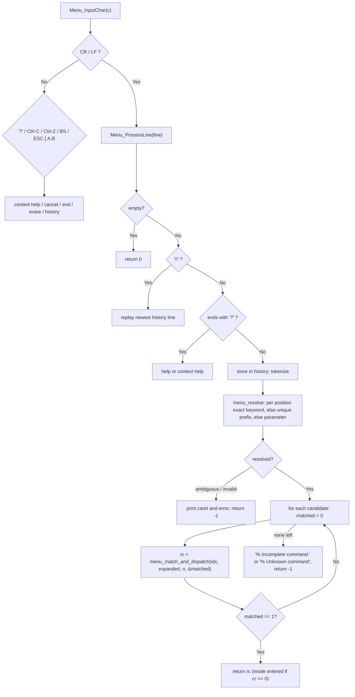
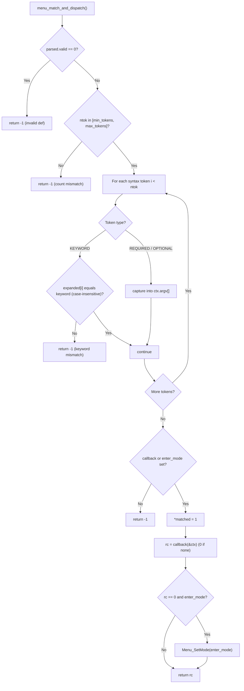
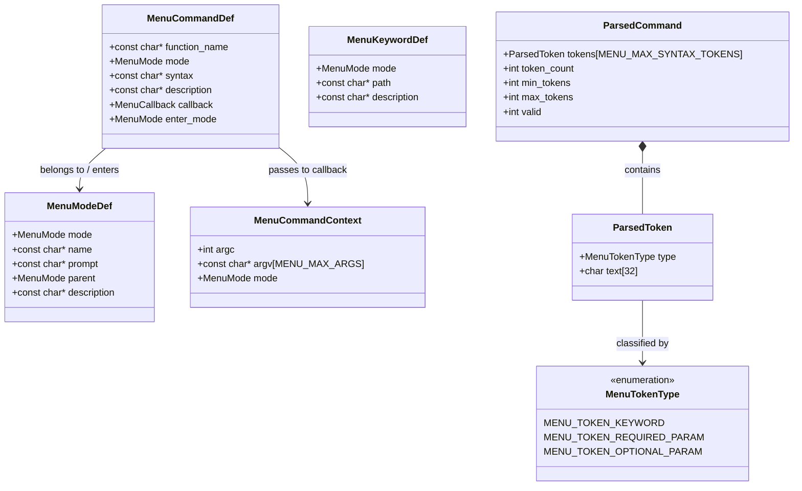
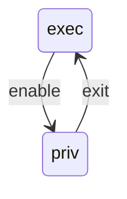

<!--
Copyright (C) 2026 — Generated by MenuBuilder AI, inspired by Steve Spano
                      (SteveSpano009@gmail.com)

This file is free software; you can redistribute it and/or
modify it under the terms of the GNU Lesser General Public
License as published by the Free Software Foundation; either
version 2.1 of the License, or (at your option) any later version.

This file is distributed in the hope that it will be useful,
but WITHOUT ANY WARRANTY; without even the implied warranty of
MERCHANTABILITY or FITNESS FOR A PARTICULAR PURPOSE.  See the GNU
Lesser General Public License for more details.

You should have received a copy of the GNU Lesser General Public
License along with this library; if not, write to the Free Software
Foundation, Inc., 51 Franklin Street, Fifth Floor, Boston, MA  02110-1301
USA

SPDX-License-Identifier: LGPL-2.1-or-later
-->

# RTLNet Zybo Z7-20 CLI — MenuDocumentation

| Item | Value |
|---|---|
| Revision | 11-14-2026 (newest row of the revision history in cli/cli_commands.txt) |
| Generated | 2026-11-14 00:00:00 -04:00 by cli/gen_menu.py from cli/cli_commands.txt |
| Commands | 12 table entries (1 mode-entry), 3 keyword groups, 3 built-ins (exit, end, help) |

## 1. Title and overview

The firmware console of the RTLNet Zybo Z7-20 board is a reduced hierarchical command
line in the style of a network switch: user exec (`rtlnet>`), privileged exec (`rtlnet#`,
`enable` and `exit`). It follows the MenuBuilder rules (explicit `matched` dispatch, aligned help, HELP
and `?` aliases, LGPL headers, revision table) extended by `MenuBuilder_hierarchical.md`:
modes and prompts, `exit`/`end`/Ctrl-Z, context-sensitive `?`, unique-prefix abbreviation,
backspace editing and history (`!!`, up/down arrow).

The same engine and command callbacks build for the Cortex-A9 target (PS UART1)
and for the desktop harness (stdin/stdout, absent-device mocks), whose scripted session
checks the parser and the mode logic.

## 2. Architecture overview



## 3. Initialization flow



## 4. Command processing and dispatch flow



## 5. Token matching detail



## 6. Data structures



### 6.1 Mode tree



| Mode | Prompt | Entered by | `exit` returns to |
|---|---|---|---|
| exec | `rtlnet>` | start-up | — (stays) |
| priv | `rtlnet#` | `enable` in exec | exec |

## 7. Command reference

One row per command line of cli/cli_commands.txt (MODE-ENTER lines included). Min/Max are
token counts; exec commands are also accepted in priv.

| # | Function | Mode | Command Syntax | Required | Optional | Min | Max | Enters | Description |
|---|---|---|---|---|---|---|---|---|---|
| 1 | - | exec | `ENABLE` | — | — | 1 | 1 | priv | Enter privileged exec |
| 2 | cli_version | exec | `SHOW VERSION` | — | — | 2 | 2 | — | Firmware and hardware identity |
| 3 | cli_ip | exec | `SHOW IP` | — | — | 2 | 2 | — | DHCP address and PHY identity |
| 4 | cli_camera | exec | `SHOW CAMERA` | — | — | 2 | 2 | — | Camera mode and capture counters |
| 5 | cli_encoder | exec | `SHOW ENCODER` | — | — | 2 | 2 | — | Encoder picture and error statistics |
| 6 | cli_stream | exec | `SHOW STREAM` | — | — | 2 | 2 | — | MPEG-TS and UDP statistics |
| 7 | cli_qp | priv | `ENCODER QP [VALUE]` | VALUE | — | 3 | 3 | — | Constant QP 0..51 |
| 8 | cli_gop | priv | `ENCODER GOP [VALUE]` | VALUE | — | 3 | 3 | — | IDR period 1..255 |
| 9 | cli_bitrate | priv | `ENCODER BITRATE [KBPS]` | KBPS | — | 3 | 3 | — | Target kbps 0..100000; zero selects constant QP |
| 10 | cli_start | priv | `STREAM START [IP] [PORT]` | IP, PORT | — | 4 | 4 | — | Start H264 MPEG-TS UDP to IPv4 destination |
| 11 | cli_stop | priv | `STREAM STOP` | — | — | 2 | 2 | — | Stop stream and release capture slot |
| 12 | cli_mode | priv | `CAMERA MODE [MODE]` | MODE | — | 3 | 3 | — | 720p30 or 1080p15; requires stream stopped |

Built-ins (menu.c): `EXIT` (every mode), `END` (privileged and configuration modes), `HELP` and `?`
(every mode, identical listing), `!!` (repeat the previous line), Ctrl-C (cancel the line),
Ctrl-Z (`end`), Ctrl-U (erase the line), up/down arrow (history).

Keyword groups (help text when `?` lists a keyword shared by several commands):

| Mode | Keyword path | Description |
|---|---|---|
| exec | `SHOW` | Show current status |
| priv | `ENCODER` | Configure encoder |
| priv | `STREAM` | Control MPEG-TS UDP stream |

## 8. Build instructions

Desktop harness, from `cpu/zynq7_h264/firmware/cli`:

```
build.bat          REM compile and link build/menu.exe
build.bat run      REM build + interactive mode (stdin/stdout)
build.bat demo     REM build + scripted session and negative controls
build.bat clean    REM remove build artifacts
```

On a POSIX host: `make CC=<host compiler>`, `make CC=<host compiler> demo`, or `make CC=<host compiler> run`.
On this workstation obtain the compiler through Resolve-RtlnetHostCc; build.bat does that automatically.
The native POSIX Makefile is supplied but is not tested in this Windows task.
ARM firmware: `powershell -NoProfile -ExecutionPolicy Bypass -File ../build.ps1 -Xsa <board XSA>`.
After editing cli_commands.txt run gen_menu.py and check_menu.py using resolved Python.
