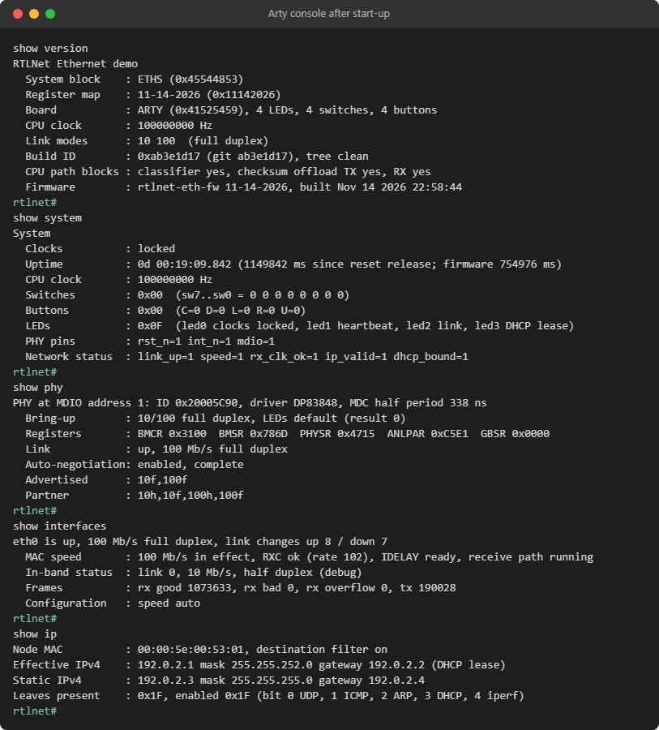
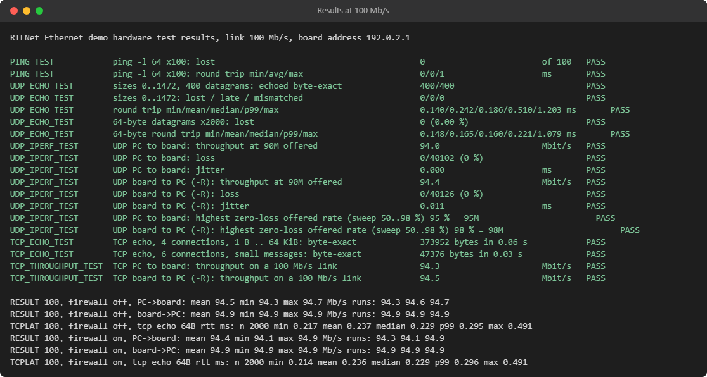
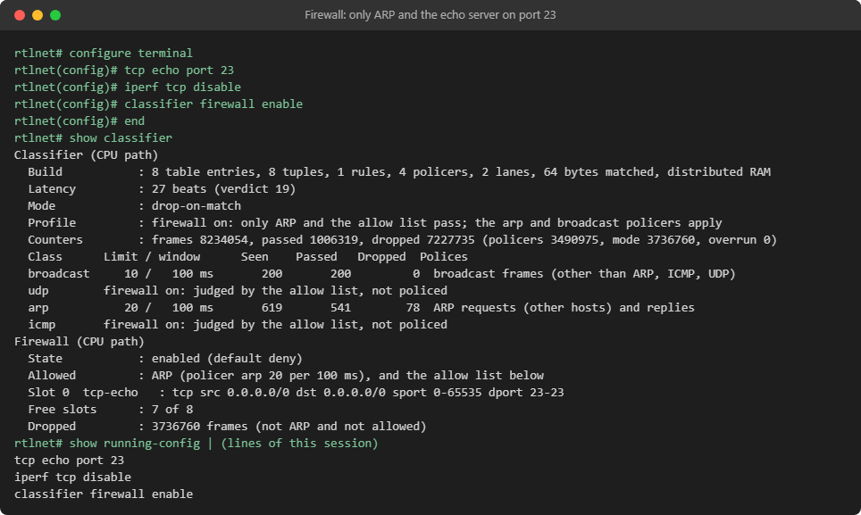
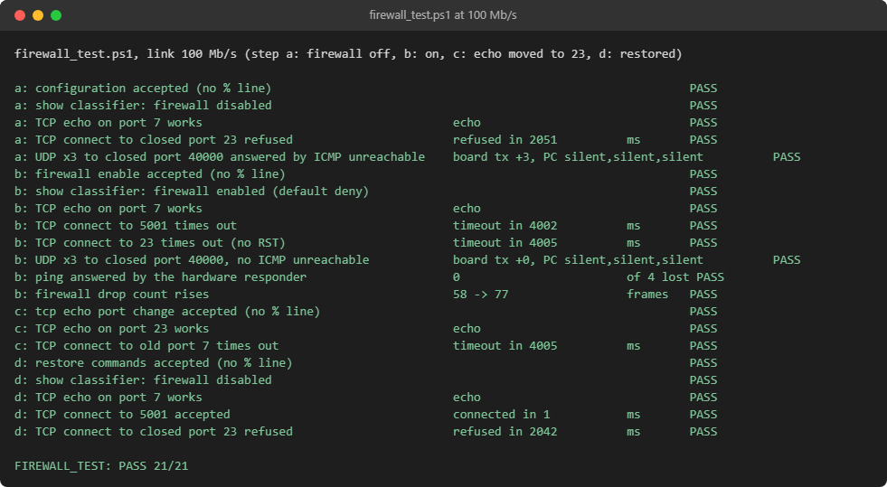
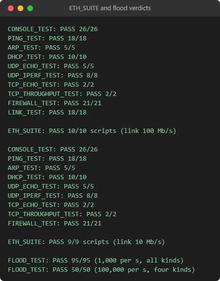
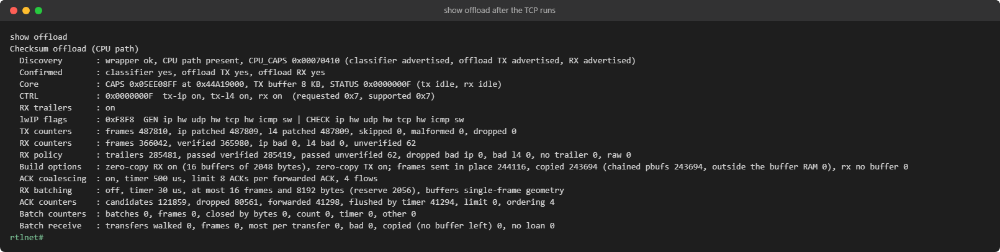

<table style="width:100%; border:none; margin:0; padding:0;">
<tr>
<td style="text-align:left; border:none; padding:0; width:50%;"></td>
<td style="text-align:right; border:none; padding:0; width:50%; vertical-align:bottom;"><strong>Demo Brief</strong> Revision 11-17-2026</td>
</tr>
</table>

<h1 style="font-size:30px; margin-top:18px;">RTLNet Ethernet Demo for the Arty A7-100T</h1>

A ready-to-run FPGA image: 10/100 Mb/s Ethernet with ARP, ping, DHCP, UDP echo and UDP iperf 2 in FPGA fabric, lwIP TCP echo and iperf 2 on a small MicroBlaze V with 256 KiB of block RAM, a protection profile that holds a flood away from the CPU, a default-deny firewall that lets only ARP and the open TCP ports reach the CPU, and a switch-style console.

### Highlights

- IronKernel includes Markdown integration guides for engineers, Claude, and Codex. The guides connect the RTL and firmware interfaces to the tests used on this board.
- ARP, ping, DHCP, UDP echo and UDP iperf 2 in FPGA fabric: 94.4 Mb/s at 100 Mb/s with no loss, no CPU involved
- lwIP TCP echo and iperf 2 on a MicroBlaze V: 94.5 / 94.9 Mb/s at 100 Mb/s, the line rate of the link
- Default-deny firewall (`classifier firewall enable`): only ARP and the open TCP ports reach the CPU, with no throughput cost
- Protection profile: a 1,000,000-frame flood leaves TCP echo byte-exact and the console responsive
- 10/100 Mb/s MII (TI DP83848J); firmware in 256 KiB of on-chip block RAM
- Switch-style console; every service, the firewall and the floods tested on the board
- Programs over JTAG with the free Vivado license; no time limit

### At a glance

| Item | Value |
|---|---|
| Ethernet | 10/100 Mb/s MII (TI DP83848J), full duplex |
| Hardware protocols | ARP, ICMP echo, DHCP client, UDP echo, UDP iperf 2 server |
| TCP | lwIP: echo port 7, iperf 2 server port 5001 |
| CPU-path firewall | default deny, off at boot: ARP plus up to 8 allow entries (services, client flows, `classifier acl`) |
| CPU | MicroBlaze V, 100 MHz, 256 KiB block RAM, no caches |
| Clock | one 100 MHz system clock (plus the PHY's MII clocks and the 25 MHz PHY reference) |
| Console | USB-UART, 115200 8N1 |
| FPGA | xc7a100tcsg324-1 |
| Utilization | 24,981 LUT (39.40 %), 36,059 FF (28.44 %), 105.5 block RAM tiles (78.15 %), 6 DSP |
| Routed timing | WNS +0.142 ns, WHS +0.051 ns, WPWS +3.000 ns |
| Source revision | hardware git ab3e1d17, firmware git f82d4f1, both trees clean |
| Time limit | none |
| License | `LICENSE.md` |

## License

The RTLNet sources and this image are under the RTLNet source-available license (`LICENSE.md`).

**Free, no fee:**

- Evaluation, development, research, teaching, hobby and personal projects, including prototypes and demonstrations that are not sold
- A commercial product whose complete design sources are public under the RTLNet license and whose changes to RTLNet files are offered back as pull requests

**Paid license from IronKernel (ironkernel.com), before the product ships:**

- A commercial product whose design sources are not public

A paid license carries no royalty and no per-unit fee. This demo contains no paid extension and no netlist.

## How it works

**Figure 1.** Demo set-up and data path (demo-ethernet, sheet 2)

1. The MAC receives frames from the PHY and the protocol wrapper answers ARP requests, ping, DHCP and the UDP echo and UDP iperf 2 ports in fabric. The CPU sees none of this traffic. The MAC, the protocol blocks and the CPU side run from one 100 MHz clock; only the two MII clocks (receive and transmit, 25 MHz at 100 Mb/s and 2.5 MHz at 10 Mb/s, both outputs of the PHY) and the 25 MHz PHY reference clock are separate.
2. Frames the wrapper does not handle (TCP, for example) pass the classifier and go to the CPU through an AXI DMA into a dual-port frame buffer RAM of 64 KiB on the CPU's data-side LMB. In the small-memory profile lwIP keeps the data segments by reference, so every TCP data frame leaves as a chained buffer and is copied; only ACKs and other single-buffer frames are sent in place. After the six 10 s TCP runs at 100 Mb/s this image had sent 245,538 frames in place and 243,746 copied (`show offload`).
3. The checksum offload core (`rtlnet_tcp_offload`) patches the IP and TCP/UDP checksums of transmitted frames in place and verifies the checksums of received frames, so lwIP does not compute them. ACK coalescing, on at boot with a 500 microsecond timer, holds back pure TCP ACKs and merges them (121,887 candidates, 79,826 dropped, 42,061 forwarded in the 100 Mb/s runs). Receive batching is available and is off at boot.
4. The classifier (`rtlnet_classifier`) judges every frame on its way to the CPU. At boot it is in pass-all mode with the protection profile: policers of 20 ARP, 10 ICMP, 10 UDP and 10 other broadcast frames per 100 ms window on the traffic the hardware did not answer. TCP and other unicast traffic is not policed. `classifier firewall enable` switches it to drop-on-match with an ARP exception and an allow list, so every frame that is neither ARP nor allowed is dropped in hardware (section CPU-path firewall). The protocol ingress filter discards multicast before the CPU. On this board the classifier tables are in distributed RAM (8 table entries, 8 tuples, 1 rule, 4 policers; 4,670 LUT, no block RAM tile).
5. lwIP on the MicroBlaze V serves TCP echo on port 7 and the TCP iperf 2 server on port 5001. The firmware reads the PHY ID by MDIO at start-up and picks the driver from it (`show phy` prints it; the Arty PHY answers as ID 0x20005C90 at MDIO address 1, driver DP83848). `speed auto` advertises 10 and 100 Mb/s full duplex; half duplex is never advertised.

### Board resources

| Item | Arty A7-100T |
|---|---|
| FPGA | xc7a100t (135 block RAM tiles) |
| PHY and interface | TI DP83848J on MII, 10/100 Mb/s; the FPGA drives the PHY's 25 MHz reference clock |
| Firmware memory | 256 KiB LMB, 64 KiB frame buffer, small-memory lwIP profile |
| Classifier tables | distributed RAM (0 block RAM tiles), small profile |
| Firewall allow entries | 8 tuple slots |
| TCP data frames | copied (segments kept by reference); ACKs sent in place |
| Auto-MDIX | off on the board: use a straight cable to a switch |

## What you need and run it

An Arty A7-100T with one micro-USB cable (J10: power, JTAG and the console), an Ethernet cable to a switch on a network with DHCP (the board does not do auto-MDIX), Vivado 2026.1 with its free license and a terminal at 115200 baud 8N1. JP2 shorted may restart the design when a terminal opens the COM port; none was seen in the campaign.

1. Program the board: `powershell -NoProfile -ExecutionPolicy Bypass -File boards/arty_a7_100/scripts/program.ps1 -Bit demos/ethernet/arty_a7_100/rtlnet_arty_a7_100_eth.bit`
2. Open the serial console. The banner `RTLNet Ethernet demo -- rtlnet-eth-fw`, `Board ARTY` and the DHCP lease line appear.
3. `show ip` prints the address; `ping` it from the PC.
4. `show interfaces`, `show phy`, `show arp`, `show counters`, `show tcp`, `show iperf`, `show offload` and `show classifier` print the state of each part. `configure terminal`, `interface eth0`, `speed 10|100|auto` sets the link speed.
5. The tests of `cpu/microblaze_v_ethernet/test/` (`run_all.ps1 -Port <COM> -Nic <adapter> -LinkMbps 10|100` and `flood_test.ps1`) run every service, the firewall and the protection profile against the board; `firewall_test.ps1` runs the firewall alone.

 <strong>Figure 2.</strong> Console: <code>show version</code>, <code>show system</code>, <code>show phy</code>, <code>show interfaces</code>, <code>show ip</code> (addresses and MAC replaced by documentation values)

## Device utilization and timing

Release image (`arty_fw2`: hardware git ab3e1d17, firmware git f82d4f1 merged into the bitstream by `updatemem`, trees clean, Vivado 2026.1) on the XC7A100T:

<table class="num wrap">
<thead><tr><th></th><th>LUTs</th><th>Flip-flops</th><th>Block RAM tiles</th><th>DSP blocks</th></tr></thead>
<tbody>
<tr><td>Release image</td><td>24,981</td><td>36,059</td><td>105.5</td><td>6</td></tr>
<tr><td>Share of the device</td><td>39.40 %</td><td>28.44 %</td><td>78.15 %</td><td>2.50 %</td></tr>
</tbody>
</table>

Routed timing at the one 100 MHz system clock: WNS +0.142 ns, WHS +0.051 ns, WPWS +3.000 ns, no failing endpoint. The block RAM tiles are: 64 for the 256 KiB CPU memory, 16 for the 64 KiB frame buffer, 3 for the AXI DMA, 22.5 for the FIFOs and buffers of the network cores and 0 for the classifier; 29.5 tiles are free.

## Measured performance

Method: the release image was programmed over JTAG and every number below was measured on that image in one campaign on 11-17-2026. A PC with a wired Gigabit adapter is connected to the board through an unmanaged switch (the switch negotiates 10 or 100 Mb/s with the board). The link speed is set from the console with `speed 10` and `speed 100`. Throughput is measured with iperf 2 (a 10 s run, in both directions; TCP is the mean of 3 runs); UDP latency and TCP latency with 2000 echoes of 64 bytes; ping with the PC's ping tool, which reports whole milliseconds. UDP iperf is offered at 90 % of the link speed; the zero-loss sweep goes from 50 % to 98 %.

<table class="num wrap">
<thead><tr><th>Test</th><th>10 Mb/s</th><th>100 Mb/s</th></tr></thead>
<tbody>
<tr><td>TCP iperf 2, PC to board, Mb/s, mean (min to max)</td><td>9.5 (9.5 to 9.5)</td><td>94.5 (94.3 to 94.7)</td></tr>
<tr><td>TCP iperf 2, board to PC, Mb/s, mean (min to max)</td><td>9.5 (9.5 to 9.5)</td><td>94.9 (94.9 to 94.9)</td></tr>
<tr><td>TCP iperf 2 with the firewall on, PC to board / board to PC, Mb/s, mean</td><td></td><td>94.4 / 94.9</td></tr>
<tr><td>TCP echo, 64 B, mean / median / p99 round trip, ms</td><td>0.434 / 0.426 / 0.491</td><td>0.237 / 0.229 / 0.295</td></tr>
<tr><td>TCP echo with the firewall on, 64 B, mean / median / p99, ms</td><td></td><td>0.236 / 0.229 / 0.296</td></tr>
<tr><td>UDP iperf 2, PC to board, Mb/s, loss</td><td>9.4 at 9 offered, 0 of 4,009</td><td>94.0 at 90 offered, 0 of 40,102</td></tr>
<tr><td>UDP iperf 2, board to PC, Mb/s, loss</td><td>9.4 at 9 offered, 0 of 4,014</td><td>94.4 at 90 offered, 0 of 40,126</td></tr>
<tr><td>UDP iperf 2, highest zero-loss rate in the sweep, PC to board</td><td>98 % of the link</td><td>95 % of the link</td></tr>
<tr><td>UDP iperf 2, highest zero-loss rate in the sweep, board to PC</td><td>98 % of the link</td><td>98 % of the link</td></tr>
<tr><td>UDP echo, 64 B, mean / median / p99 round trip, ms, loss</td><td>0.365 / 0.357 / 0.426, 0 of 2000</td><td>0.165 / 0.160 / 0.221, 0 of 2000</td></tr>
<tr><td>UDP echo, 0 to 1472 B, 400 datagrams byte-exact</td><td>400 of 400</td><td>400 of 400</td></tr>
<tr><td>Ping, 64 B x 100, lost; round trip min / avg / max, ms</td><td>0 of 100; 0 / 0 / 1</td><td>0 of 100; 0 / 0 / 1</td></tr>
<tr><td>DHCP lease and renew, ARP responder</td><td>pass</td><td>pass</td></tr>
</tbody>
</table>

 <strong>Figure 3.</strong> Performance at 100 Mb/s from the campaign, with the three-run TCP means and the TCP echo latency with the firewall off and on (the capture for 10 Mb/s is <code>ethernet_arty_perf_10.png</code>)

**What limits each figure.** The UDP echo, UDP iperf, ping, ARP and DHCP paths are RTL and carry no CPU load; the UDP iperf figures are the line rate of the link (the data rate is below the link speed because of the Ethernet, IP and UDP headers). TCP runs on the soft CPU: a 100 MHz MicroBlaze V with block RAM only and no caches handles every TCP segment in lwIP. At 100 and 10 Mb/s the CPU is fast enough and TCP reaches the line rate of the link in both directions, even though every data frame is copied in this memory profile. The CPU would be the limit only at a gigabit rate, which this board does not have. The 10 Mb/s TCP echo round trip (0.43 ms, against 0.24 ms at 100 Mb/s) is dominated by the time the frames take on a 10 Mb/s wire. The firewall adds no measurable cost: the classifier judges every frame in hardware either way, and TCP throughput and echo latency with the firewall on match the figures with it off. After the last suite of the campaign the lwIP heap of the small-memory profile had peaked at 23,228 of 24,576 bytes with 21 allocation failures since start-up (`show tcp`); no test failed, but the heap headroom is thin and the frame buffer RAM can grow to 128 KiB by a build parameter if a load needs it.

## Protection profile and flood test

The classifier is always on and the policers of the profile are installed at every boot (`show classifier`, `classifier policer <broadcast|udp|arp|icmp> <frames> <window-ms>`). `flood_test.ps1` sends one flood per kind with normal sockets for 10 s while one TCP echo connection exchanges data, the console answers `show classifier` and `show system`, and the board is pinged. All kinds at 1000 frames per second give `FLOOD_TEST: PASS 95/95`; udp-closed, udp-bcast-net, mcast and icmp-bcast at 100,000 frames per second offered give `FLOOD_TEST: PASS 50/50`. All floods ran with the link at 100 Mb/s and the firewall off. In every flood the TCP echo stays byte-exact, no console answer takes longer than 251 ms, the board's uptime shows no reset and the profile stays installed.

<table class="num wrap">
<thead><tr><th>Kind</th><th>Offered per s</th><th>Frames sent</th><th>Reached the board</th><th>Policed class: passed / dropped</th></tr></thead>
<tbody>
<tr><td>udp-closed (unicast, closed port)</td><td>1,000</td><td>10,000</td><td>10,000</td><td>udp: 1,010 / 8,990</td></tr>
<tr><td>udp-closed</td><td>100,000</td><td>1,000,000</td><td>891,430</td><td>udp: 1,010 / 890,420</td></tr>
<tr><td>udp-bcast-lim (255.255.255.255)</td><td>1,000</td><td>10,000</td><td>4,801</td><td>udp: 568 / 4,233</td></tr>
<tr><td>udp-bcast-net (subnet broadcast)</td><td>1,000</td><td>10,000</td><td>4,850</td><td>udp: 590 / 4,260</td></tr>
<tr><td>udp-bcast-net</td><td>100,000</td><td>1,000,000</td><td>5,000</td><td>udp: 286 / 4,714</td></tr>
<tr><td>mcast (group the board never joined)</td><td>1,000</td><td>10,000</td><td>5,049</td><td>none; all 5,049 counted as filtered</td></tr>
<tr><td>mcast</td><td>100,000</td><td>1,000,000</td><td>5,004</td><td>none; all 5,004 counted as filtered</td></tr>
<tr><td>icmp-bcast (32 sender threads)</td><td>1,000</td><td>672</td><td>672</td><td>icmp: 200 / 472</td></tr>
<tr><td>icmp-bcast</td><td>100,000</td><td>992</td><td>992</td><td>icmp: 310 / 682</td></tr>
</tbody>
</table>

The generator is a PC with normal sockets and the network between it and the board limits it: broadcast and multicast frames arrive at about 500 per second whatever the offered rate (4,801 to 5,049 in 10 s), while a unicast flood arrives at close to the full rate of the 100 Mb/s link: 891,430 of 1,000,000 frames in 10 s, against at most 96,150 frames per second that the link carries for a 64-byte datagram (a 110-byte frame). The board's counters show exactly what arrived. During the 100,000 per second floods 3 of 9 pings were lost during the multicast flood (33 %, below the 40 % limit of the test) and 1 of 12 during the unicast flood, none during the broadcast and ICMP floods; the loss is upstream of the board, which discards the multicast at its ingress filter before the CPU. The `udp-echo` and `icmp-board` floods are answered by the hardware and add nothing to the CPU path counters; the `arp` flood (149 requests sent) is reported, not required: 401 ARP frames seen, 323 passed, 78 dropped.

 <strong>Figure 4.</strong> <code>show classifier</code> after the flood tests: dropped frames per class, the profile limits, the pass-all mode, the distributed RAM build and the firewall state

## CPU-path firewall

`classifier firewall enable` makes the CPU path default-deny: only ARP and the entries of an allow list reach lwIP, and the classifier drops every other frame in hardware before the CPU sees it. The firewall is off at boot; `classifier firewall disable` returns to the protection profile. The firewall is a register configuration of the existing classifier engines, so the image is the same with the firewall on or off.

The classifier runs in drop-on-match mode with two gating tables, both inverted (`EXCLUDE`): the EtherType table holds one entry, ARP (0x0806), and the tuple table holds the allow list. A frame matches, and is dropped, when it is not ARP and hits no allow entry:

    drop = not ARP AND no allow entry hits

| Frame | Verdict |
|---|---|
| ARP request or reply | passes; the `arp` policer still limits it to 20 per 100 ms |
| TCP or UDP to an allowed destination port (for a client flow: from the allowed source address and port) | passes, not policed |
| TCP or UDP to any other port | dropped: no RST, no ICMP port unreachable |
| ICMP that reaches the CPU path, IPv6, VLAN-tagged frames, other EtherTypes | dropped |
| IPv4 fragments and IPv4 with options | dropped (no ports to compare) |
| Ping, ARP for the board, DHCP, UDP echo, UDP iperf | answered by the hardware in front of the classifier, unchanged |

The firmware builds the allow list from three sources, one tuple slot per entry, and keeps it current while the firewall is on:

| Source | Entry |
|---|---|
| Services | the TCP echo server (`tcp echo port`) and the TCP iperf server (`iperf tcp port`) while enabled, and the listener of an iperf dual or tradeoff test while it waits for the connect-back: protocol and destination port, any source |
| Client flows | each TCP connection the board opens: from the remote address (/32) and port to the local port, from the connect until close or error |
| ACL entries | every `classifier acl` entry; an entry for the port of a service replaces the service's any-source entry (for example to restrict the echo server to one subnet) |

This board has 8 tuple slots, so the allow list holds up to 8 entries; `classifier firewall enable` is refused, before any register write, when the list does not fit. A change of a service port, a service enable or disable, a client flow or an ACL entry is written to the hardware as the difference against the current slots: a removed entry is cleared with one write, a new entry is written into a free slot with its valid bit last. The tables stay enabled and the mode is not touched, so frames of open connections keep passing during the change.

The session of Figure 5 leaves only ARP and the echo server, moved to the telnet port 23, open to the CPU. `show classifier` lists the slots by source and the frames the firewall has dropped. While the firewall is on, the `Profile` line names the firewall and the `udp` and `icmp` rows read "judged by the allow list, not policed", because their tuple slots carry the allow list; the `arp` and `broadcast` policers keep working. `show running-config` lists `classifier firewall enable` as the last classifier line.

 <strong>Figure 5.</strong> Only ARP and the echo server on port 23: the commands, <code>show classifier</code> with the Firewall block (one slot used, 7 free) and the lines of <code>show running-config</code> (addresses replaced by documentation values)

`firewall_test.ps1` checks the firewall from the PC in four steps and restores the configuration at the end. Step a, firewall off: a closed TCP port is refused, and UDP datagrams to a closed port are answered with ICMP port unreachable (counted on the board's CPU transmit counter). Step b, firewall on: echo on port 7 works, ports 5001 and 23 get no answer at all, closed UDP ports get no answer, ping is answered and the drop count rises. Step c: the echo server moves to port 23 while the firewall stays on; port 23 opens and port 7 closes. Step d: the firewall is off again and the services are back on their ports. The test gives `FIREWALL_TEST: PASS 21/21` at 100 and at 10 Mb/s.

 <strong>Figure 6.</strong> <code>firewall_test.ps1</code> at 100 Mb/s: the 21 checks of the four steps

Floods with the firewall on (100 Mb/s link, echo server on port 7 and iperf server on port 5001 allowed, one TCP echo connection running, 10 s per flood):

<table class="num wrap">
<thead><tr><th>Kind</th><th>Offered per s</th><th>Frames sent</th><th>Dropped by the firewall</th><th>Frames to the CPU</th><th>TCP echo rounds, slowest round</th></tr></thead>
<tbody>
<tr><td>udp-closed</td><td>1,000</td><td>10,000</td><td>10,007</td><td>14,594</td><td>14,584, 2.9 ms</td></tr>
<tr><td>udp-closed</td><td>85,000</td><td>850,000</td><td>850,008</td><td>3,923</td><td>3,915, 6.8 ms</td></tr>
<tr><td>udp-closed</td><td>100,000</td><td>1,000,000</td><td>957,174</td><td>442</td><td>434, 1,110 ms</td></tr>
<tr><td>udp-bcast-net</td><td>100,000</td><td>1,000,000</td><td>5,002</td><td>14,094</td><td>14,091, 2.9 ms</td></tr>
<tr><td>icmp-bcast (32 sender threads)</td><td>1,000</td><td>672</td><td>678</td><td>14,591</td><td>14,579, 3.0 ms</td></tr>
</tbody>
</table>

Every flood frame that reaches the board is dropped by the firewall (the drop counts include a few frames from other hosts of the network), the frames to the CPU are the TCP echo segments, every echo is byte-exact with no error, the console answers within 267 ms and the board does not reset. At 100,000 per second offered the unicast flood fills the wire: 957,000 to 958,000 frames reached the board in 10 s in each of three runs, the full rate of the link for these frames. The echo segments from the PC then wait in the switch port toward the board behind the flood and the echo slows to 434 to 503 rounds, with at most one segment retransmitted by the PC; the board drops none of the echo segments that arrive (CPU path no-buffer drops 0, lwIP TCP drops 0). At 85,000 per second, below the full rate, the echo makes 3,915 rounds with a slowest round of 6.8 ms. With the firewall off, fewer frames of the same floods reach the board: 886,000 to 904,000 at 100,000 per second, with 3,713 to 4,118 echo rounds, and 804,000 of 850,000 at 85,000 per second. The frames that do not arrive are lost upstream of the board (its receive overflow counter stays 0), at a place not determined in this campaign.

## Test results

| Test | 100 Mb/s | 10 Mb/s |
|---|---|---|
| `run_all.ps1` | `ETH_SUITE: PASS 10/10 scripts (link 100 Mb/s)` (with `-IncludeLink`) | `ETH_SUITE: PASS 9/9 scripts (link 10 Mb/s)` |
| console_test, ping_test, arp_test, dhcp_test | 26/26, 18/18, 5/5, 10/10 | 26/26, 18/18, 5/5, 10/10 |
| udp_echo_test, udp_iperf_test, tcp_echo_test, tcp_throughput_test | 5/5, 8/8, 2/2, 2/2 | 5/5, 8/8, 2/2, 2/2 |
| `firewall_test.ps1` | `FIREWALL_TEST: PASS 21/21` | `FIREWALL_TEST: PASS 21/21` |
| `link_test.ps1` (`speed 100`, `speed 10`, `speed auto`) | `LINK_TEST: PASS 18/18` | |
| `flood_test.ps1` (100 Mb/s link) | `FLOOD_TEST: PASS 95/95` (all kinds, 1,000 per s); `FLOOD_TEST: PASS 50/50` (four kinds, 100,000 per s) | |

 <strong>Figure 7.</strong> The two <code>ETH_SUITE</code> verdicts with the verdict of each script, and the flood verdicts

 <strong>Figure 8.</strong> <code>show offload</code> after the TCP runs at 100 Mb/s (counters cleared before the runs): checksums done in hardware, frames sent in place and copied, and ACK coalescing counters

Further captures are in `demos/ethernet/images/`: `ethernet_arty_perf_10.png` (10 Mb/s results), `ethernet_arty_flood1000.png` and `ethernet_arty_flood100000.png` (the flood tests).

## Console commands

| Command | Effect |
|---|---|
| `show version`, `show system`, `show interfaces`, `show phy` | firmware and build; clocks, uptime, LEDs; interface state; PHY ID and address, link speed, advertised modes and the partner's modes |
| `show ip`, `show dhcp`, `show arp` | address; DHCP client and lease; ARP table |
| `show counters`, `show tcp`, `show iperf`, `show offload` | frame and protocol counters; TCP connections; iperf server counters; checksum offload, ACK coalescing and batching counters |
| `show classifier`, `classifier policer <class> <frames> <window-ms>` | mode, profile state, per-class counters and the Firewall block (state, slots by source, free slots, dropped frames); change one policer |
| `classifier firewall enable\|disable` | the default-deny firewall of the CPU path (configuration mode); off at boot |
| `classifier acl [<n>] tcp\|udp\|any src <ip>/<len> dst <ip>/<len> [sport <lo>[-<hi>]] [dport <lo>[-<hi>]] gate\|classify\|police 
`, `no classifier acl [<n>]` | ACL entry 0..5 (configuration mode); with the firewall on every entry is an allow entry |
| `tcp echo port <n>`, `tcp echo enable\|disable`, `iperf tcp port <n>`, `iperf tcp enable\|disable` | the TCP services (configuration mode); with the firewall on their ports open and close with them |
| `offload ack-coalesce on\|off [timer-us]`, `offload rx-batch on\|off [timer-us] [frames]` | the receive features (configuration mode) |
| `configure terminal`, `interface eth0` | configuration mode and the interface |
| `speed 10\|100\|auto` | the only link control; `auto` advertises 10 and 100 Mb/s full duplex, half duplex is never advertised |
| `ip dhcp`, `renew` | DHCP on the interface; ask for the lease again |

## Limits

- The link is 10 or 100 Mb/s, full duplex only; there is no gigabit mode on this board. Auto-MDIX is off on the board, so a direct cable to a PC needs a crossover unless the PC port does auto-MDIX; the campaign used a switch.
- The firmware memory is small (256 KiB, 64 KiB frame buffer): every TCP data frame is copied, and the lwIP heap of 24 KiB has thin headroom. At 100 Mb/s the CPU still reaches the line rate of the link.
- The classifier is a small build in distributed RAM (8 table entries, 8 tuple slots, 4 policers). It polices traffic by class, or with the firewall on drops everything outside the allow list; it limits a flood that reaches the board and does not stop a flood on the wire. A flood that fills the wire slows the allowed traffic upstream of the board. The flood figures come from a PC with normal sockets, not from a hardware traffic generator.
- The firewall holds up to 8 allow entries, judges IPv4 TCP and UDP by protocol, addresses and ports, and drops IPv4 fragments, IPv4 with options and IPv6 while it is on. It keeps no connection state: an allow entry for a port admits every frame to that port from the sources it names. While it is on, UDP and ICMP frames that reach the CPU path are judged by the allow list, not policed by class.
- Ping round trips are whole milliseconds (the PC's ping tool); the latency figures are the UDP echo and TCP echo round trips.
- Programming is over JTAG only; a power cycle removes the image. Boot from the Quad-SPI flash and the behavior with JP2 shorted were not verified.

## Contact IronKernel

For FPGA integration, reference designs, board bring-up, or custom firmware and driver development, send IronKernel your target board and project goal. [IronKernel.com](https://ironkernel.com/) · [support@ironkernel.com](mailto:support@ironkernel.com)
