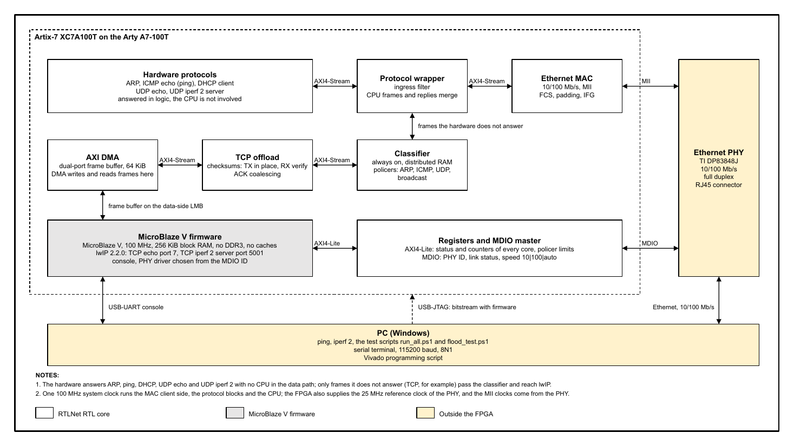
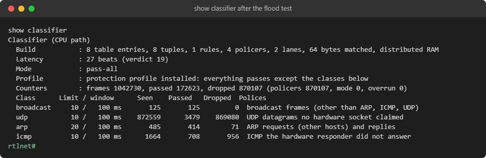

<table style="width:100%; border:none; margin:0; padding:0;">
<tr>
<td style="text-align:left; border:none; padding:0; width:50%;"></td>
<td style="text-align:right; border:none; padding:0; width:50%; vertical-align:bottom;"><strong>Demo Brief</strong> Revision 11-14-2026</td>
</tr>
</table>

<h1 style="font-size:30px; margin-top:18px;">RTLNet Ethernet Demo for the Arty A7-100T</h1>

A ready-to-run FPGA image: 10/100 Mb/s Ethernet with ARP, ping, DHCP, UDP echo and UDP iperf 2 in FPGA fabric, lwIP TCP echo and iperf 2 on a small MicroBlaze V with 256 KiB of block RAM, a protection profile that holds a flood away from the CPU, and a switch-style console.

This demo is a prebuilt bitstream of the IronKernel RTLNet Ethernet stack, with its firmware inside, for a Digilent Arty A7-100T (AMD Artix-7 XC7A100T). The MII MAC and the protocol blocks (ARP, ICMP echo, DHCP client, UDP echo, UDP iperf 2 server) are RTL and work with no CPU in the data path. One 100 MHz system clock runs the MAC client side, the protocol blocks and a small MicroBlaze V. The MicroBlaze V has 256 KiB of block RAM and no DDR3, no caches, no video and no H.264; it runs lwIP for TCP (echo on port 7, iperf 2 server on port 5001) and the console on the USB-UART. A classifier with per-class policers sits in front of the CPU and is always on. Programming takes one script; the image has no time limit. It is the second board of the Ethernet demo: the CPU, the protocol cores and the firmware source are those of the Nexys Video image (see `../nexys_video/ethernet_nexys_video_brief.pdf`).

### Highlights

- Hardware ARP, ICMP echo, DHCP client, UDP echo and UDP iperf 2 server in FPGA fabric; UDP iperf carries 93.9 and 94.4 Mb/s at 100 Mb/s and 9.4 Mb/s at 10 Mb/s with no loss and the CPU not involved
- lwIP TCP echo (port 7) and TCP iperf 2 server (port 5001) on a MicroBlaze V in block RAM: 94.8 Mb/s PC to board and 94.9 Mb/s board to PC at 100 Mb/s, 9.5 Mb/s at 10 Mb/s: the line rate of the link in both directions
- Protection profile (always on): policers on UDP, ICMP, ARP and broadcast traffic toward the CPU; under a flood of 1,000,000 frames in 10 s (100,000 per s offered, 847,545 reached the board) the TCP echo stays byte-exact, the console answers within 236 ms and the board does not reset
- 10/100 Mb/s MII with a TI DP83848J PHY, full duplex; the PHY is found by its MDIO ID (ID 0x20005C90 at address 1); `speed 10|100|auto` is the only link control and half duplex is never advertised
- The same firmware source as the Nexys Video demo, in its small-memory profile; the classifier is in distributed RAM (no block RAM) and every other buffer is sized to fit 135 block RAM tiles (105.5 used)
- Hierarchical, switch-style console (`show ip`, `show phy`, `show offload`, `show classifier`, `configure terminal`, `interface eth0`)
- Hardware tests for every service at both speeds: `ETH_SUITE: PASS 8/8` at 10 and 100 Mb/s; `FLOOD_TEST: PASS 95/95` and `50/50`
- No build needed: the free Vivado license programs the board over JTAG
- Source-available: the RTL, the CPU and the firmware are in the repository, and this image has no time limit

### At a glance

| Item | Value |
|---|---|
| Ethernet | 10/100 Mb/s MII (TI DP83848J), full duplex |
| Hardware protocols | ARP, ICMP echo, DHCP client, UDP echo, UDP iperf 2 server |
| TCP | lwIP: echo port 7, iperf 2 server port 5001 |
| CPU | MicroBlaze V, 100 MHz, 256 KiB block RAM, no DDR3, no caches |
| Clock | one 100 MHz system clock (plus the PHY's MII clocks and the 25 MHz PHY reference) |
| Console | USB-UART, 115200 8N1 |
| FPGA | xc7a100tcsg324-1 |
| Utilization | 24,981 LUT (39.40 %), 36,059 FF (28.44 %), 105.5 block RAM tiles (78.15 %), 6 DSP |
| Routed timing | WNS +0.142 ns, WHS +0.051 ns, WPWS +3.000 ns |
| Source revision | git ab3e1d17, tree clean |
| Time limit | none |
| License | `LICENSE.md` |

## License

The RTLNet sources and this image are under the RTLNet source-available license (`LICENSE.md`).

**Free, no fee:**

- Evaluation and development, including prototypes and demonstrations that are not sold
- Research and teaching
- Hobby and personal projects
- A commercial product whose complete design sources are public under the RTLNet license and whose changes to RTLNet files are offered back as pull requests

**Paid license from IronKernel (ironkernel.com), before the product ships:**

- A commercial product whose design sources are not public

A paid license carries no royalty and no per-unit fee. This demo contains no paid extension and no netlist.

## How it works

**Figure 1.** Demo set-up and data path (demo-ethernet, sheet 2)

1. The MAC receives frames from the PHY and the protocol wrapper answers ARP requests, ping, DHCP and the UDP echo and UDP iperf 2 ports in fabric. The CPU sees none of this traffic. The MAC, the protocol blocks and the CPU side run from one 100 MHz clock; only the two MII clocks (receive and transmit, 25 MHz at 100 Mb/s and 2.5 MHz at 10 Mb/s, both outputs of the PHY) and the 25 MHz PHY reference clock are separate.
2. Frames the wrapper does not handle (TCP, for example) pass the classifier and go to the CPU through an AXI DMA into a dual-port frame buffer RAM of 64 KiB on the CPU's data-side LMB. In the small-memory profile lwIP keeps the data segments by reference, so every TCP data frame leaves as a chained buffer and is copied; only ACKs and other single-buffer frames are sent in place. After the six 10 s TCP runs at 100 Mb/s this image had sent 244,116 frames in place and 243,694 copied (`show offload`); at 10 Mb/s 25,065 in place and 24,414 copied.
3. The checksum offload core (`rtlnet_tcp_offload`) patches the IP and TCP/UDP checksums of transmitted frames in place and verifies the checksums of received frames, so lwIP does not compute them. ACK coalescing, on at boot with a 500 microsecond timer, holds back pure TCP ACKs and merges them (121,859 candidates, 80,561 dropped, 41,298 forwarded in the 100 Mb/s runs). Receive batching is available and is off at boot.
4. The classifier (`rtlnet_classifier`) stays in pass-all mode and the firmware installs a protection profile: policers of 20 ARP, 10 ICMP, 10 UDP and 10 other broadcast frames per 100 ms window on the traffic the hardware did not answer. TCP and other unicast traffic is not policed. The protocol ingress filter discards multicast before the CPU. On this board the classifier tables are in distributed RAM (8 table entries, 8 tuples, 1 rule, 4 policers; 4,670 LUT, no block RAM tile).
5. lwIP on the MicroBlaze V serves TCP echo on port 7 and the TCP iperf 2 server on port 5001. The firmware reads the PHY ID by MDIO at start-up and picks the driver from it (`show phy` prints it; the Arty PHY answers as ID 0x20005C90 at MDIO address 1, driver DP83848). `speed auto` advertises 10 and 100 Mb/s full duplex; half duplex is never advertised.

### What differs from the Nexys Video demo

| Item | Nexys Video | Arty A7-100T |
|---|---|---|
| FPGA | xc7a200t | xc7a100t (135 block RAM tiles) |
| PHY and interface | RGMII, 10/100/1000 Mb/s | TI DP83848J on MII, 10/100 Mb/s; the FPGA drives the PHY's 25 MHz reference clock |
| Firmware memory | 512 KiB LMB, 128 KiB frame buffer | 256 KiB LMB, 64 KiB frame buffer, small-memory lwIP profile |
| Classifier tables | block RAM (30 tiles) | distributed RAM (0 tiles), small profile |
| TCP data frames | most sent in place | copied (segments kept by reference); ACKs in place |
| Auto-MDIX | not applicable | off on the board: use a straight cable to a switch |

## What you need and run it

An Arty A7-100T with one micro-USB cable (J10: power, JTAG and the console), an Ethernet cable to a switch on a network with DHCP (the board does not do auto-MDIX), Vivado 2026.1 with its free license and a terminal at 115200 baud 8N1. JP2 shorted may restart the design when a terminal opens the COM port; none was seen in the campaign.

1. Program the board: `powershell -NoProfile -ExecutionPolicy Bypass -File boards/arty_a7_100/scripts/program.ps1 -Bit demos/ethernet/arty_a7_100/rtlnet_arty_a7_100_eth.bit`
2. Open the serial console. The banner `RTLNet Ethernet demo -- rtlnet-eth-fw`, `Board ARTY` and the DHCP lease line appear.
3. `show ip` prints the address; `ping` it from the PC.
4. `show interfaces`, `show phy`, `show arp`, `show counters`, `show tcp`, `show iperf`, `show offload` and `show classifier` print the state of each part. `configure terminal`, `interface eth0`, `speed 10|100|auto` sets the link speed.
5. The tests of `cpu/microblaze_v_ethernet/test/` (`run_all.ps1 -Port <COM> -Nic <adapter> -LinkMbps 10|100` and `flood_test.ps1`) run every service and the protection profile against the board.

 <strong>Figure 2.</strong> Console: <code>show version</code>, <code>show system</code>, <code>show phy</code>, <code>show interfaces</code>, <code>show ip</code> (addresses and MAC replaced by documentation values)

## Device utilization and timing

Release image (`arty_rel`, git ab3e1d17, tree clean, Vivado 2026.1) on the XC7A100T:

<table class="num wrap">
<thead><tr><th></th><th>LUTs</th><th>Flip-flops</th><th>Block RAM tiles</th><th>DSP blocks</th></tr></thead>
<tbody>
<tr><td>Release image</td><td>24,981</td><td>36,059</td><td>105.5</td><td>6</td></tr>
<tr><td>Share of the device</td><td>39.40 %</td><td>28.44 %</td><td>78.15 %</td><td>2.50 %</td></tr>
</tbody>
</table>

Routed timing at the one 100 MHz system clock: WNS +0.142 ns, WHS +0.051 ns, WPWS +3.000 ns, no failing endpoint. The block RAM tiles are: 64 for the 256 KiB CPU memory, 16 for the 64 KiB frame buffer, 3 for the AXI DMA, 22.5 for the FIFOs and buffers of the network cores and 0 for the classifier; 29.5 tiles are free.

## Measured performance

Method: the release image was programmed over JTAG and every number below was measured on that image in one campaign on 11-14-2026. A PC with a wired Gigabit adapter is connected to the board through an unmanaged switch (the switch negotiates 10 or 100 Mb/s with the board). The link speed is set from the console with `speed 10` and `speed 100`. Throughput is measured with iperf 2 (a 10 s run, in both directions; TCP is the mean of 3 runs); UDP latency and TCP latency with 2000 echoes of 64 bytes; ping with the PC's ping tool, which reports whole milliseconds. UDP iperf is offered at 90 % of the link speed; the zero-loss sweep goes from 50 % to 98 %.

<table class="num wrap">
<thead><tr><th>Test</th><th>10 Mb/s</th><th>100 Mb/s</th></tr></thead>
<tbody>
<tr><td>TCP iperf 2, PC to board, Mb/s, mean (min to max)</td><td>9.5 (9.5 to 9.5)</td><td>94.8 (94.6 to 94.9)</td></tr>
<tr><td>TCP iperf 2, board to PC, Mb/s, mean (min to max)</td><td>9.5 (9.5 to 9.5)</td><td>94.9 (94.8 to 94.9)</td></tr>
<tr><td>TCP echo, 64 B, mean / median / p99 round trip, ms</td><td>0.429 / 0.426 / 0.470</td><td>0.231 / 0.229 / 0.265</td></tr>
<tr><td>UDP iperf 2, PC to board, Mb/s, loss</td><td>9.4 at 9 offered, 0 of 4,010</td><td>93.9 at 90 offered, 0 of 40,055</td></tr>
<tr><td>UDP iperf 2, board to PC, Mb/s, loss</td><td>9.4 at 9 offered, 0 of 4,014</td><td>94.4 at 90 offered, 0 of 40,126</td></tr>
<tr><td>UDP iperf 2, highest zero-loss rate in the sweep, PC to board</td><td>98 % of the link</td><td>95 % of the link</td></tr>
<tr><td>UDP iperf 2, highest zero-loss rate in the sweep, board to PC</td><td>98 % of the link</td><td>98 % of the link</td></tr>
<tr><td>UDP echo, 64 B, mean / median / p99 round trip, ms, loss</td><td>0.361 / 0.357 / 0.408, 0 of 2000</td><td>0.174 / 0.161 / 0.246, 0 of 2000</td></tr>
<tr><td>UDP echo, 0 to 1472 B, 400 datagrams byte-exact</td><td>400 of 400</td><td>400 of 400</td></tr>
<tr><td>Ping, 64 B x 100, lost; round trip min / avg / max, ms</td><td>0 of 100; 0 / 0 / 1</td><td>0 of 100; 0 / 0 / 1</td></tr>
<tr><td>DHCP lease and renew, ARP responder</td><td>pass</td><td>pass</td></tr>
</tbody>
</table>

 <strong>Figure 3.</strong> Performance at 100 Mb/s from the campaign (the capture for 10 Mb/s is <code>ethernet_arty_perf_10.png</code>)

**What limits each figure.** The UDP echo, UDP iperf, ping, ARP and DHCP paths are RTL and carry no CPU load; the UDP iperf figures are the line rate of the link (the data rate is below the link speed because of the Ethernet, IP and UDP headers). TCP runs on the soft CPU: a 100 MHz MicroBlaze V with block RAM only, no caches and no DDR3, handles every TCP segment in lwIP. At 100 and 10 Mb/s the CPU is fast enough and TCP reaches the line rate of the link in both directions, even though every data frame is copied in this memory profile. The CPU would be the limit only at a gigabit rate, which this board does not have. The 10 Mb/s TCP echo round trip (0.43 ms, against 0.23 ms at 100 Mb/s) is dominated by the time the frames take on a 10 Mb/s wire. During the runs the lwIP heap of the small-memory profile peaked at 23,224 of 24,576 bytes with 18 allocation failures since start-up (`show tcp`); no test failed, but the heap headroom is thin and the frame buffer RAM can grow to 128 KiB by a build parameter if a load needs it.

## Protection profile and flood test

The classifier is always on and the policers of the profile are installed at every boot (`show classifier`, `classifier policer <broadcast|udp|arp|icmp> <frames> <window-ms>`). `flood_test.ps1` sends one flood per kind with normal sockets for 10 s while one TCP echo connection exchanges data, the console answers `show classifier` and `show system`, and the board is pinged. All kinds at 1000 frames per second give `FLOOD_TEST: PASS 95/95`; udp-closed, udp-bcast-net, mcast and icmp-bcast at 100,000 frames per second offered give `FLOOD_TEST: PASS 50/50`. All floods ran with the link at 100 Mb/s. In every flood the TCP echo stays byte-exact, no console answer takes longer than 239 ms, the board's uptime shows no reset and the profile stays installed.

<table class="num wrap">
<thead><tr><th>Kind</th><th>Offered per s</th><th>Frames sent</th><th>Reached the board</th><th>Policed class: passed / dropped</th></tr></thead>
<tbody>
<tr><td>udp-closed (unicast, closed port)</td><td>1,000</td><td>10,000</td><td>10,000</td><td>udp: 1,000 / 9,000</td></tr>
<tr><td>udp-closed</td><td>100,000</td><td>1,000,000</td><td>847,545</td><td>udp: 1,010 / 846,535</td></tr>
<tr><td>udp-bcast-lim (255.255.255.255)</td><td>1,000</td><td>10,000</td><td>4,813</td><td>udp: 573 / 4,240</td></tr>
<tr><td>udp-bcast-net (subnet broadcast)</td><td>1,000</td><td>10,000</td><td>5,188</td><td>udp: 611 / 4,577</td></tr>
<tr><td>udp-bcast-net</td><td>100,000</td><td>1,000,000</td><td>5,000</td><td>udp: 272 / 4,728</td></tr>
<tr><td>mcast (group the board never joined)</td><td>1,000</td><td>10,000</td><td>5,002</td><td>none; all 5,002 counted as filtered</td></tr>
<tr><td>mcast</td><td>100,000</td><td>1,000,000</td><td>5,005</td><td>none; all 5,005 counted as filtered</td></tr>
<tr><td>icmp-bcast (32 sender threads)</td><td>1,000</td><td>672</td><td>672</td><td>icmp: 210 / 462</td></tr>
<tr><td>icmp-bcast</td><td>100,000</td><td>992</td><td>992</td><td>icmp: 498 / 494</td></tr>
</tbody>
</table>

The generator is a PC with normal sockets and the network between it and the board limits it: broadcast and multicast frames arrive at about 500 per second whatever the offered rate (5,000 to 5,188 in 10 s), while a unicast flood arrives at the full rate of the 100 Mb/s link: 847,545 of 1,000,000 frames of 64 bytes in 10 s, about 85,000 per second. The board's counters show exactly what arrived. During the 100,000 per second broadcast and multicast floods 3 of 9 pings were lost (33 %), and none during the unicast and ICMP floods; the loss is upstream of the board, which discards the multicast at its ingress filter. The `udp-echo` and `icmp-board` floods are answered by the hardware and add nothing to the CPU path counters; the `arp` flood (152 requests sent) is reported, not required: 410 ARP frames seen, 339 passed, 71 dropped.

 <strong>Figure 4.</strong> <code>show classifier</code> after the flood test: dropped frames per class, the profile limits, the pass-all mode and the distributed RAM build

## Test results

| Test | 100 Mb/s | 10 Mb/s |
|---|---|---|
| `run_all.ps1`, 8 scripts | `ETH_SUITE: PASS 8/8 scripts (link 100 Mb/s)` | `ETH_SUITE: PASS 8/8 scripts (link 10 Mb/s)` |
| console_test, ping_test, arp_test, dhcp_test | 26/26, 18/18, 5/5, 10/10 | 26/26, 18/18, 5/5, 10/10 |
| udp_echo_test, udp_iperf_test, tcp_echo_test, tcp_throughput_test | 5/5, 8/8, 2/2, 2/2 | 5/5, 8/8, 2/2, 2/2 |
| `link_test.ps1` (`speed 100`, `speed 10`, `speed auto`) | `LINK_TEST: PASS 18/18` | |
| `flood_test.ps1` (100 Mb/s link) | `FLOOD_TEST: PASS 95/95` (all kinds, 1,000 per s); `FLOOD_TEST: PASS 50/50` (four kinds, 100,000 per s) | |

 <strong>Figure 5.</strong> The two <code>ETH_SUITE</code> verdicts with the verdict of each script, and the link and flood verdicts

 <strong>Figure 6.</strong> <code>show offload</code> after the TCP runs at 100 Mb/s (counters cleared before the runs): checksums done in hardware, frames sent in place and copied, and ACK coalescing counters

Further captures are in `demos/ethernet/images/`: `ethernet_arty_perf_10.png` (10 Mb/s results), `ethernet_arty_flood1000.png` and `ethernet_arty_flood100000.png` (the flood tests).

## Console commands

| Command | Effect |
|---|---|
| `show version`, `show system`, `show interfaces`, `show phy` | firmware and build; clocks, uptime, LEDs; interface state; PHY ID and address, link speed, advertised modes and the partner's modes |
| `show ip`, `show dhcp`, `show arp` | address; DHCP client and lease; ARP table |
| `show counters`, `show tcp`, `show iperf`, `show offload` | frame and protocol counters; TCP connections; iperf server counters; checksum offload, ACK coalescing and batching counters |
| `show classifier`, `classifier policer <class> <frames> <window-ms>` | profile state and per-class counters; change one policer |
| `offload ack-coalesce on\|off [timer-us]`, `offload rx-batch on\|off [timer-us] [frames]` | the receive features (configuration mode) |
| `configure terminal`, `interface eth0` | configuration mode and the interface |
| `speed 10\|100\|auto` | the only link control; `auto` advertises 10 and 100 Mb/s full duplex, half duplex is never advertised |
| `ip dhcp`, `renew` | DHCP on the interface; ask for the lease again |

## Limits

- The link is 10 or 100 Mb/s, full duplex only; there is no gigabit mode on this board. Auto-MDIX is off on the board, so a direct cable to a PC needs a crossover unless the PC port does auto-MDIX; the campaign used a switch.
- The firmware memory is small (256 KiB, 64 KiB frame buffer): every TCP data frame is copied, and the lwIP heap of 24 KiB has thin headroom. At 100 Mb/s the CPU still reaches the line rate of the link.
- The classifier is a small build in distributed RAM (8 table entries, 4 policers); it polices traffic by class, limits a flood that reaches the board and does not stop a flood on the wire. The flood figures come from a PC with normal sockets, not from a hardware traffic generator.
- Ping round trips are whole milliseconds (the PC's ping tool); the latency figures are the UDP echo and TCP echo round trips.
- The demo has no DDR3, no video and no H.264; it is the network stack alone.
- Programming is over JTAG only; a power cycle removes the image. Boot from the Quad-SPI flash and the behavior with JP2 shorted were not verified.

