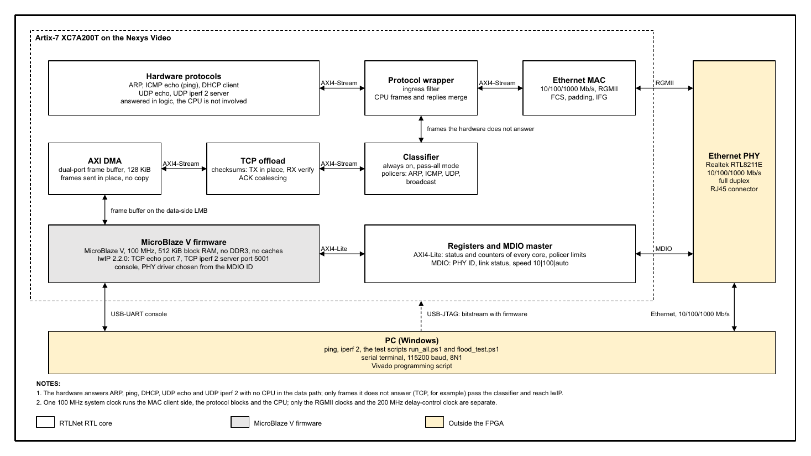
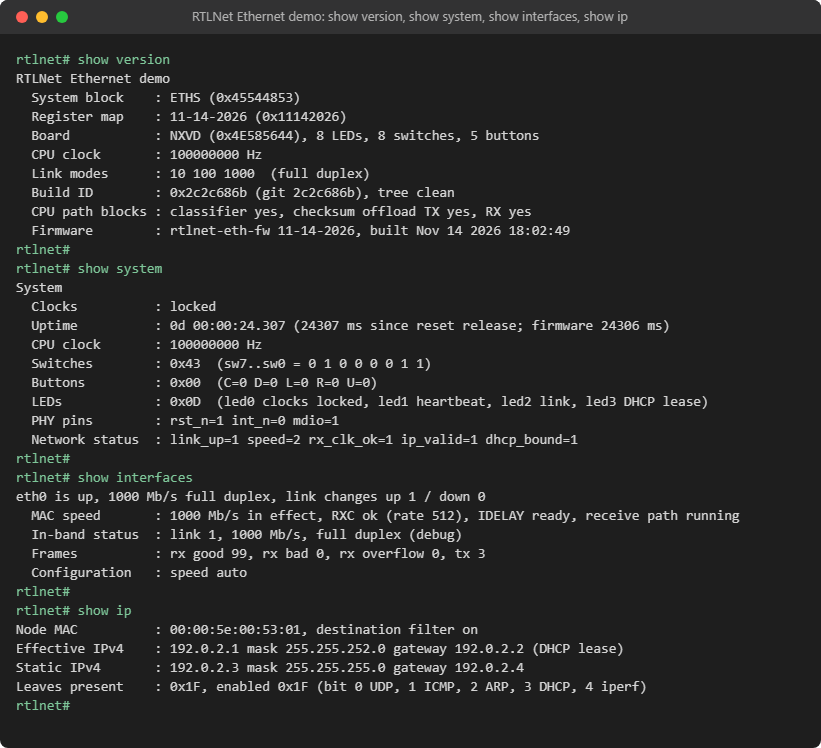
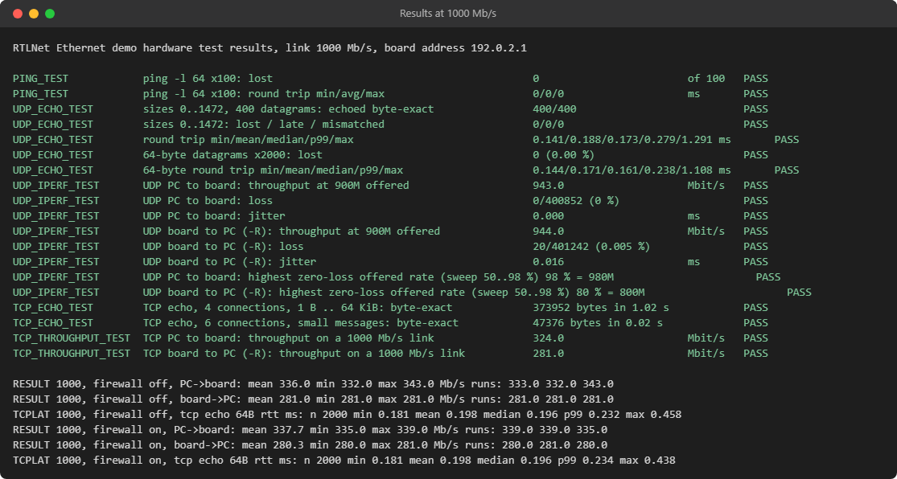
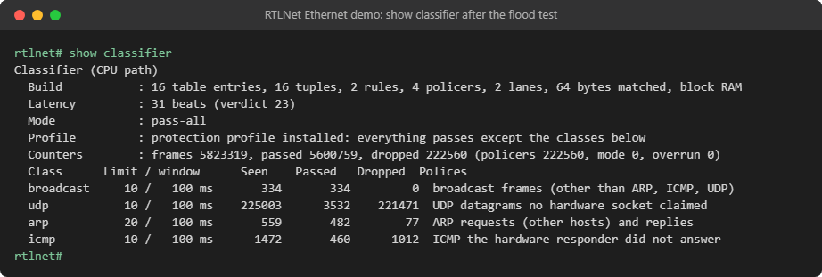
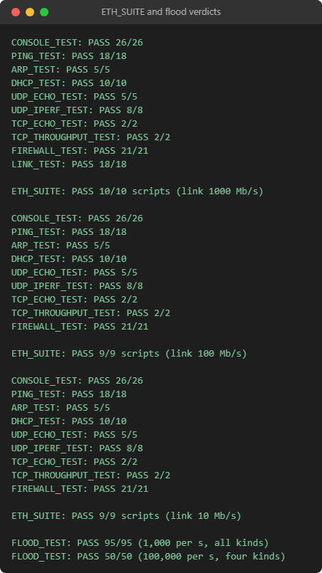
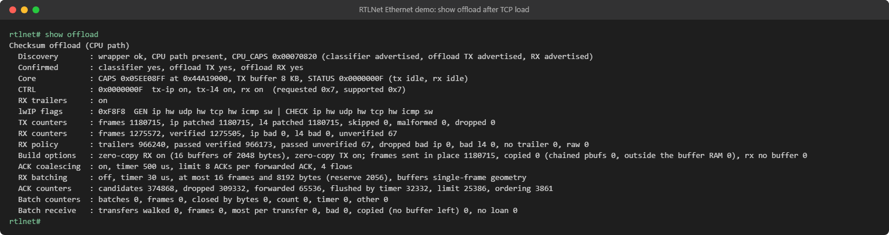

<table style="width:100%; border:none; margin:0; padding:0;">
<tr>
<td style="text-align:left; border:none; padding:0; width:50%;"></td>
<td style="text-align:right; border:none; padding:0; width:50%; vertical-align:bottom;"><strong>Demo Brief</strong> Revision 11-14-2026</td>
</tr>
</table>

<h1 style="font-size:30px; margin-top:18px;">RTLNet Ethernet Demo for the Nexys Video</h1>

A ready-to-run FPGA image: 10/100/1000 Mb/s Ethernet with ARP, ping, DHCP, UDP echo and UDP iperf 2 in FPGA fabric, lwIP TCP echo and iperf 2 on a small MicroBlaze V in block RAM, a protection profile that holds a flood away from the CPU, and a switch-style console.

This demo is a prebuilt bitstream of the IronKernel RTLNet Ethernet stack, with its firmware inside, for a Digilent Nexys Video (AMD Artix-7 XC7A200T). The RGMII MAC and the protocol blocks (ARP, ICMP echo, DHCP client, UDP echo, UDP iperf 2 server) are RTL and work with no CPU in the data path. One 100 MHz system clock runs the MAC client side, the protocol blocks and a small MicroBlaze V. The MicroBlaze V has 512 KiB of block RAM and no DDR3, no caches, no video and no H.264; it runs lwIP for TCP (echo on port 7, iperf 2 server on port 5001) and the console on the USB-UART. A classifier with per-class policers sits in front of the CPU and is always on. Programming takes one script; the image has no time limit.

### Highlights

- Hardware ARP, ICMP echo, DHCP client, UDP echo and UDP iperf 2 server in FPGA fabric; UDP iperf reaches 942 and 944 Mb/s at 1000 Mb/s with the CPU not involved
- lwIP TCP echo (port 7) and TCP iperf 2 server (port 5001) on a MicroBlaze V in block RAM: 350 Mb/s PC to board and 283 Mb/s board to PC at 1000 Mb/s, 94.6 to 94.7 Mb/s at 100 Mb/s, 9.5 Mb/s at 10 Mb/s
- Protection profile (always on): policers on UDP, ICMP, ARP and broadcast traffic toward the CPU; under a 200,000 frame flood in 10 s the TCP echo stays byte-exact, the console answers within 237 ms and the board does not reset
- 10/100/1000 Mb/s RGMII, full duplex; the PHY is chosen from its MDIO ID; `speed 10|100|auto` is the only link control and half duplex is never advertised
- Hierarchical, switch-style console (`show ip`, `show phy`, `show offload`, `show classifier`, `configure terminal`, `interface eth0`)
- Hardware tests for every service and speed: `ETH_SUITE: PASS 8/8` at 10, 100 and 1000 Mb/s; `FLOOD_TEST: PASS 95/95` and `50/50`
- No build needed: the free Vivado license programs the board over JTAG
- Source-available: the RTL, the CPU and the firmware are in the repository, and this image has no time limit

### At a glance

| Item | Value |
|---|---|
| Ethernet | 10/100/1000 Mb/s RGMII, full duplex |
| Hardware protocols | ARP, ICMP echo, DHCP client, UDP echo, UDP iperf 2 server |
| TCP | lwIP: echo port 7, iperf 2 server port 5001 |
| CPU | MicroBlaze V, 100 MHz, 512 KiB block RAM, no DDR3, no caches |
| Clock | one 100 MHz system clock |
| Console | USB-UART, 115200 8N1 |
| FPGA | xc7a200tsbg484-1 |
| Utilization | 23,891 LUT (17.86 %), 33,968 FF (12.69 %), 228.5 block RAM tiles (62.60 %), 6 DSP |
| Routed timing | WNS +0.154 ns, WHS +0.012 ns, WPWS +0.264 ns |
| Source revision | git 2c2c686b, tree clean |
| Time limit | none |
| License | `LICENSE.md` |

## License

The RTLNet sources and this image are under the RTLNet source-available license (`LICENSE.md`).

**Free, no fee:**

- Evaluation and development, including prototypes and demonstrations that are not sold
- Research and teaching
- Hobby and personal projects
- A commercial product whose complete design sources are public under the RTLNet license and whose changes to RTLNet files are offered back as pull requests

**Paid license from IronKernel (ironkernel.com), before the product ships:**

- A commercial product whose design sources are not public

A paid license carries no royalty and no per-unit fee. This demo contains no paid extension and no netlist.

## How it works

**Figure 1.** Demo set-up and data path (demo-ethernet, sheet 1)

1. The MAC receives frames from the PHY and the protocol wrapper answers ARP requests, ping, DHCP and the UDP echo and UDP iperf 2 ports in fabric. The CPU sees none of this traffic. The MAC, the protocol blocks and the CPU side run from one 100 MHz clock; only the RGMII receive clock, the RGMII transmit clocks and the 200 MHz delay-control clock are separate.
2. Frames the wrapper does not handle (TCP, for example) pass the classifier and go to the CPU through an AXI DMA into a dual-port frame buffer RAM on the CPU's data-side LMB. A frame that leaves the CPU as one buffer in that RAM is sent from where it is, with no copy. In one TCP test sequence at 1000 Mb/s this image sent 1,180,715 frames in place and copied none (`show offload`).
3. The checksum offload core (`rtlnet_tcp_offload`) patches the IP and TCP/UDP checksums of transmitted frames in place and verifies the checksums of received frames, so lwIP does not compute them. ACK coalescing, on at boot with a 500 microsecond timer, holds back pure TCP ACKs and merges them. Receive batching, which hands several frames to the CPU at once, is available and is off at boot (see Measured performance for the reason).
4. The classifier (`rtlnet_classifier`) stays in pass-all mode and the firmware installs a protection profile: policers of 20 ARP, 10 ICMP, 10 UDP and 10 other broadcast frames per 100 ms window on the traffic the hardware did not answer. TCP and other unicast traffic is not policed. The protocol ingress filter discards multicast before the CPU.
5. lwIP on the MicroBlaze V serves TCP echo on port 7 and the TCP iperf 2 server on port 5001. The firmware reads the PHY ID by MDIO at start-up and picks the driver from it (`show phy` prints it; the Nexys Video PHY answers as ID 0x001CC915, driver RTL8211E). `speed auto` advertises every full-duplex mode; half duplex is never advertised.

## What you need and run it

A Nexys Video with its 12 V supply (JP4 on JTAG), two micro-USB cables (PROG, UART), an Ethernet cable to a network with DHCP, Vivado 2026.1 with its free license and a terminal at 115200 baud 8N1.

1. Program the board: `powershell -NoProfile -ExecutionPolicy Bypass -File boards/nexys_video/scripts/program.ps1 -Bit demos/ethernet/nexys_video/rtlnet_nexys_video_eth.bit`
2. Open the serial console. The banner `RTLNet Ethernet demo -- rtlnet-eth-fw` and the DHCP lease line appear.
3. `show ip` prints the address; `ping` it from the PC.
4. `show interfaces`, `show phy`, `show arp`, `show counters`, `show tcp`, `show iperf`, `show offload` and `show classifier` print the state of each part. `configure terminal`, `interface eth0`, `speed 10|100|auto` sets the link speed.
5. The tests of `cpu/microblaze_v_ethernet/test/` (`run_all.ps1 -Port <COM> -Nic <adapter> -LinkMbps 10|100|1000` and `flood_test.ps1`) run every service and the protection profile against the board.

 <strong>Figure 2.</strong> Console after start-up: <code>show version</code>, <code>show system</code>, <code>show interfaces</code>, <code>show ip</code> (addresses and MAC replaced by documentation values)

## Device utilization and timing

Release image (`eth_rel`, git 2c2c686b, tree clean, Vivado 2026.1) on the XC7A200T:

<table class="num wrap">
<thead><tr><th></th><th>LUTs</th><th>Flip-flops</th><th>Block RAM tiles</th><th>DSP blocks</th></tr></thead>
<tbody>
<tr><td>Release image</td><td>23,891</td><td>33,968</td><td>228.5</td><td>6</td></tr>
<tr><td>Share of the device</td><td>17.86 %</td><td>12.69 %</td><td>62.60 %</td><td>0.81 %</td></tr>
</tbody>
</table>

Routed timing at the one 100 MHz system clock: WNS +0.154 ns, WHS +0.012 ns, WPWS +0.264 ns. The setup margin is thin. The block RAM tiles include the 512 KiB CPU memory and the 128 KiB frame buffer.

## Measured performance

Method: the release image was programmed over JTAG and every number below was measured on that image in one campaign on 11-14-2026. A PC with a wired Gigabit adapter is connected to the board through an unmanaged switch. The link speed is set from the console with `speed 10`, `speed 100` and `speed auto` (which gives 1000 Mb/s). Throughput is measured with iperf 2 (a 10 s run, in both directions; TCP is the mean of 3 runs); UDP latency and TCP latency with 2000 echoes of 64 bytes; ping with the PC's ping tool, which reports whole milliseconds. UDP iperf is offered at 90 % of the link speed; the zero-loss sweep goes from 50 % to 98 %.

<table class="num wrap">
<thead><tr><th>Test</th><th>10 Mb/s</th><th>100 Mb/s</th><th>1000 Mb/s</th></tr></thead>
<tbody>
<tr><td>TCP iperf 2, PC to board, Mb/s, mean (min to max)</td><td>9.5 (9.5 to 9.5)</td><td>94.7 (94.5 to 94.8)</td><td>349.7 (347.0 to 352.0)</td></tr>
<tr><td>TCP iperf 2, board to PC, Mb/s, mean (min to max)</td><td>9.5 (9.5 to 9.5)</td><td>94.6 (94.4 to 94.9)</td><td>283.3 (282.0 to 284.0)</td></tr>
<tr><td>TCP echo, 64 B, mean / median / p99 round trip, ms</td><td>1.350 / 1.343 / 1.403</td><td>0.231 / 0.229 / 0.267</td><td>0.198 / 0.196 / 0.229</td></tr>
<tr><td>UDP iperf 2, PC to board, Mb/s, loss</td><td>9.4 at 9 offered, 0 of 4,007</td><td>94.1 at 90 offered, 0 of 40,057</td><td>942.0 at 900 offered, 0 of 400,604</td></tr>
<tr><td>UDP iperf 2, board to PC, Mb/s, loss</td><td>9.4 at 9 offered, 0 of 4,014</td><td>94.4 at 90 offered, 0 of 40,126</td><td>944.0 at 900 offered, 71 of 401,242 (0.018 %)</td></tr>
<tr><td>UDP iperf 2, highest zero-loss rate in the sweep, PC to board</td><td>98 % of the link</td><td>90 % of the link</td><td>98 % of the link (980 Mb/s)</td></tr>
<tr><td>UDP iperf 2, highest zero-loss rate in the sweep, board to PC</td><td>98 % of the link</td><td>98 % of the link</td><td>98 % of the link (980 Mb/s)</td></tr>
<tr><td>UDP echo, 64 B, mean / median / p99 round trip, ms, loss</td><td>1.287 / 1.275 / 1.357, 0 of 2000</td><td>0.163 / 0.160 / 0.205, 0 of 2000</td><td>0.163 / 0.160 / 0.208, 0 of 2000</td></tr>
<tr><td>UDP echo, 0 to 1472 B, 400 datagrams byte-exact</td><td>400 of 400</td><td>400 of 400</td><td>400 of 400</td></tr>
<tr><td>Ping, 64 B x 100, lost; round trip min / avg / max, ms</td><td>0 of 100; 1 / 1 / 2</td><td>0 of 100; 0 / 0 / 1</td><td>0 of 100; 0 / 0 / 1</td></tr>
<tr><td>DHCP lease and renew, ARP responder</td><td>pass</td><td>pass</td><td>pass</td></tr>
</tbody>
</table>

 <strong>Figure 3.</strong> Performance at 1000 Mb/s from the release campaign (the captures for 100 and 10 Mb/s are <code>images/ethernet_perf_100.png</code> and <code>ethernet_perf_10.png</code>)

**What limits each figure.** The UDP echo, UDP iperf, ping, ARP and DHCP paths are RTL and carry no CPU load; the UDP iperf figures are the line rate of the link (the data rate is below 1000 Mb/s because of the Ethernet, IP and UDP headers; the one lost-datagram count above, 71 of 401,242 at 900 Mb/s offered board to PC, does not recur in the sweep up to 980 Mb/s). TCP runs on the soft CPU: a 100 MHz MicroBlaze V with block RAM only, no caches and no DDR3, handles every TCP segment in lwIP. At 100 and 10 Mb/s the CPU is fast enough and TCP reaches the line rate of the link. At 1000 Mb/s the CPU is the limit: 283 to 350 Mb/s, 28 to 35 % of the link. The hardware offloads (checksums, in-place transmit, ACK coalescing) raise the figure but do not remove that limit.

### Receive features: the measured reason for the boot defaults

The same image was run at 1000 Mb/s with the receive features set from the console (iperf 2, 3 runs of 10 s each; TCP echo of 64 bytes, 2000 round trips):

<table class="num wrap">
<thead><tr><th>Setting</th><th>PC to board, Mb/s</th><th>Board to PC, Mb/s</th><th>TCP echo mean, ms</th></tr></thead>
<tbody>
<tr><td>ACK coalescing off, batching off</td><td>349.7</td><td>257.7</td><td>0.198</td></tr>
<tr><td>ACK coalescing 500 us, batching 30 us</td><td>314.7</td><td>273.3</td><td>0.241</td></tr>
<tr><td>ACK coalescing 500 us, batching off (boot default), repeat run</td><td>342.0</td><td>284.0</td><td>0.198</td></tr>
</tbody>
</table>

ACK coalescing raises the board to PC rate by about 10 % (258 to 284 Mb/s) with no cost in latency. Receive batching, in this run, lowers the PC to board rate by 8 to 10 % and adds 0.04 ms to the TCP round trip, so it is off at boot; it stays available with `offload rx-batch on [timer-us] [frames]`. The boot-default row is a second measurement; the first one, in the table above, gave 349.7 and 283.3 Mb/s.

## Protection profile and flood test

The classifier is always on and the policers of the profile are installed at every boot (`show classifier`, `classifier policer <broadcast|udp|arp|icmp> <frames> <window-ms>`). `flood_test.ps1` sends one flood per kind with normal sockets for 10 s while one TCP echo connection exchanges data, the console answers `show classifier` and `show system`, and the board is pinged. All kinds at 1000 frames per second give `FLOOD_TEST: PASS 95/95`; udp-closed, udp-bcast-net, mcast and icmp-bcast at 20,000 frames per second give `FLOOD_TEST: PASS 50/50`. In every flood the TCP echo stays byte-exact, no console answer takes longer than 237 ms, the board's uptime shows no reset and the profile stays installed.

<table class="num wrap">
<thead><tr><th>Kind</th><th>Offered per s</th><th>Frames sent</th><th>Reached the board</th><th>Policed class: passed / dropped</th></tr></thead>
<tbody>
<tr><td>udp-closed (unicast, closed port)</td><td>1,000</td><td>10,000</td><td>10,001</td><td>udp: 1,011 / 8,990</td></tr>
<tr><td>udp-closed</td><td>20,000</td><td>200,000</td><td>199,690</td><td>udp: 1,010 / 198,680</td></tr>
<tr><td>udp-bcast-lim (255.255.255.255)</td><td>1,000</td><td>10,000</td><td>5,192</td><td>udp: 610 / 4,582</td></tr>
<tr><td>udp-bcast-net (subnet broadcast)</td><td>1,000</td><td>10,000</td><td>4,776</td><td>udp: 572 / 4,204</td></tr>
<tr><td>udp-bcast-net</td><td>20,000</td><td>200,000</td><td>5,305</td><td>udp: 290 / 5,015</td></tr>
<tr><td>mcast (group the board never joined)</td><td>1,000</td><td>10,000</td><td>5,238</td><td>none; all 5,238 counted as filtered</td></tr>
<tr><td>mcast</td><td>20,000</td><td>200,000</td><td>5,004</td><td>none; all 5,004 counted as filtered</td></tr>
<tr><td>icmp-bcast (32 sender threads)</td><td>1,000</td><td>672</td><td>672</td><td>icmp: 210 / 462</td></tr>
<tr><td>icmp-bcast</td><td>20,000</td><td>800</td><td>800</td><td>icmp: 250 / 550</td></tr>
</tbody>
</table>

The generator is a PC with normal sockets and the network between it and the board limits it: broadcast and multicast frames arrive at about 500 per second whatever the offered rate (5,004 to 5,305 in 10 s), while a unicast flood arrives at the full rate (199,690 of 200,000). The board's counters show exactly what arrived. During the 20,000 per second broadcast and multicast floods, 1 to 2 of 12 pings were lost (8 to 17 %), and none during the unicast and ICMP floods. The `udp-echo` and `icmp-board` floods are answered by the hardware and add nothing to the CPU path counters; the `arp` flood (147 requests sent) is reported, not required: 391 ARP frames seen, 314 passed, 77 dropped.

 <strong>Figure 4.</strong> <code>show classifier</code> after the flood test: dropped frames per class, the profile limits and the pass-all mode

## Test results

| Test | 1000 Mb/s | 100 Mb/s | 10 Mb/s |
|---|---|---|---|
| `run_all.ps1`, 8 scripts | `ETH_SUITE: PASS 8/8 scripts (link 1000 Mb/s)` | `ETH_SUITE: PASS 8/8 scripts (link 100 Mb/s)` | `ETH_SUITE: PASS 8/8 scripts (link 10 Mb/s)` |
| console_test, ping_test, arp_test, dhcp_test | 26/26, 18/18, 5/5, 10/10 | 26/26, 18/18, 5/5, 10/10 | 26/26, 18/18, 5/5, 10/10 |
| udp_echo_test, udp_iperf_test, tcp_echo_test, tcp_throughput_test | 5/5, 8/8, 2/2, 2/2 | 5/5, 8/8, 2/2, 2/2 | 5/5, 8/8, 2/2, 2/2 |
| `flood_test.ps1` | `FLOOD_TEST: PASS 95/95` (all kinds, 1,000 per s); `FLOOD_TEST: PASS 50/50` (four kinds, 20,000 per s) | | |

 <strong>Figure 5.</strong> The three <code>ETH_SUITE</code> verdicts and the verdict of each script

 <strong>Figure 6.</strong> <code>show offload</code> after the TCP runs at 1000 Mb/s (counters cleared before the runs): checksums done in hardware, frames sent in place and ACK coalescing counters

Further captures are in `images/`: `ethernet_runcfg.png` (`show running-config`), `ethernet_flood1000.png` and `ethernet_flood20000.png` (the flood tests), `ethernet_perf_100.png` and `ethernet_perf_10.png`.

## Console commands

| Command | Effect |
|---|---|
| `show version`, `show system`, `show interfaces`, `show phy` | firmware and build; clocks, uptime, LEDs; interface state; PHY ID, link speed, advertised modes and the partner's modes |
| `show ip`, `show dhcp`, `show arp` | address; DHCP client and lease; ARP table |
| `show counters`, `show tcp`, `show iperf`, `show offload` | frame and protocol counters; TCP connections; iperf server counters; checksum offload, ACK coalescing and batching counters |
| `show classifier`, `classifier policer <class> <frames> <window-ms>` | profile state and per-class counters; change one policer |
| `offload ack-coalesce on\|off [timer-us]`, `offload rx-batch on\|off [timer-us] [frames]` | the receive features (configuration mode) |
| `configure terminal`, `interface eth0` | configuration mode and the interface |
| `speed 10\|100\|auto` | the only link control; `auto` advertises every full-duplex mode, half duplex is never advertised |
| `ip dhcp`, `renew` | DHCP on the interface; ask for the lease again |

## Limits

- TCP is limited by the soft CPU: the MicroBlaze V runs at 100 MHz with block RAM only, so TCP iperf is 283 to 350 Mb/s at 1000 Mb/s. The UDP paths (echo, iperf 2, ping, ARP, DHCP) are in hardware and carry the line rate of the link.
- The link is full duplex only; half duplex is never advertised.
- The classifier polices traffic by class; it limits a flood that reaches the board and does not stop a flood on the wire. The flood figures come from a PC with normal sockets, not from a hardware traffic generator.
- Ping round trips are whole milliseconds (the PC's ping tool); the latency figures are the UDP echo and TCP echo round trips.
- The demo has no DDR3, no video and no H.264; it is the network stack alone.
- The image has no time limit. It loads over JTAG only; a power cycle removes it.

