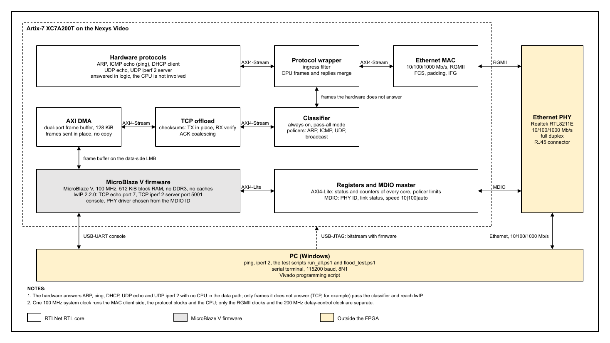
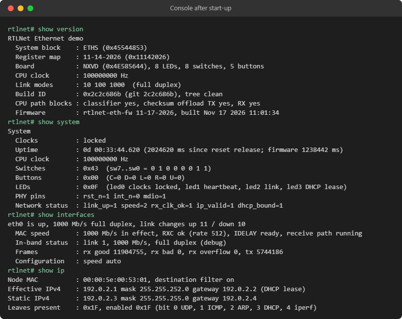
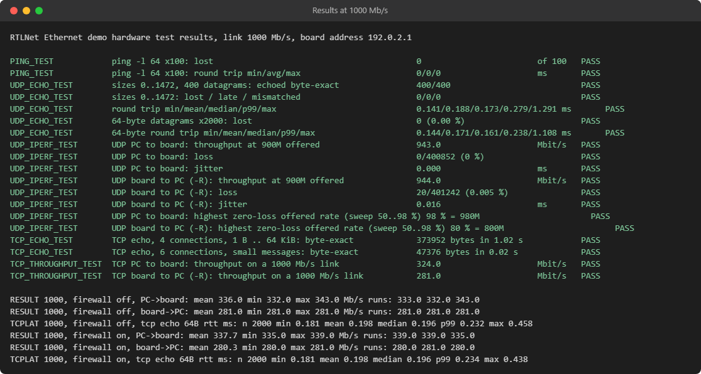
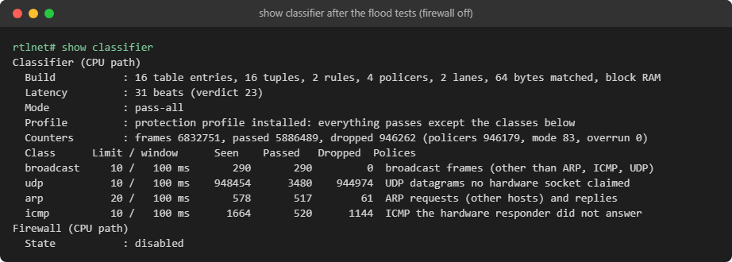
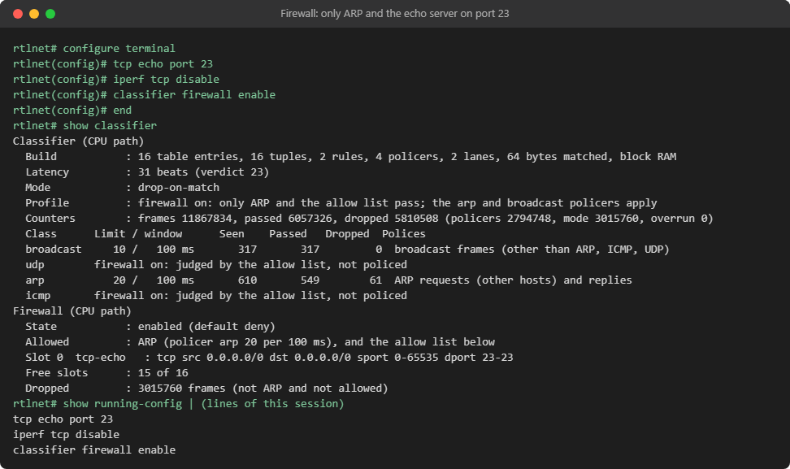
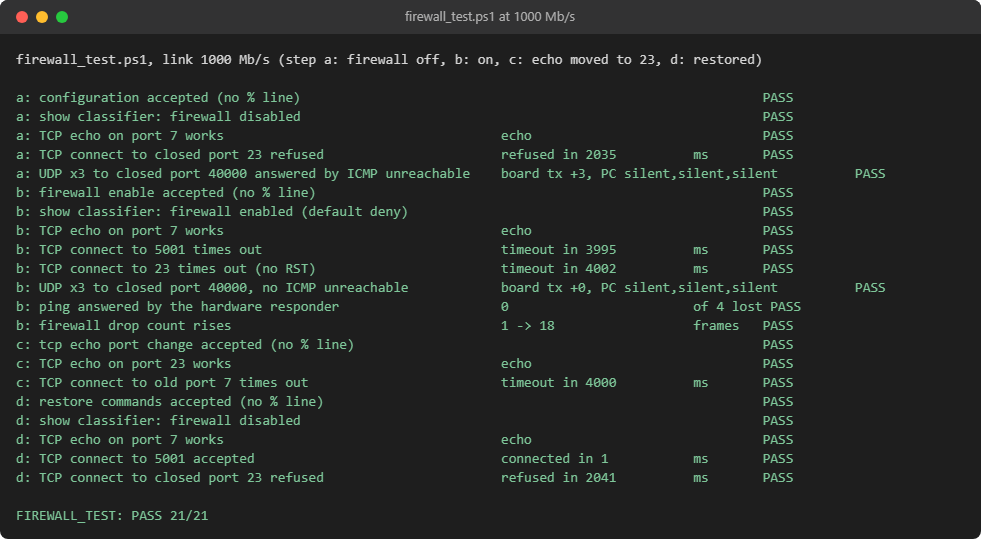
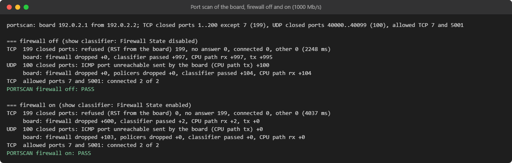
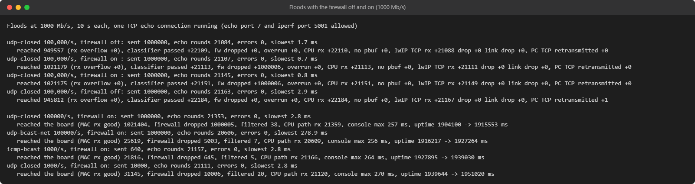
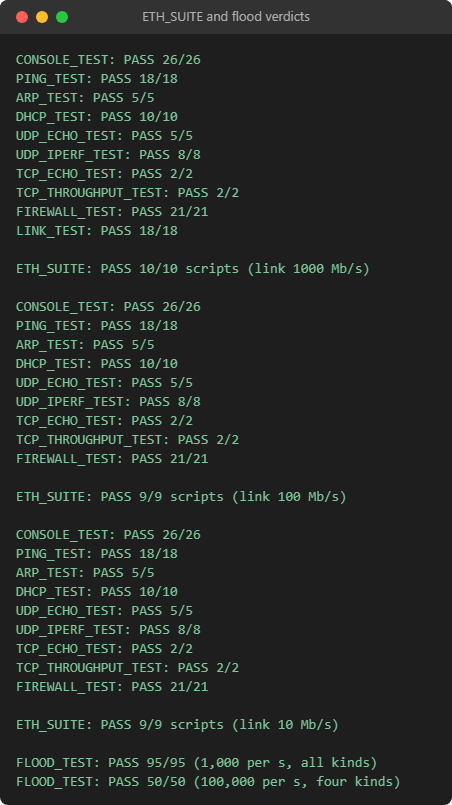
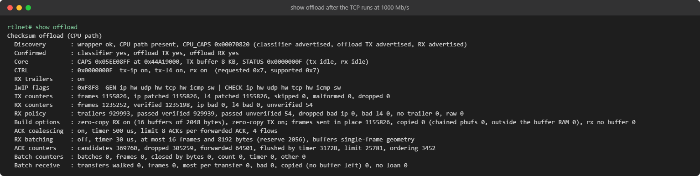

<table style="width:100%; border:none; margin:0; padding:0;">
<tr>
<td style="text-align:left; border:none; padding:0; width:50%;"></td>
<td style="text-align:right; border:none; padding:0; width:50%; vertical-align:bottom;"><strong>Demo Brief</strong> Revision 11-17-2026</td>
</tr>
</table>

<h1 style="font-size:30px; margin-top:18px;">RTLNet Ethernet Demo for the Nexys Video</h1>

A ready-to-run FPGA image: 10/100/1000 Mb/s Ethernet with ARP, ping, DHCP, UDP echo and UDP iperf 2 in FPGA fabric, lwIP TCP echo and iperf 2 on a small MicroBlaze V with 512 KiB of block RAM, a protection profile that holds a flood away from the CPU, a default-deny firewall that lets only ARP and the open TCP ports reach the CPU, and a switch-style console.

### Highlights

- ARP, ping, DHCP, UDP echo and UDP iperf 2 in fabric: 943 / 944 Mb/s at 1000 Mb/s
- lwIP TCP on a MicroBlaze V: 336 / 281 Mb/s at 1000 Mb/s, line rate at 100 and 10 Mb/s
- Default-deny firewall: only ARP and the open TCP ports reach the CPU, at no throughput cost
- Firewall on: a 1,000,000-frame flood and a closed-port scan are dropped in hardware
- Protection profile: per-class policers hold floods away from the CPU
- 10/100/1000 Mb/s RGMII (RTL8211E); firmware in 512 KiB of block RAM
- Every service, the firewall and the floods tested on the board; JTAG with the free Vivado license, no time limit

### At a glance

| Item | Value |
|---|---|
| Ethernet | 10/100/1000 Mb/s RGMII (RTL8211E), full duplex |
| Hardware protocols | ARP, ICMP echo, DHCP client, UDP echo, UDP iperf 2 server |
| TCP | lwIP: echo port 7, iperf 2 server port 5001 |
| CPU-path firewall | default deny, off at boot: ARP plus up to 16 allow entries |
| CPU | MicroBlaze V, 100 MHz, 512 KiB block RAM, no caches |
| Clock | one 100 MHz system clock |
| Console | USB-UART, 115200 8N1 |
| FPGA | xc7a200tsbg484-1 |
| Utilization | 23,891 LUT (17.86 %), 33,968 FF (12.69 %), 228.5 block RAM tiles (62.60 %), 6 DSP |
| Routed timing | WNS +0.154 ns, WHS +0.012 ns, WPWS +0.264 ns |
| Source revision | hardware git 2c2c686b, firmware git f82d4f1, both trees clean |
| Time limit | none |
| License | `LICENSE.md` |

## License

The RTLNet sources and this image are under the RTLNet source-available license (`LICENSE.md`).

**Free, no fee:**

- Evaluation, development, research, teaching, hobby and personal projects, including prototypes and demonstrations that are not sold
- A commercial product whose complete design sources are public under the RTLNet license and whose changes to RTLNet files are offered back as pull requests

**Paid license from IronKernel (ironkernel.com), before the product ships:**

- A commercial product whose design sources are not public

A paid license carries no royalty and no per-unit fee. This demo contains no paid extension and no netlist.

## How it works

**Figure 1.** Demo set-up and data path (demo-ethernet, sheet 1)

1. The MAC receives frames from the PHY and the protocol wrapper answers ARP requests, ping, DHCP and the UDP echo and UDP iperf 2 ports in fabric. The CPU sees none of this traffic. The MAC, the protocol blocks and the CPU side run from one 100 MHz clock; only the RGMII receive clock, the RGMII transmit clocks and the 200 MHz delay-control clock are separate.
2. Frames the wrapper does not handle (TCP, for example) pass the classifier and go to the CPU through an AXI DMA into a dual-port frame buffer RAM of 128 KiB on the CPU's data-side LMB. A frame that leaves the CPU as one buffer in that RAM is sent from where it is, with no copy. In the TCP runs at 1000 Mb/s this image sent 1,155,826 frames in place and copied none (`show offload`).
3. The checksum offload core (`rtlnet_tcp_offload`) patches the IP and TCP/UDP checksums of transmitted frames in place and verifies the checksums of received frames, so lwIP does not compute them. ACK coalescing, on at boot with a 500 microsecond timer, holds back pure TCP ACKs and merges them (369,760 candidates, 305,259 dropped, 64,501 forwarded in the 1000 Mb/s runs). Receive batching is available and is off at boot (section Receive features).
4. The classifier (`rtlnet_classifier`) judges every frame on its way to the CPU. At boot it is in pass-all mode with the protection profile: policers of 20 ARP, 10 ICMP, 10 UDP and 10 other broadcast frames per 100 ms window on the traffic the hardware did not answer. TCP and other unicast traffic is not policed. `classifier firewall enable` switches it to drop-on-match with an ARP exception and an allow list, so every frame that is neither ARP nor allowed is dropped in hardware (section CPU-path firewall). The protocol ingress filter discards multicast before the CPU. On this board the classifier tables are in block RAM (16 table entries, 16 tuples, 2 rules, 4 policers).
5. lwIP on the MicroBlaze V serves TCP echo on port 7 and the TCP iperf 2 server on port 5001. The firmware reads the PHY ID by MDIO at start-up and picks the driver from it (`show phy` prints it; the Nexys Video PHY answers as ID 0x001CC915, driver RTL8211E). `speed auto` advertises every full-duplex mode; half duplex is never advertised.

## What you need and run it

A Nexys Video with its 12 V supply (JP4 on JTAG), two micro-USB cables (PROG, UART), an Ethernet cable to a switch on a network with DHCP, Vivado 2026.1 with its free license and a terminal at 115200 baud 8N1.

1. Program the board: `powershell -NoProfile -ExecutionPolicy Bypass -File boards/nexys_video/scripts/program.ps1 -Bit demos/ethernet/nexys_video/rtlnet_nexys_video_eth.bit`
2. Open the serial console. The banner `RTLNet Ethernet demo -- rtlnet-eth-fw` and the DHCP lease line appear.
3. `show ip` prints the address; `ping` it from the PC.
4. `show interfaces`, `show phy`, `show arp`, `show counters`, `show tcp`, `show iperf`, `show offload` and `show classifier` print the state of each part. `configure terminal`, `interface eth0`, `speed 10|100|auto` sets the link speed.
5. The tests of `cpu/microblaze_v_ethernet/test/` (`run_all.ps1 -Port <COM> -Nic <adapter> -LinkMbps 10|100|1000` and `flood_test.ps1`) run every service, the firewall and the protection profile against the board; `firewall_test.ps1` runs the firewall alone.

 <strong>Figure 2.</strong> Console: <code>show version</code>, <code>show system</code>, <code>show interfaces</code>, <code>show ip</code> (addresses and MAC replaced by documentation values)

## Device utilization and timing

Release image (`eth_fw2`: hardware git 2c2c686b, firmware git f82d4f1 merged into the bitstream by `updatemem`, trees clean, Vivado 2026.1) on the XC7A200T:

<table class="num wrap">
<thead><tr><th></th><th>LUTs</th><th>Flip-flops</th><th>Block RAM tiles</th><th>DSP blocks</th></tr></thead>
<tbody>
<tr><td>Release image</td><td>23,891</td><td>33,968</td><td>228.5</td><td>6</td></tr>
<tr><td>Share of the device</td><td>17.86 %</td><td>12.69 %</td><td>62.60 %</td><td>0.81 %</td></tr>
</tbody>
</table>

Routed timing at the one 100 MHz system clock: WNS +0.154 ns, WHS +0.012 ns, WPWS +0.264 ns, no failing endpoint. The block RAM tiles include the 512 KiB CPU memory (the firmware ends at 306,192 bytes) and the 128 KiB frame buffer.

## Measured performance, firewall off and on

Method: the release image was programmed over JTAG and every number below was measured on that image in one campaign on 11-17-2026. A PC with a wired Gigabit adapter is connected to the board through an unmanaged switch. The link speed is set from the console with `speed 10`, `speed 100` and `speed auto` (which gives 1000 Mb/s). Each test runs once with the firewall off (the boot state: protection profile, pass-all) and once with the firewall on (`classifier firewall enable` with the boot services, so the allow list is TCP port 7 and TCP port 5001, 2 of 16 slots, and every other frame toward the CPU is dropped). Before and after each firewall-on run the script reads `show classifier` and checks that the firewall is enabled.

What each test does:

| Test | What the PC sends and checks | What answers on the board | Firewall on: the path of these frames |
|---|---|---|---|
| TCP iperf 2 | iperf 2 client, one TCP connection, 10 s, 3 runs per direction (`-R` for board to PC); the mean of the 3 runs | lwIP iperf 2 server, port 5001 | allowed (service entry, TCP port 5001) |
| TCP echo latency | one TCP connection to port 7; 2000 messages of 64 bytes, each sent when the previous echo is back; round trip timed on the PC | lwIP echo server, port 7 | allowed (service entry, TCP port 7) |
| TCP echo byte-exact (`tcp_echo_test.ps1`) | 4 connections with messages of 1 B to 64 KiB, then 6 connections with small messages; every byte compared | lwIP echo server, port 7 | allowed |
| UDP iperf 2 (`udp_iperf_test.ps1`) | 90 % of the link speed for 5 s in each direction, counting lost datagrams; then a sweep from 50 % to 98 % that stops at the first rate with a loss | hardware UDP iperf 2 server | not involved: answered by the hardware in front of the classifier |
| UDP echo (`udp_echo_test.ps1`) | 2000 datagrams of 64 bytes (round trip timed), then 400 datagrams of 0 to 1472 bytes compared byte for byte | hardware UDP echo, port 7 | not involved |
| Ping (`ping_test.ps1`) | 100 echo requests of 64 bytes (and 10 each of 0 to 1472 bytes) | hardware ICMP responder | not involved |

<table class="num wrap onoff">
<thead><tr><th>Test</th><th>10 Mb/s off</th><th class="on">10 Mb/s on</th><th>100 Mb/s off</th><th class="on">100 Mb/s on</th><th>1000 Mb/s off</th><th class="on">1000 Mb/s on</th></tr></thead>
<tbody>
<tr><td>TCP iperf 2, PC to board, Mb/s (mean of 3 runs)</td><td>9.5</td><td class="on">9.5</td><td>94.7</td><td class="on">94.5</td><td>336.0</td><td class="on">337.7</td></tr>
<tr><td>TCP iperf 2, board to PC, Mb/s (mean of 3 runs)</td><td>9.5</td><td class="on">9.5</td><td>94.9</td><td class="on">94.9</td><td>281.0</td><td class="on">280.3</td></tr>
<tr><td>TCP echo, 64 B, round trip mean / p99, ms</td><td>1.358 / 1.408</td><td class="on">1.355 / 1.417</td><td>0.238 / 0.285</td><td class="on">0.231 / 0.271</td><td>0.198 / 0.232</td><td class="on">0.198 / 0.234</td></tr>
<tr><td>TCP echo byte-exact, 4 + 6 connections</td><td>pass</td><td class="on">pass</td><td>pass</td><td class="on">pass</td><td>pass</td><td class="on">pass</td></tr>
<tr><td>UDP iperf 2, PC to board at 90 %, Mb/s</td><td>9.4</td><td class="on">9.4</td><td>94.0</td><td class="on">93.9</td><td>943.0</td><td class="on">942.0</td></tr>
<tr><td>UDP iperf 2, PC to board, datagrams lost</td><td>0</td><td class="on">0</td><td>0</td><td class="on">0</td><td>0</td><td class="on">0</td></tr>
<tr><td>UDP iperf 2, board to PC at 90 %, Mb/s</td><td>9.4</td><td class="on">9.4</td><td>94.4</td><td class="on">94.4</td><td>944.0</td><td class="on">944.0</td></tr>
<tr><td>UDP iperf 2, board to PC, datagrams lost</td><td>0</td><td class="on">0</td><td>0</td><td class="on">0</td><td>20</td><td class="on">0</td></tr>
<tr><td>UDP iperf 2, highest zero-loss rate, PC to board / board to PC, % of the link</td><td>98 / 98</td><td class="on">98 / 98</td><td>90 / 98</td><td class="on">95 / 98</td><td>98 / 80</td><td class="on">98 / 90</td></tr>
<tr><td>UDP echo, 64 B, round trip mean / p99, ms</td><td>1.303 / 1.363</td><td class="on">1.281 / 1.339</td><td>0.174 / 0.230</td><td class="on">0.179 / 0.241</td><td>0.171 / 0.238</td><td class="on">0.166 / 0.213</td></tr>
<tr><td>UDP echo, 0 to 1472 B, byte-exact</td><td>400 of 400</td><td class="on">400 of 400</td><td>400 of 400</td><td class="on">400 of 400</td><td>400 of 400</td><td class="on">400 of 400</td></tr>
<tr><td>Ping, 64 B x 100, lost</td><td>0</td><td class="on">0</td><td>0</td><td class="on">0</td><td>0</td><td class="on">0</td></tr>
</tbody>
</table>

The firewall-on columns match the firewall-off columns within the spread from run to run: the classifier judges every frame in hardware at the rate of the link in either mode, and the UDP services and ping are answered in front of it. The UDP iperf 2 runs offer 4,006 to 401,242 datagrams per direction; the board-to-PC sweep at 1000 Mb/s stops at 80 % and 90 % in these two runs because of single lost datagrams between the board and the iperf receiver on the PC (20 of 401,242 at 900 Mb/s offered in the firewall-off run), with the firewall off and on.

 <strong>Figure 3.</strong> Results at 1000 Mb/s from the campaign, with the three-run TCP means and the TCP echo latency with the firewall off and on (the captures for 100 and 10 Mb/s are <code>ethernet_perf_100.png</code> and <code>ethernet_perf_10.png</code>)

**What limits each figure.** The UDP echo, UDP iperf, ping, ARP and DHCP paths are RTL and carry no CPU load; the UDP iperf figures are the line rate of the link (the data rate is below the link speed because of the Ethernet, IP and UDP headers). TCP runs on the soft CPU: a 100 MHz MicroBlaze V with block RAM only and no caches handles every TCP segment in lwIP. At 100 and 10 Mb/s the CPU is fast enough and TCP reaches the line rate of the link. At 1000 Mb/s the CPU is the limit: 280 to 338 Mb/s, 28 to 34 % of the link. The hardware offloads (checksums, in-place transmit, ACK coalescing) raise the figure but do not remove that limit. After the TCP runs the lwIP heap had peaked at 37,320 of 65,536 bytes with no allocation failure (`show tcp`).

### Receive features: the measured reason for the boot defaults

The same image at 1000 Mb/s with the receive features set from the console (firewall off, iperf 2, 3 runs of 10 s each; TCP echo of 64 bytes, 2000 round trips):

<table class="num wrap">
<thead><tr><th>Setting</th><th>PC to board, Mb/s</th><th>Board to PC, Mb/s</th><th>TCP echo mean, ms</th></tr></thead>
<tbody>
<tr><td>ACK coalescing off, batching off</td><td>339.3</td><td>259.0</td><td>0.201</td></tr>
<tr><td>ACK coalescing 500 us, batching 30 us</td><td>316.3</td><td>272.7</td><td>0.232</td></tr>
<tr><td>ACK coalescing 500 us, batching off (boot default)</td><td>336.0</td><td>281.0</td><td>0.198</td></tr>
</tbody>
</table>

ACK coalescing raises the board to PC rate by about 8 % (259 to 281 Mb/s) with no cost in latency. Receive batching lowers the PC to board rate by about 6 % (336 to 316 Mb/s) and adds 0.03 ms to the TCP round trip, so it is off at boot; it stays available with `offload rx-batch on [timer-us] [frames]`.

## Protection profile and flood test (firewall off)

The classifier is always on and the policers of the profile are installed at every boot (`show classifier`, `classifier policer <broadcast|udp|arp|icmp> <frames> <window-ms>`). `flood_test.ps1` sends one flood per kind with normal sockets for 10 s while one TCP echo connection exchanges data, the console answers `show classifier` and `show system`, and the board is pinged. All kinds at 1000 frames per second give `FLOOD_TEST: PASS 95/95`; udp-closed, udp-bcast-net, mcast and icmp-bcast at 100,000 frames per second offered give `FLOOD_TEST: PASS 50/50`. All floods ran with the link at 1000 Mb/s and the firewall off. In every flood the TCP echo stays byte-exact, no console answer takes longer than 247 ms, the board's uptime shows no reset and the profile stays installed.

<table class="num wrap">
<thead><tr><th>Kind</th><th>Offered per s</th><th>Frames sent</th><th>Reached the board</th><th>Policed class: passed / dropped</th></tr></thead>
<tbody>
<tr><td>udp-closed (unicast, closed port)</td><td>1,000</td><td>10,000</td><td>10,000</td><td>udp: 1,010 / 8,990</td></tr>
<tr><td>udp-closed</td><td>100,000</td><td>1,000,000</td><td>923,386</td><td>udp: 1,010 / 922,376</td></tr>
<tr><td>udp-bcast-lim (255.255.255.255)</td><td>1,000</td><td>10,000</td><td>4,787</td><td>udp: 570 / 4,217</td></tr>
<tr><td>udp-bcast-net (subnet broadcast)</td><td>1,000</td><td>10,000</td><td>4,781</td><td>udp: 561 / 4,220</td></tr>
<tr><td>udp-bcast-net</td><td>100,000</td><td>1,000,000</td><td>5,491</td><td>udp: 320 / 5,171</td></tr>
<tr><td>mcast (group the board never joined)</td><td>1,000</td><td>10,000</td><td>5,198</td><td>none; all 5,198 counted as filtered</td></tr>
<tr><td>mcast</td><td>100,000</td><td>1,000,000</td><td>5,004</td><td>none; all 5,004 counted as filtered</td></tr>
<tr><td>icmp-bcast (32 sender threads)</td><td>1,000</td><td>672</td><td>672</td><td>icmp: 210 / 462</td></tr>
<tr><td>icmp-bcast</td><td>100,000</td><td>992</td><td>992</td><td>icmp: 310 / 682</td></tr>
</tbody>
</table>

The generator is a PC with normal sockets and the network between it and the board limits it: broadcast and multicast frames arrive at about 500 per second whatever the offered rate (4,781 to 5,491 in 10 s), and a unicast flood of 100,000 per second offered arrives at 923,386 of 1,000,000 frames in 10 s with the firewall off (with the firewall on, all of them arrive; see below). The board's counters show exactly what arrived. During the 100,000 per second broadcast and multicast floods 2 of 12 pings were lost in each (17 %, below the 40 % limit of the test), and none during the unicast and ICMP floods; the loss is upstream of the board, which discards the multicast at its ingress filter before the CPU. The `udp-echo` and `icmp-board` floods are answered by the hardware and add nothing to the CPU path counters; the `arp` flood (149 requests sent) is reported, not required: 395 ARP frames seen, 334 passed, 61 dropped.

 <strong>Figure 4.</strong> <code>show classifier</code> after the flood tests (firewall off): frames per class, the profile limits, the pass-all mode, the block RAM build and the firewall state

## CPU-path firewall

`classifier firewall enable` makes the CPU path default-deny: only ARP and the entries of an allow list reach lwIP, and the classifier drops every other frame in hardware before the CPU sees it. The firewall is off at boot; `classifier firewall disable` returns to the protection profile. The firewall is a register configuration of the existing classifier engines, so the image is the same with the firewall on or off.

The classifier runs in drop-on-match mode with two gating tables, both inverted (`EXCLUDE`): the EtherType table holds one entry, ARP (0x0806), and the tuple table holds the allow list. A frame matches, and is dropped, when it is not ARP and hits no allow entry:

    drop = not ARP AND no allow entry hits

| Frame | Verdict |
|---|---|
| ARP request or reply | passes; the `arp` policer still limits it to 20 per 100 ms |
| TCP or UDP to an allowed destination port (for a client flow: from the allowed source address and port) | passes, not policed |
| TCP or UDP to any other port | dropped: no RST, no ICMP port unreachable |
| ICMP that reaches the CPU path, IPv6, VLAN-tagged frames, other EtherTypes | dropped |
| IPv4 fragments and IPv4 with options | dropped (no ports to compare) |
| Ping, ARP for the board, DHCP, UDP echo, UDP iperf | answered by the hardware in front of the classifier, unchanged |

The firmware builds the allow list from three sources, one tuple slot per entry, and keeps it current while the firewall is on:

| Source | Entry |
|---|---|
| Services | the TCP echo server (`tcp echo port`) and the TCP iperf server (`iperf tcp port`) while enabled, and the listener of an iperf dual or tradeoff test while it waits for the connect-back: protocol and destination port, any source |
| Client flows | each TCP connection the board opens: from the remote address (/32) and port to the local port, from the connect until close or error |
| ACL entries | every `classifier acl` entry; an entry for the port of a service replaces the service's any-source entry (for example to restrict the echo server to one subnet) |

This board has 16 tuple slots, so the allow list holds up to 16 entries; `classifier firewall enable` is refused, before any register write, when the list does not fit. A change of a service port, a service enable or disable, a client flow or an ACL entry is written to the hardware as the difference against the current slots: a removed entry is cleared with one write, a new entry is written into a free slot with its valid bit last. The tables stay enabled and the mode is not touched, so frames of open connections keep passing during the change.

The session of Figure 5 leaves only ARP and the echo server, moved to the telnet port 23, open to the CPU. `show classifier` lists the slots by source and the frames the firewall has dropped. While the firewall is on, the `Profile` line names the firewall and the `udp` and `icmp` rows read "judged by the allow list, not policed", because their tuple slots carry the allow list; the `arp` and `broadcast` policers keep working. `show running-config` lists `classifier firewall enable` as the last classifier line.

 <strong>Figure 5.</strong> Only ARP and the echo server on port 23: the commands, <code>show classifier</code> with the Firewall block (one slot used, 15 free) and the lines of <code>show running-config</code>

`firewall_test.ps1` checks the firewall from the PC in four steps and restores the configuration at the end. Step a, firewall off: a closed TCP port is refused, and UDP datagrams to a closed port are answered with ICMP port unreachable (counted on the board's CPU transmit counter). Step b, firewall on: echo on port 7 works, ports 5001 and 23 get no answer at all, closed UDP ports get no answer, ping is answered and the drop count rises. Step c: the echo server moves to port 23 while the firewall stays on; port 23 opens and port 7 closes. Step d: the firewall is off again and the services are back on their ports. The test gives `FIREWALL_TEST: PASS 21/21` at 1000, 100 and 10 Mb/s.

 <strong>Figure 6.</strong> <code>firewall_test.ps1</code> at 1000 Mb/s: the 21 checks of the four steps

### Closed ports: port scan with the firewall off and on

A port scan from the PC at 1000 Mb/s: one TCP connect to each closed port 1 to 200 (port 7 left out), all started together and given 4 s; one UDP datagram to each closed port 40000 to 40099, 20 ms apart (below the `udp` policer limit); and a connect to the two allowed ports. The board's counters show what reached the CPU and what the board sent back.

| Probe | Firewall off | Firewall on |
|---|---|---|
| TCP connect to 199 closed ports | 199 refused: the classifier passes the SYNs (997 frames, the PC repeats a SYN after a RST) and lwIP answers each with a RST (995 sent) | 199 get no answer: the classifier drops 600 frames (the PC repeats each SYN), 0 reach the CPU, 0 RST sent |
| UDP datagram to 100 closed ports | 100 ICMP port unreachable sent by the board | 0 sent; 103 frames dropped by the firewall, 0 reach the CPU |
| TCP connect to the allowed ports 7 and 5001 | 2 of 2 connect | 2 of 2 connect |
| Result | `PORTSCAN firewall off: PASS` | `PORTSCAN firewall on: PASS` |

 <strong>Figure 7.</strong> The port scan with the firewall off and on: the PC's result for each probe kind and the board's counters (addresses replaced by documentation values)

### Floods with the firewall off and on

The same unicast flood to a closed UDP port, 100,000 frames per second offered for 10 s on the 1000 Mb/s link, alternately with the firewall off and on, while one TCP echo connection runs (echo server on port 7 and iperf server on port 5001 allowed). "Reached the board" counts every frame the MAC received, the TCP echo segments included.

<table class="num wrap onoff">
<thead><tr><th>Run</th><th>Frames sent</th><th>Reached the board</th><th>Dropped by the firewall</th><th>Passed to the CPU</th><th>TCP echo rounds, slowest round</th></tr></thead>
<tbody>
<tr><td>firewall off</td><td>1,000,000</td><td>949,557</td><td>0</td><td>22,110</td><td>21,084, 1.7 ms</td></tr>
<tr><td class="on">firewall on</td><td>1,000,000</td><td>1,021,179</td><td>1,000,006</td><td>21,113</td><td>21,107, 0.7 ms</td></tr>
<tr><td class="on">firewall on</td><td>1,000,000</td><td>1,021,175</td><td>1,000,006</td><td>21,151</td><td>21,145, 0.8 ms</td></tr>
<tr><td>firewall off</td><td>1,000,000</td><td>945,812</td><td>0</td><td>22,184</td><td>21,163, 2.9 ms</td></tr>
</tbody>
</table>

With the firewall on, every one of the 1,000,000 flood frames reaches the board and is dropped by the classifier (the 6 more are frames from other hosts of the network); the frames to the CPU are the TCP echo segments, the echo is byte-exact with no error and no TCP segment is lost on the board (CPU path no-buffer drops 0, lwIP TCP drops 0). With the firewall off the `udp` policer passes 10 datagrams per 100 ms (about 1,000 in 10 s) to lwIP, which answers each with an ICMP port unreachable, and drops the rest. With the firewall off fewer flood frames reach the board (about 924,000 to 928,000 of 1,000,000); the frames that do not arrive are lost upstream of the board (its receive overflow counter stays 0), at a place not determined in this campaign. Further floods with the firewall on:

<table class="num wrap">
<thead><tr><th>Kind</th><th>Offered per s</th><th>Frames sent</th><th>Dropped by the firewall</th><th>Passed to the CPU</th><th>TCP echo rounds, slowest round</th></tr></thead>
<tbody>
<tr><td>udp-closed</td><td>1,000</td><td>10,000</td><td>10,006</td><td>21,120</td><td>21,111, 2.8 ms</td></tr>
<tr><td>udp-closed</td><td>100,000</td><td>1,000,000</td><td>1,000,005</td><td>21,359</td><td>21,353, 2.8 ms</td></tr>
<tr><td>udp-bcast-net</td><td>100,000</td><td>1,000,000</td><td>5,003</td><td>20,609</td><td>20,606, 279 ms</td></tr>
<tr><td>icmp-bcast (32 sender threads)</td><td>1,000</td><td>640</td><td>645</td><td>21,166</td><td>21,157, 2.8 ms</td></tr>
</tbody>
</table>

The console answers within 270 ms during these floods and the board does not reset. The broadcast flood reaches the board at about 500 frames per second, as with the firewall off; its slowest echo round (279 ms) is a delay in the network, while the board drops every broadcast datagram that arrives.

 <strong>Figure 8.</strong> The floods with the firewall off and on: what the generator sent, the TCP echo, and the board's counters for each run (addresses replaced by documentation values)

## Test results

| Test | 1000 Mb/s | 100 Mb/s | 10 Mb/s |
|---|---|---|---|
| `run_all.ps1` (firewall off, with `firewall_test.ps1`) | `ETH_SUITE: PASS 10/10 scripts (link 1000 Mb/s)` (with `-IncludeLink`) | `ETH_SUITE: PASS 9/9 scripts (link 100 Mb/s)` | `ETH_SUITE: PASS 9/9 scripts (link 10 Mb/s)` |
| console_test, ping_test, arp_test, dhcp_test | 26/26, 18/18, 5/5, 10/10 | 26/26, 18/18, 5/5, 10/10 | 26/26, 18/18, 5/5, 10/10 |
| udp_echo_test, udp_iperf_test, tcp_echo_test, tcp_throughput_test | 5/5, 8/8, 2/2, 2/2 | 5/5, 8/8, 2/2, 2/2 | 5/5, 8/8, 2/2, 2/2 |
| The same five service tests with the firewall on (ping_test first) | 18/18, 5/5, 8/8, 2/2, 2/2 | 18/18, 5/5, 8/8, 2/2, 2/2 | 18/18, 5/5, 8/8, 2/2, 2/2 |
| `firewall_test.ps1` | `FIREWALL_TEST: PASS 21/21` | `FIREWALL_TEST: PASS 21/21` | `FIREWALL_TEST: PASS 21/21` |
| `link_test.ps1` (`speed 100`, `speed 10`, `speed auto`) | `LINK_TEST: PASS 18/18` | | |
| Port scan (firewall off, on) | `PORTSCAN`: PASS, PASS | | |
| `flood_test.ps1` (firewall off) | `FLOOD_TEST: PASS 95/95` (all kinds, 1,000 per s); `FLOOD_TEST: PASS 50/50` (four kinds, 100,000 per s) | | |

 <strong>Figure 9.</strong> The three <code>ETH_SUITE</code> verdicts with the verdict of each script, and the flood verdicts

 <strong>Figure 10.</strong> <code>show offload</code> after the TCP runs at 1000 Mb/s (counters cleared before the runs): checksums done in hardware, frames sent in place, and ACK coalescing counters

Further captures are in `demos/ethernet/images/`: `ethernet_perf_100.png` and `ethernet_perf_10.png` (100 and 10 Mb/s results), `ethernet_runcfg.png` (`show running-config`), `ethernet_flood1000.png` and `ethernet_flood100000.png` (the flood tests).

## Console commands

| Command | Effect |
|---|---|
| `show version`, `show system`, `show interfaces`, `show phy` | firmware and build; clocks, uptime, LEDs; interface state; PHY ID and address, link speed, advertised modes and the partner's modes |
| `show ip`, `show dhcp`, `show arp` | address; DHCP client and lease; ARP table |
| `show counters`, `show tcp`, `show iperf`, `show offload` | frame and protocol counters; TCP connections; iperf server counters; checksum offload, ACK coalescing and batching counters |
| `show classifier`, `classifier policer <class> <frames> <window-ms>` | mode, profile state, per-class counters and the Firewall block (state, slots by source, free slots, dropped frames); change one policer |
| `classifier firewall enable\|disable` | the default-deny firewall of the CPU path (configuration mode); off at boot |
| `classifier acl [<n>] tcp\|udp\|any src <ip>/<len> dst <ip>/<len> [sport <lo>[-<hi>]] [dport <lo>[-<hi>]] gate\|classify\|police 
`, `no classifier acl [<n>]` | ACL entry 0..13 (configuration mode); with the firewall on every entry is an allow entry |
| `tcp echo port <n>`, `tcp echo enable\|disable`, `iperf tcp port <n>`, `iperf tcp enable\|disable` | the TCP services (configuration mode); with the firewall on their ports open and close with them |
| `offload ack-coalesce on\|off [timer-us]`, `offload rx-batch on\|off [timer-us] [frames]` | the receive features (configuration mode) |
| `configure terminal`, `interface eth0` | configuration mode and the interface |
| `speed 10\|100\|auto` | the only link control; `auto` advertises every full-duplex mode, half duplex is never advertised |
| `ip dhcp`, `renew` | DHCP on the interface; ask for the lease again |

## Limits

- TCP is limited by the soft CPU: the MicroBlaze V runs at 100 MHz with block RAM only, so TCP iperf is 280 to 338 Mb/s at 1000 Mb/s. The UDP paths (echo, iperf 2, ping, ARP, DHCP) are in hardware and carry the line rate of the link.
- The link is full duplex only; half duplex is never advertised.
- The classifier polices traffic by class, or with the firewall on drops everything outside the allow list; it limits a flood that reaches the board and does not stop a flood on the wire. The flood figures come from a PC with normal sockets, not from a hardware traffic generator.
- The firewall holds up to 16 allow entries, judges IPv4 TCP and UDP by protocol, addresses and ports, and drops IPv4 fragments, IPv4 with options and IPv6 while it is on. It keeps no connection state: an allow entry for a port admits every frame to that port from the sources it names. While it is on, UDP and ICMP frames that reach the CPU path are judged by the allow list, not policed by class.
- Ping round trips are whole milliseconds (the PC's ping tool); the latency figures are the UDP echo and TCP echo round trips.
- The image loads over JTAG only; a power cycle removes it. Boot from the Quad-SPI flash was not verified.

