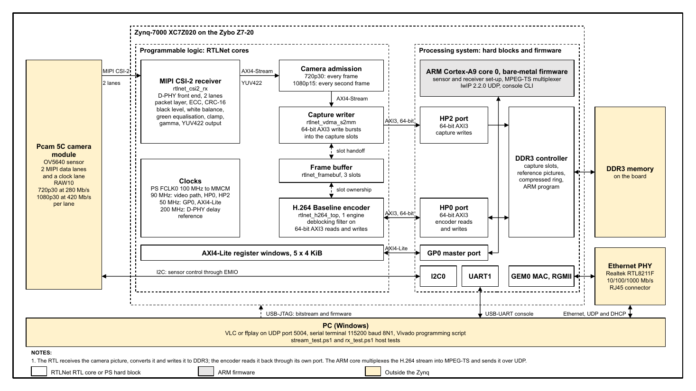
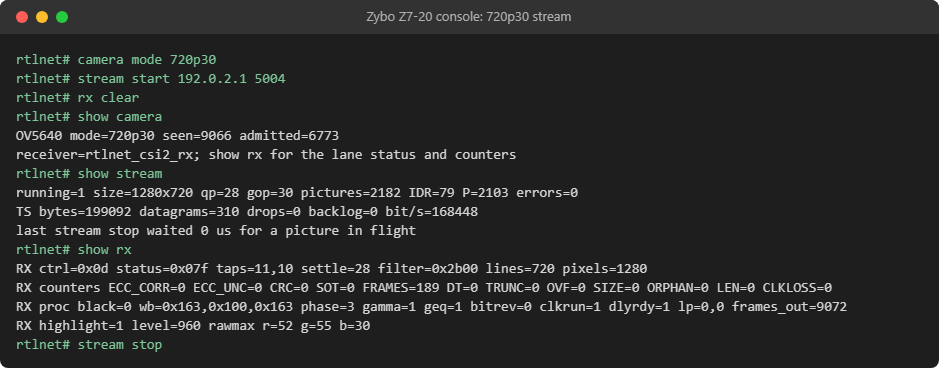
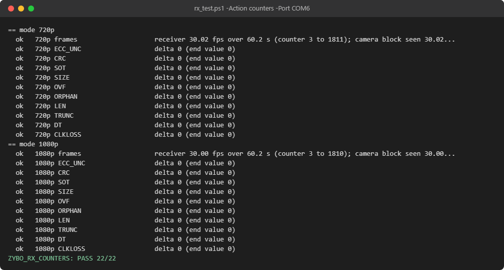
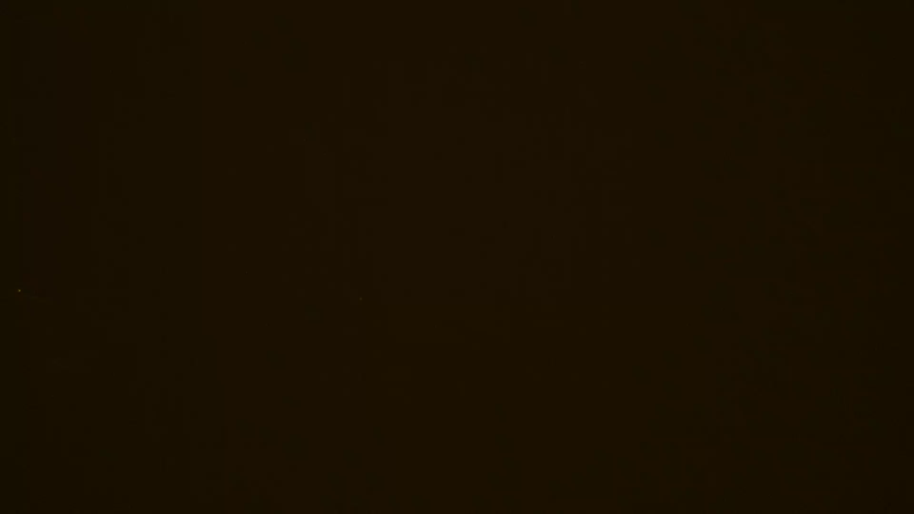

<table style="width:100%; border:none; margin:0; padding:0;">
<tr>
<td style="text-align:left; border:none; padding:0; width:50%;"></td>
<td style="text-align:right; border:none; padding:0; width:50%; vertical-align:bottom;"><strong>Demo Brief</strong> Revision 11-16-2026</td>
</tr>
</table>

<h1 style="font-size:30px; margin-top:18px;">RTLNet H.264 Camera Demo for the Zybo Z7-20</h1>

A real camera to a PC: a Pcam 5C on the Zybo Z7-20, received by the IronKernel MIPI CSI-2 receiver in FPGA fabric, encoded by an RTLNet H.264 Baseline engine and streamed as MPEG-TS over UDP by a bare-metal ARM application. 720p30 and 1080p15, measured on the board.

This demo is a prebuilt image of the IronKernel RTLNet camera design for a Digilent Zybo Z7-20 (AMD Zynq-7000 XC7Z020) with a Digilent Pcam 5C (OmniVision OV5640 sensor, two MIPI CSI-2 data lanes). The receiver `rtlnet_csi2_rx` is IronKernel's own: it takes the sensor's D-PHY lanes in the FPGA fabric, checks the packet headers (ECC) and payloads (CRC-16), converts the Bayer data to YUV422 (black level, white balance, green equalisation, highlight clamp, gamma) and hands the picture to a capture writer that stores it in the DDR3 memory of the Zynq through a 64-bit AXI3 HP port. One RTLNet H.264 encoder (Constrained Baseline profile, CAVLC, in-loop deblocking filter) reads the pictures through a second HP port and writes the compressed pictures back. A bare-metal firmware on ARM core 0 sets up the sensor and the receiver, multiplexes the pictures into MPEG-TS and sends them over UDP through the PS Gigabit Ethernet and lwIP. VLC or ffplay on a PC shows the stream. The image has no time limit and contains no netlist.

Because the Zynq needs its processing system initialized and its ARM firmware started, the demo is three binary files, not one bitstream: the bitstream, the firmware ELF and the PS initialization script. One PowerShell script loads them over JTAG; the load is volatile.

### Highlights

- Own MIPI CSI-2 receiver in fabric (`rtlnet_csi2_rx`): two-lane D-PHY front end, ECC and CRC-16 packet layer, Bayer stage with white balance and highlight clamp, YUV422; all twelve error counters read 0 over 60 s in both modes
- Capture writer and encoder are 64-bit masters on the PS HP ports (no bridge, no arbiter); one 90 MHz video clock
- 720p30 (every sensor frame) and 1080p15 (every second frame), Constrained Baseline, constant QP or constant bit rate
- MPEG-TS over UDP to VLC or ffplay; `stream_test.ps1` checks the transport stream and decodes it with ffmpeg: PASS 16/16 in three runs
- 120 s soaks without a continuity, PTS or decode error: 3,573 pictures at 720p, 1,771 at 1080p
- Console on the USB-UART: `show camera`, `show rx`, `show stream`, `camera mode`, `stream start`, `encoder bitrate`, `rx` commands; ARM core 0 only
- Source-available: RTL, receiver, firmware and scripts are in the repository; no time limit

### At a glance

| Item | Value |
|---|---|
| Board, camera | Zybo Z7-20 (XC7Z020-1CLG400), Pcam 5C (OV5640) |
| Camera link | MIPI CSI-2, 2 data lanes, RAW10; 280 Mb/s per lane (720p), 420 Mb/s per lane (1080p) |
| Stream | MPEG-TS over UDP, H.264 Constrained Baseline |
| Modes | 1280 x 720 at 30 pictures/s; 1920 x 1080 at 15 pictures/s |
| Encoder | RTLNet H.264, 1 engine, deblocking filter on |
| Clocks | 90 MHz video path, 50 MHz AXI-Lite, 200 MHz D-PHY delay reference |
| Network | PS Gigabit Ethernet (RTL8211F), lwIP 2.2.0, DHCP |
| Console | USB-UART, 115200 8N1 |
| Utilization | 33,151 LUT (62.31 %), 26,393 FF, 26 block RAM tiles, 50 DSP |
| Routed timing | WNS +0.222 ns; WHS +0.051 ns without the two named deviation endpoints |
| Image, firmware | `own9`, `fw19`; git 91d71cb, working tree not clean |
| Time limit | none |
| License | `LICENSE.md` |

## License

The RTLNet sources and this image are under the RTLNet source-available license (`LICENSE.md`).

**Free, no fee:**

- Evaluation and development, including prototypes and demonstrations that are not sold
- Research and teaching
- Hobby and personal projects
- A commercial product whose complete design sources are public under the RTLNet license and whose changes to RTLNet files are offered back as pull requests

**Paid license from IronKernel (ironkernel.com), before the product ships:**

- A commercial product whose design sources are not public

A paid license carries no royalty and no per-unit fee. This demo contains no paid extension and no netlist.

## How it works

**Figure 1.** Demo set-up and data path (demo-h264-zybo)

1. The OV5640 sends RAW10 over two MIPI lanes: 720p at 280 Mb/s per lane (HS clock 140 MHz, double data rate) and 1080p at 420 Mb/s per lane (210 MHz). `rtlnet_csi2_rx` samples the lanes with an IDELAYE2 and an ISERDESE2 per lane (the delay tap of each lane is a run-time setting), tracks the low-power states, finds the sync byte, merges the two lanes and checks the packet header ECC and the payload CRC-16. The receiver cannot stall the sensor: a byte-clock FIFO crosses to the 90 MHz clock and drops entries, counted in `OVF`, if the capture path is not ready.
2. The Bayer stage subtracts the black level, applies the white balance gains of the mode, equalises the two greens of the sensor, clamps highlights (the red and blue channels reach full scale before green at 1080p, which turned clipped areas pink without the clamp), demosaics and converts to YUV422 with gamma. The camera admission passes every frame at 720p30 and every second frame at 1080p15.
3. The capture writer (`rtlnet_vdma_s2mm`) writes each admitted picture into one of three capture slots in DDR3 as bursts of 16 beats of 8 bytes on HP2. The frame buffer (`rtlnet_framebuf`) tracks which slot the capture writer fills and which the encoder holds. All DDR3 access is in bursts; no single-beat transaction is issued.
4. The encoder reads the picture through HP0 (row bursts and 128-byte search-window and tile bursts), keeps its reconstructed reference pictures in DDR3, and writes the compressed pictures to a ring. It raises an interrupt per picture. Both ports are 64-bit AXI3 masters connected straight to the PS: no width bridge, no arbiter.
5. The ARM firmware starts the sensor over I2C (the OV5640 register tables of the Pcam 5C software release), brings the receiver up, serves the console, and for each finished picture multiplexes the H.264 access unit into MPEG-TS (PAT, PMT, PCR, PES with PTS) and sends 188-byte packets in UDP datagrams through lwIP and the PS Ethernet MAC. The firmware reads the PHY by MDIO and takes the DHCP lease; there is no static fallback.
6. Registers sit in five 4 KiB windows on GP0 (camera admission, capture writer, frame buffer, encoder, receiver). Video data never passes through them.

## What you need and run it

A Zybo Z7-20 with a Pcam 5C, a micro-USB cable in the PROG UART port (JTAG and console), an Ethernet cable to a network with DHCP, AMD Vitis or Vivado 2026.1 for `xsdb` (the free license is enough; nothing is built), and VLC or ffplay with UDP port 5004 open in the PC's firewall. The files are in `demos/h264_baseline/zybo_z7_20/`: `rtlnet_zybo_z7_20.bit`, `rtlnet_zybo.elf`, `ps7_init.tcl` and `build_info.txt`. The README of that folder has the details.

1. Load the board: `powershell -NoProfile -ExecutionPolicy Bypass -File boards/zybo_z7_20/scripts/program_demo.ps1`. The script runs `ps7_init`, loads the bitstream, runs `ps7_post_config`, downloads the ELF to ARM core 0 and starts it, and ends with `RTLNET_ZYBO_PROGRAM: PASS (exit 0)`. It refuses unless the JTAG chain holds an `xc7z020` device.
2. Open the console (115200 8N1). About 40 s after the load the prompt `rtlnet>` appears. `enable`, then `show ip` prints the board's address.
3. Start the player: `ffplay -fflags nobuffer udp://@:5004`, or in VLC the network stream `udp://@:5004`.
4. On the console: `camera mode 720p30`, `stream start <PC address> 5004`. `camera mode 1080p15` (stream stopped) selects 1080p. `stream stop` ends the stream.
5. `show camera`, `show rx`, `show stream` and `show encoder` print the state; `rx clear` clears the receiver counters.

 <strong>Figure 2.</strong> Console during the 720p30 stream: <code>show camera</code>, <code>show stream</code>, <code>show rx</code> (addresses replaced by documentation values; the counters were cleared with <code>rx clear</code> after the start; the scene was dark)

## Measured results

Method: the image was built from the repository (`own9`, firmware `fw19`), loaded over JTAG and measured on one Zybo Z7-20 with one Pcam 5C, at room temperature, powered from a direct PC USB port, with the PS Ethernet to a switch and a PC on the same network. `rx_test.ps1 -Action counters` reads the receiver counters over 60 s per mode; `stream_test.ps1` captures the UDP datagrams on the PC and checks the transport stream (continuity counters, PAT and PMT CRC-32, PCR, PES, PTS steps, IDR every 30 pictures), the stream parameters with ffprobe and the whole capture with ffmpeg, from the second IDR picture on (the first burst of a new UDP flow can arrive reordered although the board sends in order). Results of the image campaign of 11-15-2026:

<table class="num wrap">
<thead><tr><th>Test</th><th>720p30</th><th>1080p15</th></tr></thead>
<tbody>
<tr><td>Sensor frame rate, receiver <code>FRAMES</code> over 60 s</td><td>30.00 fps</td><td>30.01 fps</td></tr>
<tr><td>Admitted to the encoder</td><td>30.00 fps</td><td>15.01 fps</td></tr>
<tr><td>Receiver counters over 60 s: <code>ECC_CORR</code>, <code>ECC_UNC</code>, <code>CRC</code>, <code>SOT</code>, <code>DT</code>, <code>TRUNC</code>, <code>OVF</code>, <code>SIZE</code>, <code>ORPHAN</code>, <code>LEN</code>, <code>CLKLOSS</code></td><td>all 0 (<code>ZYBO_RX_COUNTERS: PASS 22/22</code>)</td><td>all 0</td></tr>
<tr><td><code>stream_test.ps1 -Mode both</code>, three consecutive runs</td><td colspan="2"><code>ZYBO_STREAM_TEST: PASS 16/16</code> in each run</td></tr>
<tr><td>120 s soak: access units, continuity errors, PTS gaps</td><td>3,573, 0, 0</td><td>1,771, 0, 0</td></tr>
<tr><td>120 s soak: stream rate, encoder errors, dropped pictures, decode errors</td><td>30.000 fps, 0, 0, 0</td><td>15.000 fps, 0, 0, 0</td></tr>
<tr><td>ffprobe</td><td>h264 Constrained Baseline, 1280x720, 30.00 fps</td><td>h264 Constrained Baseline, 1920x1080, 15.00 fps</td></tr>
</tbody>
</table>

Re-run on 11-16-2026 from the released files of this demo (the load of step 1 above, not the build folder): `rx_test.ps1 -Port COM6 -Action counters` gave `ZYBO_RX_COUNTERS: PASS 22/22` (receiver 30.02 fps at 720p and 30.00 fps at 1080p over 60.2 s, every error counter's delta 0). `stream_test.ps1 -Mode both` gave 14 of 16 steps ok: sensor and stream rate, board (no encoder error, no dropped picture, no UDP drop), startup, transport stream, probe and decode passed in both modes; the two picture steps failed because the room was dark (the check needs a luma range of 40 or more). The three-run PASS 16/16 above was taken with lit monitors in view.

 <strong>Figure 3.</strong> <code>rx_test.ps1 -Action counters</code> on the released files, 60 s per mode: <code>ZYBO_RX_COUNTERS: PASS 22/22</code>

### Bit rate

At the default constant QP 28 in the dark scene of 11-16-2026, <code>show stream</code> read 168,448 bit/s at 720p30 and 141,376 bit/s at 1080p15. The bit rate follows the scene; a lit, detailed scene needs more, and `encoder bitrate <kb/s>` selects constant bit rate. The bit rate of a lit scene was not measured with this image.

### Receiver margin

The sampling margin of the two high-speed lanes was measured by sweeping the IDELAY tap of both lanes together (3 s per tap, 78 ps per tap, `rx_test.ps1 -Action sweep`) on the previous image `own6`, which has the same receiver sources and constraints; the sweep was not repeated on `own9`.

<table class="num wrap">
<thead><tr><th>Mode</th><th>Lane rate</th><th>Error-free taps</th><th>Window</th><th>Default taps (lane 0, lane 1)</th></tr></thead>
<tbody>
<tr><td>720p30</td><td>280 Mb/s</td><td>0 to 29 (30 taps)</td><td>2,340 ps</td><td>11, 10</td></tr>
<tr><td>1080p30 sensor</td><td>420 Mb/s</td><td>0 to 21 (22 taps)</td><td>1,716 ps</td><td>11, 10</td></tr>
</tbody>
</table>

At 1080p errors appear at taps 22 to 26 and the receiver is clean again from tap 27 (the next bit period). The lower edge of the window lies below tap 0 and is not measured. The defaults sit near the centre of the 1080p window. One unit, one cable, room temperature.

## Captured pictures

<table style="width:100%; border:none;"><tr><td style="border:none; width:50%; text-align:center;"></td><td style="border:none; width:50%; text-align:center;"></td></tr></table><strong>Figure 4.</strong> Decoded pictures of the stream, 1280 x 720 (left) and 1920 x 1080 (right), taken eight seconds into a capture from the released image on 11-16-2026. The room was dark and the camera saw no lit object, so the pictures are almost black. They are not a statement about picture quality; they are to be retaken in daylight (<code>images/README.md</code>).

Earlier frames of the same design, taken with two monitors lit in an otherwise dark room (image `own9`, 11-15-2026): upright in both modes, monitor text readable, no block errors, tearing or colour banding visible at 720p and 1080p. White balance gains per mode make a neutral wall R:G:B within about 5 percent (measured on image `own7`); the two greens of the sensor are equalised (green level of the four pixel parities 188.2 / 187.9 / 188.5 / 188.3 after, 190 / 201 / 178 / 190 before); the highlight clamp keeps bright areas neutral at 1080p (bright pixels 251.0 : 221.6 : 234.5 without the clamp, 252.8 : 251.1 : 239.3 with it, on monitor strips). The colour of a lit scene and a true sunlit clipped window were not checked on `own9`.

## Device utilization and timing

Image `own9` (git 91d71cb, Vivado 2026.1) on the XC7Z020:

<table class="num wrap">
<thead><tr><th></th><th>LUTs</th><th>Flip-flops</th><th>Block RAM tiles</th><th>DSP blocks</th></tr></thead>
<tbody>
<tr><td>Image</td><td>33,151</td><td>26,393</td><td>26</td><td>50</td></tr>
<tr><td>Share of the device</td><td>62.31 %</td><td>24.81 %</td><td>18.57 %</td><td>22.73 %</td></tr>
</tbody>
</table>

Routed timing: WNS +0.222 ns, worst pulse-width slack +0.264 ns, WHS -1.429 ns. The negative hold slack belongs to exactly two endpoints, the `DDLY` inputs of the two `ISERDESE2` samplers of the receiver's data lanes (gate `DPHY_HS_INPUT`, below); without them WHS is +0.051 ns. The build gates print `PASS with deviation DPHY_HS_INPUT`; critical warnings are 0 in synthesis and 2 in implementation, both the timing statements of the deviation.

**The deviation.** The IDELAYE2 of each data lane is loaded with its tap at run time, so static timing uses the attribute value 0 and cannot see the loaded tap: no tap makes the static model close. The gate accepts exactly those two pins and fails any other timing failure. The evidence for the margin is the tap sweep on the board above, not the static model; `build_info.txt` records the deviation as named and `dphy_hardware_verification open`.

## Limits and what is not verified

- One board, one Pcam 5C, one cable, room temperature, direct PC USB power. Not measured: temperature, supply, other cables, boards and sensors.
- The static timing of the two high-speed input samplers fails hold (named deviation `DPHY_HS_INPUT`, open). The margin is measured, not proven by analysis; the sweep was made on image `own6` and not repeated on `own9`.
- The pictures in this brief were taken in a dark room and are to be retaken in daylight. The colour of lit scenes, a sunlit clipped window and the bit rate of lit scenes were not checked on `own9`. A saturated coloured highlight is desaturated towards white when its green is at the clamp level or above.
- The non-continuous clock mode and a stopped high-speed clock on a real sensor were not tested. The AMD primitive branch of the D-PHY front end is covered by synthesis, the gates and the board runs, not by simulation.
- Loading is JTAG only and volatile; boot from the SD card or the QSPI flash has not been built or tested. The jumper positions of the tested board were not recorded.
- The image was built from a working tree with local changes (`git_dirty 1` in `build_info.txt`, base commit 91d71cb).
- Latency from the lens to the player was not measured. 1080p is streamed at 15 pictures per second (the sensor runs 30), not at 30. The first group of pictures of a new UDP flow can arrive reordered at the PC although the board sends in order; `stream_test.ps1` therefore judges the stream from the second IDR picture and reports the first group's continuity errors without judging them.
- Through a weak USB port the board lost power as soon as the fabric was configured and the ARM ran; use a direct PC USB port or a 5 V supply.
- The encoder is the Constrained Baseline engine: no B pictures, no CABAC, no High profile.

## Console commands

| Command | Effect |
|---|---|
| `enable` | privileged mode (the commands below need it) |
| `show version`, `show ip` | firmware revision; PHY ID, link, DHCP lease and address |
| `show camera` | sensor mode, frames `seen` from the receiver and `admitted` to the encoder |
| `show rx` | receiver status, the twelve counters, Bayer settings, raw maxima of the last frame |
| `show encoder`, `show stream` | pictures, IDR and P counts, errors, MPEG-TS bytes and datagrams, drops, bit/s |
| `camera mode 720p30\|1080p15` | sensor and admission mode (stream stopped) |
| `stream start <address> <port>`, `stream stop` | start or stop the MPEG-TS UDP stream |
| `encoder qp <0..51>`, `encoder gop <1..255>`, `encoder bitrate <kb/s>` | constant QP; pictures between IDR pictures; constant bit rate (0 returns to constant QP) |
| `rx clear` | clear the receiver counters |
| `rx taps <lane 0> <lane 1>`, `rx wb <R> <G> <B>`, `rx black`, `rx phase`, `rx gamma`, `rx geq`, `rx highlight <0\|1> <level>`, `rx bitrev`, `rx settle` | receiver settings, effective at once (the Bayer registers at the next frame); a `camera mode` loads the defaults of the mode again |

