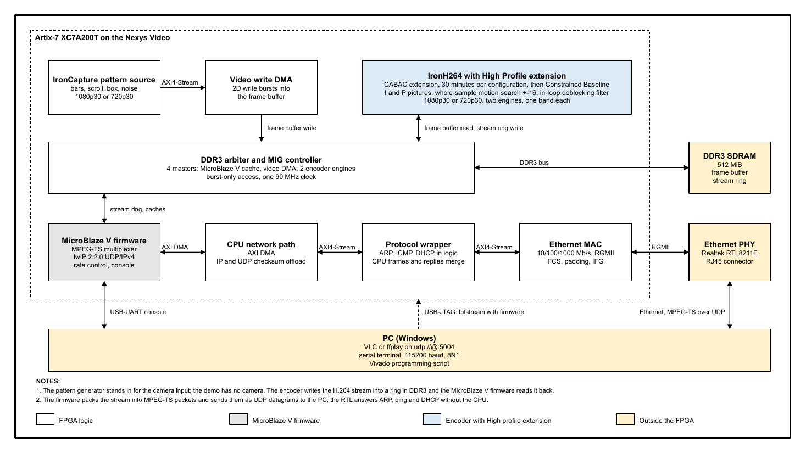
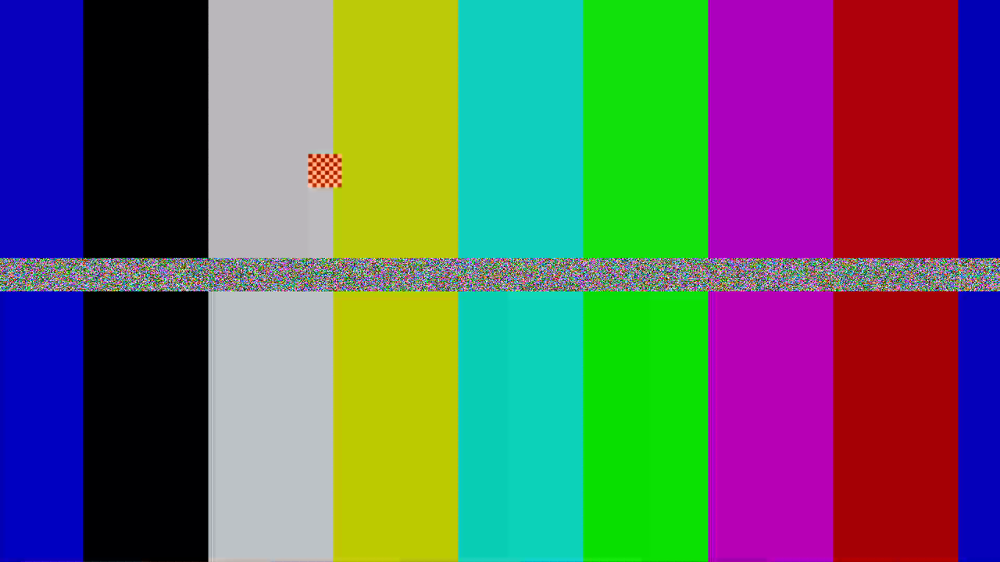

<table style="width:100%; border:none; margin:0; padding:0;">
<tr>
<td style="text-align:left; border:none; padding:0; width:50%;"></td>
<td style="text-align:right; border:none; padding:0; width:50%; vertical-align:bottom;"><strong>Demo Brief</strong> Revision 11-13-2026</td>
</tr>
</table>

<h1 style="font-size:30px; margin-top:18px;">RTLNet H.264 High Profile Encoder Demo for the Nexys Video</h1>

A ready-to-run FPGA image of the H.264 encoder with the High profile extension: CABAC entropy coding for 30 minutes after each programming, with 1080p30 and 720p30 test patterns streamed over Ethernet to VLC or ffplay.

This demo is a prebuilt bitstream, with its firmware inside, of the IronKernel RTLNet H.264 encoder with the High profile extension (CABAC entropy coding) for a Digilent Nexys Video (AMD Artix-7 XC7A200T). It is the demonstration form of a paid feature: High profile runs for 30 minutes after each configuration of the FPGA, then the encoder sends one IDR picture and continues in Constrained Baseline without a break in the stream. The board makes test patterns, two encoder engines code them, and the MicroBlaze V firmware sends them as MPEG-TS over the RTLNet gigabit Ethernet stack to a PC. The demo shows how many bits CABAC saves at the same QP.

### Highlights

- IronKernel includes Markdown integration guides for engineers, Claude, and Codex. The guides connect the RTL and firmware interfaces to the tests used on this board.
- CABAC against CAVLC at the same QP: 12.5 % fewer bits on pattern `all` at QP 28, 18.3 % at QP 40, 46.0 % on `box` and 52.3 % on `scroll` at QP 28, with equal PSNR
- At 8 Mb/s on pattern `all`, CABAC runs at a lower QP (average 46.5 against 48.7) and gains 1.54 dB minimum and 1.86 dB mean PSNR
- License end measured on the demo image: one IDR picture 1,799.82 s after configuration, High (profile_idc 100, CABAC) before it and Constrained Baseline (profile_idc 66, CAVLC) after it, 59,404 pictures sent and 0 dropped over the 1,980 s capture
- 10-minute soak at 1080p30 with CABAC: 18,002 pictures, 0 dropped, 24.02 Mb/s against 27.54 Mb/s with CAVLC, multiplexer load 75.7 %, PSNR 44.20 dB or better
- FFmpeg decodes every stream without an error line, JM decodes every access unit and ffprobe reports High; VLC or ffplay play the MPEG-TS on UDP port 5004
- Bitstream only: no source or simulation model of the extension is included; use in a design needs a paid license

### At a glance

| Item | Value |
|---|---|
| Picture sizes | 1920 x 1080 and 1280 x 720, 30 pictures/s |
| Stream bit rate tested | 0.19 to 24.02 Mb/s with CABAC (1080p30) |
| Compression ratio | 31 : 1 to 3,888 : 1 with CABAC (test patterns) |
| Profile | High (profile_idc 100), CABAC; Constrained Baseline after 30 min |
| Tools | I and P, one reference, whole-sample search +-16, deblocking filter |
| Engines, rate control | 2, constant bit rate or constant QP |
| Clock | 90 MHz, encoder, DDR3 path and CPU |
| FPGA | xc7a200tsbg484-1 |
| Utilization | LUT 74.51 % / FF 34.26 % / block RAM 80.14 % / DSP 11.35 % |
| Routed timing | WNS +0.167 ns |
| Ethernet | 10/100/1000 Mb/s RGMII |
| Time limit | High profile 30 min after each programming |
| License | `LICENSE_DEMO.md`; paid license for use in a product |

## License

This demo package is under the demonstration license (`LICENSE_DEMO.md`). The RTLNet sources are under the RTLNet source-available license (`LICENSE.md`).

**Free, no fee:**

- Loading this bitstream into the Nexys Video and running it, to evaluate and to demonstrate the High profile extension
- Copying the package and passing it on, complete and unmodified, with its license file
- Publishing measurements made with it, when the publication names the package revision and states that the demonstration form was used

**Not allowed with this package:**

- Shipping, selling or deploying it in a product or a paid service
- Removing, bypassing or extending the 30-minute limit
- Reverse engineering or modifying the bitstream

**Paid license from IronKernel (ironkernel.com):**

- CABAC and High profile in your own design, without the time limit
- A commercial product with RTLNet whose design sources are not public

A paid license carries no royalty and no per-unit fee.

## How it works

**Figure 1.** Demo set-up and data path (demo-h264, sheet 2)

1. The test pattern generator (`rtlnet_csi2_rx`) sends one YUV 4:2:2 frame per frame tick with sensor line timing (4,000 clocks per line at 720p30, 2,666 at 1080p30). The video write DMA writes it in bursts of at most 16 beats, never crossing 4 KiB, into a frame buffer of three 4 MiB slots at DDR3 offset 0x1000_0000; the firmware is the only reader and takes one slot per picture.
2. 1080p30 is coded as 1920 x 1088 (120 x 68 macroblocks), the bottom 8 lines cropped. Engine 0 codes the first 34 macroblock rows and engine 1 the next 34 (720p30: 23 and 22), each band as its own slice; the firmware joins the two rings in engine order. The edge between the bands is not filtered.
3. In an engine, a read DMA fetches a macroblock row as 16 row bursts, converts 4:2:2 to 4:2:0 and fills a strip buffer. Stage A codes a macroblock in about 373 clocks (intra SAD, 4x4 transform, quantizer, rebuild loop); stage B turns the levels into packer commands. The entropy layer is CABAC from the High profile extension; the SPS and PPS carry profile_idc 100. NAL units go into a ring in DDR3 (4 MiB per engine at 0x1200_0000).
4. For P pictures a search stage runs one macroblock ahead: a 16-sample SAD unit scores the zero vector, the median predictor, neighbouring vectors and diamond steps of 16 down to 1 sample within +-16 (150 to 250 clocks per macroblock). Stage A chooses P_Skip, P_L0_16x16, Intra16x16 or an I_PCM fallback that caps a macroblock at 3,081 bits.
5. The rebuilt picture goes macroblock-tiled into one of two DDR3 buffers (a 16-beat burst per luma tile, an 8-beat burst per chroma tile; 3,133,440 bytes per 1080p picture); the next P picture reads the other as its reference. The deblocking filter runs per engine after the rebuild, so the reference is the filtered picture and intra prediction uses unfiltered samples.
6. A 128-byte index record per slice and picture marks it complete. The PIC_DONE interrupt starts the turnaround: the picture is queued, the next one starts at once, and the main loop sends it in chunks of four datagrams (at most 3 wait; a frame that finds the queue full is skipped and counted). The multiplexer writes PAT and PMT per access unit, a PES with PTS and DTS stepping 3,000 ticks of 90 kHz, a PCR on every access unit and seven 188-byte packets per datagram; lwIP sends it through the AXI DMA and the checksum offload to the protocol wrapper and the MAC.

## What you need and run it

A Nexys Video with its 12 V supply (JP4 on JTAG), two micro-USB cables (PROG, UART), an Ethernet cable to a network with DHCP, Vivado 2026.1 with its free license, a terminal at 115200 baud 8N1, and VLC or ffplay with UDP port 5004 open.

1. Program the board: `powershell -NoProfile -ExecutionPolicy Bypass -File boards/nexys_video/scripts/program.ps1 -Bit demos/h264_high_profile_demo/nexys_video/rtlnet_nexys_video.bit`
2. Open the serial console. `show ip` prints the board's address once DHCP has answered.
3. Start the player on the PC: `ffplay -fflags nobuffer udp://@:5004`, or open `udp://@:5004` in VLC.
4. On the console: `enable` (privileged mode), `camera mode 1080p30`, `camera pattern all 4`, `encoder bitrate 8000`, `encoder profile high`, `stream h264 <PC address> 5004`.
5. `show stream` and `show encoder` print the picture counts, bit rate, dropped pictures and encoder state and the High profile license state with the time left. `stream stop` ends the stream.

## The test pattern

<table style="width:100%; border:none; margin:0; padding:0;">
<tr>
<td style="border:none; padding:0; width:38%; vertical-align:top; white-space:normal;"> <strong>Figure 2.</strong> Pattern all, speed 4, decoded from the board's stream, 1080p30, 8 Mb/s, demo image, 11-13-2026</td>
<td style="border:none; padding:0 0 0 12px; width:20%; vertical-align:top; white-space:normal;"> <strong>Figure 3.</strong> Pattern bars, decoded from the board's stream, 1080p30; capture of 11-11-2026</td>
</tr>
</table>

The generator (`rtlnet_csi2_rx_pattern`) makes every frame from the pattern, the speed and the frame counter, with no frame memory and no multiplier. `camera pattern all 4` stacks three layers at 4 pixels per frame, the upper covering the lower:
a 64 x 64 box over a 64-line noise band over eight 75 % color bars that scroll right and wrap. Figure 2 shows the shifted bars, the noise band across the middle and the checkered box at the upper left; every frame is new. The soft smearing near the box and in the bars below the noise band is coding loss at 8 Mb/s.

Patterns: `bars` (0) static bars on macroblock boundaries; `scroll` (1) the bars moving right with wrap-around; `box` (2) a 64 x 64 checkerboard box moving (speed, speed div 2) pixels per frame and bouncing at the edges over the bars;
`noise` (3) the bars with a 64-row noise band from a 32-bit LFSR, new seed every frame; `all` (4) the three combined.

The speed runs from -32 to +32 pixels per frame (default 4, 0 = still). The noise band holds the bit rate of `all` high, so it also loads the multiplexer and the network path. Models in C and Python (`pattern_model.py`) give the expected picture for the PSNR checks.

## Bit rate and picture quality

CAVLC against CABAC at the same QP, board runs, GOP 30, FFmpeg decode, PSNR against the pattern model; the saving is (CAVLC - CABAC) / CAVLC.
Clocks per macroblock are measured against a budget of 735 at 1080p30 and 1,666 at 720p30 (two engines, 90 MHz). QP is the quantisation parameter of H.264, 0 to 51: a higher QP codes the picture more coarsely, which gives fewer bits and a lower PSNR.

<table class="num">
<thead><tr><th>Size</th><th>Pattern, setting</th><th>CAVLC, Mb/s</th><th>CABAC, Mb/s</th><th>Saving</th><th>Ratio CAVLC / CABAC</th><th>PSNR min / mean, dB</th><th>Clocks per MB</th></tr></thead>
<tbody>
<tr><td>1080p30</td><td>all, QP 28</td><td>27.23</td><td>23.83</td><td>12.5 %</td><td>27 : 1 / 31 : 1</td><td>44.27 / 44.89</td><td>494 / 569</td></tr>
<tr><td>1080p30</td><td>all, QP 40</td><td>15.83</td><td>12.94</td><td>18.3 %</td><td>47 : 1 / 58 : 1</td><td>33.69 / 33.92</td><td>493 / 571</td></tr>
<tr><td>1080p30</td><td>scroll, QP 28</td><td>0.52</td><td>0.25</td><td>52.3 %</td><td>1,427 : 1 / 2,986 : 1</td><td>48.01 / 50.03</td><td>482 / 484</td></tr>
<tr><td>1080p30</td><td>scroll, QP 28, filter on</td><td>0.44</td><td>0.19</td><td>56.6 %</td><td>1,689 : 1 / 3,888 : 1</td><td>48.85 / 50.48; 50.41 / 50.87</td><td>-</td></tr>
<tr><td>1080p30</td><td>all, QP 28, 10-minute soak</td><td>27.54</td><td>24.02</td><td>12.8 %</td><td>27 : 1 / 31 : 1</td><td>min 44.28; 44.20</td><td>-</td></tr>
</tbody>
</table>

Ratio = raw rate / stream rate; 8-bit 4:2:0 at 30 pictures per second is 746.5 Mb/s for 1920 x 1080 and 331.8 Mb/s for 1280 x 720 (width x height x 1.5 x 8 x 30). The rate-control rows use the set point; the `scroll` ratios are large because most of the picture is static or repeats.

## Encoder features

| Feature | This image |
|---|---|
| Profile | profile_idc 100 (High) with CABAC in the first 30 minutes; Constrained Baseline (66, CAVLC) after the license end or with `encoder profile baseline` |
| Pictures | 1280 x 720 (level_idc 31), 1920 x 1080 (level_idc 40, coded 1920 x 1088), progressive, 30 pictures/s |
| Picture types | IDR and P, one reference picture, GOP 1 to 255 (default 30), SPS and PPS before every IDR picture |
| Prediction | Intra16x16 (vertical, horizontal, DC, plane) with I_PCM fallback; one 16 x 16 partition, P_Skip, whole-sample vectors within +-16; two engines, one slice per band |
| Transform, entropy | 4x4 integer transform, luma and chroma DC transforms, QP 0 to 51 (driver minimum 12); CABAC from the High profile extension |
| Deblocking filter | in-loop (clause 8.7), one per engine, idc 2 on and 1 off, offsets -6 to +6, switchable between pictures without an IDR picture |
| Rate control | constant QP (default 28) or constant bit rate 0 to 100 Mb/s, virtual buffer 100 to 2,000 ms (default 500), QP range 12 to 51, at most 2 QP steps per picture, start QP 48 |

Not coded: B pictures, several reference pictures, partitions below 16 x 16, sub-sample motion search, Intra 4x4 and 8x8, QP per macroblock, rate-distortion mode decision, interlaced coding, the 8x8 transform and the adaptive transform choice (not in this image).

## Console commands

| Command | Effect |
|---|---|
| `camera mode 720p30\|1080p30`, `camera pattern <bars\|scroll\|box\|noise\|all> [speed]` | picture size and rate; test pattern and speed, -32 to 32, default 4 |
| `encoder bitrate <kb/s>` | constant bit rate; the value is in kb/s (8000 is 8 Mb/s), 0 to 100,000; 0 returns to constant QP |
| `encoder qp <n>`, `encoder buffer <ms>`, `encoder qprange <min> <max>` | constant QP (default 28); rate-control buffer 100 to 2,000 ms (default 500); QP range 12 to 51 |
| `encoder gop <n>`, `encoder notify interrupt\|polled` | IDR picture every n pictures (1 to 255, default 30); how the end of a picture reaches the firmware (default interrupt) |
| `encoder deblock on\|off`, `encoder deblock-offsets <alpha> <beta>` | in-loop filter on or off (default on); offsets -6 to 6 |
| `encoder profile high\|baseline` | High profile (CABAC) or Constrained Baseline (CAVLC) |
| `stream h264 <ip> <port>` / `stream stop` | start the MPEG-TS stream over UDP to the PC, stop it |
| `show ip`, `show stream`, `show encoder history [n]`, `clear counters` | the board's address; picture counts, rate, dropped pictures, multiplexer load; bits, QP and buffer fill per second; clears the statistics |
| `show encoder` | QP, GOP, per-engine clocks per picture, rate control, High profile license state and time left |

## Verification

| Evidence | Result |
|---|---|
| Simulation | unit benches (transforms 298,436 checks, CAVLC coder 37,912); JM, OpenH264 and FFmpeg byte-identical to the rebuilt picture in 74 of 74 I-picture, 46 of 46 P and 53 of 53 motion configurations; `RTLNET_REGRESSION: 183 passed, 0 failed` |
| Board gates | video bring-up 19 of 19, console 101 of 101, rate control 33 of 33 and 35 of 35 with CABAC, deblocking switch 31 of 31, ten-minute soak 14 of 14 with CABAC |
| License end (`hp_expiry_test.ps1`, demo image) | every gate passes: forced IDR picture at 1,799.82 s, High before and Constrained Baseline after |

## Build variants

Compile-time parameters of `rtlnet_h264_top` choose the tool set; a feature that is left out costs no logic. `HIGH_PROFILE` 0 is the public Constrained Baseline encoder, 1 adds the High profile extension with CABAC,
`HP_T8` and `HP_T8_AUTO` add the 8x8 transform and the per-macroblock choice, `DEBLOCK` 1 adds the deblocking filter, `NUM_ENGINES` is 2. Post-synthesis, encoder core alone, 90 MHz, Vivado 2026.1; RAMB36 + RAMB18 for DEBLOCK 0 / 1.

<table class="num">
<thead><tr><th>Encoder</th><th>HIGH_PROFILE / HP_T8 / HP_T8_AUTO</th><th>DEBLOCK 0, LUT / FF / DSP</th><th>DEBLOCK 1, LUT / FF / DSP</th><th>RAMB36 + 18</th><th>Source</th></tr></thead>
<tbody>
<tr><td>CAVLC Baseline</td><td>0 / - / -</td><td>46,773 / 34,892 / 76</td><td>58,597 / 39,835 / 76</td><td>34+6/42+6</td><td>public</td></tr>
<tr><td><strong>CABAC</strong></td><td>1 / 0 / 0</td><td>52,032 / 37,497 / 76</td><td><strong>63,846 / 42,439 / 76</strong></td><td>34+6/42+6</td><td>paid</td></tr>
<tr><td>CABAC + 8x8 transform</td><td>1 / 1 / 0</td><td>65,365 / 55,172 / 188</td><td>77,085 / 60,124 / 188</td><td>34+6/42+6</td><td>paid</td></tr>
<tr><td>CABAC + 8x8 + adaptive choice</td><td>1 / 1 / 1</td><td>71,538 / 58,425 / 236</td><td>82,968 / 63,382 / 236</td><td>34+6/42+6</td><td>paid</td></tr>
</tbody>
</table>

This demo image is the bold entry, CABAC with `DEBLOCK` 1 and `NUM_ENGINES` 2, with the 30-minute license timer.

## Device utilization, clocks and timing

Post-route result of this image on the XC7A200T.

<table class="num">
<thead><tr><th></th><th>LUTs</th><th>Flip-flops</th><th>Slices</th><th>Block RAM tiles</th><th>DSP blocks</th></tr></thead>
<tbody>
<tr><td>Used</td><td>99,700</td><td>91,680</td><td>32,152</td><td>292.5 (255 RAMB36 + 75 RAMB18)</td><td>84</td></tr>
<tr><td>Share of the device</td><td>74.51 %</td><td>34.26 %</td><td>96.12 %</td><td>80.14 %</td><td>11.35 %</td></tr>
</tbody>
</table>

Clocks: `ui_clk` = `cpu_clk` 90.000 MHz (MicroBlaze V, DDR3 arbiter, video DMA, pattern generator, both encoder engines); DDR3 memory clock 360 MHz;
`clk125` and `clk125_90` 125 MHz (Ethernet MAC, RGMII); `axis_clk` 62.5 MHz (AXI4-Stream paths); `proto_clk` 50 MHz (protocol wrapper).

Routed timing: WNS +0.167 ns, WHS +0.013 ns, WPWS +0.131 ns, 0 failing endpoints, first build attempt, `rtlnet_cdc: PASS`.

## Ethernet link

| Link | Stream result | How to select |
|---|---|---|
| 1000 Mb/s | High profile 1080p30 at 8 Mb/s, 60 s: 0 dropped pictures, 0 lost datagrams | `enable`, `configure terminal`, `interface eth0`, `speed auto`, `end` (the state after programming) |
| 100 Mb/s | the same run: 0 dropped pictures, 0 lost datagrams | `enable`, `configure terminal`, `interface eth0`, `speed 100`, `end` |

Set the speed before `stream h264`; the link returns in 3 to 4 s and `show phy` prints the result.

## Limits

- The pictures are test patterns; the demo has no camera, and PSNR is against the pattern model. The 8x8 transform, sub-sample motion search and B pictures are not in this image.
- High profile runs for 30 minutes after each configuration of the FPGA. Programming the board again restores the 30 minutes; `stream stop`, `stream h264` and a firmware `reload` do not. `encoder transform8x8 on` is refused by name (`hp_caps` 0001).
- The firmware multiplexer limits the rate at 1080p30: 27.5 Mb/s runs with no drop; pictures drop at 31 to 32 Mb/s. The image loads over JTAG only.

## Contact IronKernel

For FPGA integration, reference designs, board bring-up, or custom firmware and driver development, send IronKernel your target board and project goal. [IronKernel.com](https://ironkernel.com/) · [support@ironkernel.com](mailto:support@ironkernel.com)
