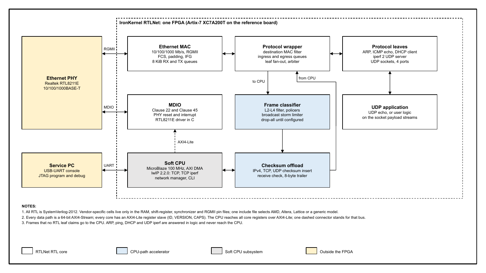

# RTLNet Ethernet/IPv4 stack for FPGAs

RTLNet handles ARP, ping, DHCP and UDP in FPGA logic. Its optional processor path adds TCP services, hardware checksum offload and a configurable firewall. Ethernet reference designs run on the Digilent Nexys Video and Arty A7-100T.

**Markdown design guide for AI-assisted integration.** Use the repository README with Claude or Codex to trace a packet from PHY to application, integrate the RTL and firmware, and select the matching board tests.

An FPGA application exchanges UDP payloads through AXI4-Stream. Protocol logic receives, classifies and answers traffic independently of firmware. Frames that need a software service reach lwIP through a protected DMA path. A serial console gives the operator access to link state, address configuration, service counters and classifier rules.

| Reference image | Nexys Video | Arty A7-100T |
|---|---|---|
| FPGA | AMD Artix-7 XC7A200T-1 | AMD Artix-7 XC7A100T-1 |
| PHY and interface | Realtek RTL8211E, RGMII | TI DP83848J, MII |
| Tested full-duplex links | 10, 100 and 1,000 Mb/s | 10 and 100 Mb/s |
| Ethernet firmware | 100 MHz MicroBlaze V, 512 KiB local RAM | 100 MHz MicroBlaze V, 256 KiB local RAM |
| CPU frame buffer | 128 KiB | 64 KiB |
| Hardware services | ARP, ICMP echo, DHCP, UDP sockets, echo and iperf 2 UDP | Same network services |

**Measured at gigabit speed.** With the Nexys CPU-path firewall enabled, the wired test delivered 942 Mb/s of UDP from PC to board and 944 Mb/s from board to PC, with zero reported datagram loss in both runs. TCP averaged 337.7 and 280.3 Mb/s in the same directions.

## How packets move through RTLNet

**Figure 1.** The Nexys Video data path. The Arty design connects an MII MAC to the same protocol and application interfaces.

| Function | Behavior |
|---|---|
| Ethernet and PHY | The MAC handles frame checks, padding and the inter-frame gap. MDIO provides PHY discovery, link negotiation and diagnostics. |
| Receive dispatch | The wrapper checks the destination MAC and presents each frame to the protocol blocks. Traffic claimed in hardware stays on the hardware path. Unclaimed frames are candidates for the CPU. |
| Hardware UDP | Bound sockets expose payload streams with metadata. UDP echo and the iperf 2 server exercise receive and transmit independently of the CPU. |
| CPU protection | L2–L4 classification, policers and a configurable allow list govern traffic reaching the CPU. The boot protection profile limits broadcast traffic. The optional default-deny firewall admits ARP and enabled TCP services. |
| Software TCP | MicroBlaze V runs lwIP TCP echo and iperf 2. Hardware patches outbound checksums and verifies received traffic. The wrapper arbitrates replies and outbound CPU frames at frame boundaries. |

The Ethernet-only images use on-chip RAM. The Nexys media demonstration streams encoded color bars using companion IronCapture and IronH264 IP. The networking interfaces also serve applications that generate their own payloads.

## Throughput measured on hardware

A wired PC and unmanaged switch connected each board to the iperf 2 peer. The figures below come from the released Ethernet-only images. Columns report traffic directions separately. TCP figures are means of three runs.

| Board and negotiated link | Firewall | UDP PC → board | UDP board → PC | TCP PC → board | TCP board → PC |
|---|---|---:|---:|---:|---:|
| Nexys, 1,000 Mb/s | On | 942.0 | 944.0 | 337.7 | 280.3 |
| Nexys, 1,000 Mb/s | Off | 943.0 | 944.0 | 336.0 | 281.0 |
| Nexys, 100 Mb/s | Off | 94.0 | 94.4 | 94.7 | 94.9 |
| Arty, 100 Mb/s | Off | 94.0 | 94.4 | 94.5 | 94.9 |
| Arty, 10 Mb/s | Off | 9.4 | 9.4 | 9.5 | 9.5 |

All throughput values are Mb/s of reported application traffic. UDP used the 90% offered-load setting. The gigabit firewall-off run reported 20 lost datagrams from board to PC and zero in the reverse direction. Both firewall-on gigabit runs and both Arty UDP directions shown reported zero loss.

**Latency.** On the Nexys gigabit link with the firewall enabled, a 64-byte UDP echo averaged 0.166 ms round trip (p99 0.213 ms). TCP echo averaged 0.198 ms (p99 0.234 ms). These are application round-trip measurements through the switch and host.

## FPGA resources

| Routed Ethernet design | LUTs | Flip-flops | Block RAM tiles | DSPs | Setup / hold slack |
|---|---:|---:|---:|---:|---:|
| Nexys Video | 23,891 | 33,968 | 228.5 | 6 | +0.154 / +0.012 ns |
| Arty A7-100T | 24,981 | 36,059 | 105.5 | 6 | +0.142 / +0.051 ns |

The Vivado 2026.1 build records include the processor, local memory, DMA, classifier, PHY management and protocol logic. These totals apply to the complete reference images.

## Reference designs and evaluation

| Application | Starting point |
|---|---|
| FPGA instrument or data source | Connect application logic to a hardware UDP socket. The socket supplies packet metadata and streams payloads over the 64-bit internal bus. |
| Networked control endpoint | Use the MicroBlaze V configuration for TCP, CLI and diagnostic services. Read hardware counters to distinguish protocol traffic from packets admitted to the CPU. |
| Board evaluation | Load the appropriate Nexys or Arty Ethernet image over JTAG. Inspect the negotiated link and DHCP address over the 115200-baud console, then exercise ping, UDP echo and bidirectional iperf 2. |
| Multimedia system | The Nexys media configuration adds DDR, frame management and companion video IP. Its resource and performance results belong to that configuration. |

Nexys Video supports a gigabit PHY. The Arty A7-100T reference uses a 10/100 PHY. The 64-bit internal packet stream is an integration interface; measured link rates are those of the selected MAC, PHY and board.

## Contact IronKernel

IronKernel provides FPGA network design, IP integration, hardware design review, board bring-up, embedded Linux and bare-metal firmware. For a reference design, source licensing or custom development, send your target board and project goal. Include the Ethernet PHY, required line rate and whether the application needs hardware UDP, software TCP or both.

[IronKernel.com](https://ironkernel.com/) · [support@ironkernel.com](mailto:support@ironkernel.com)

