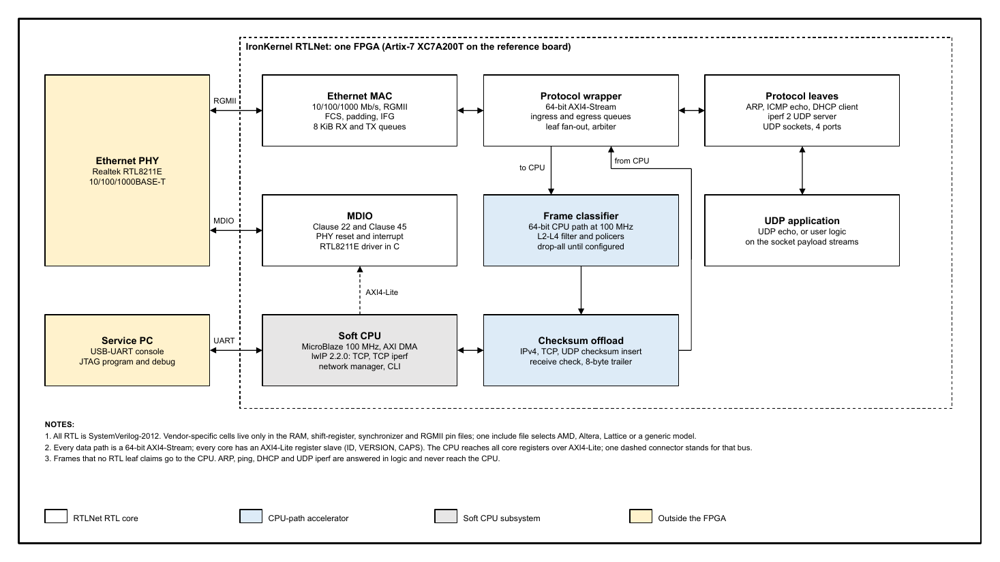
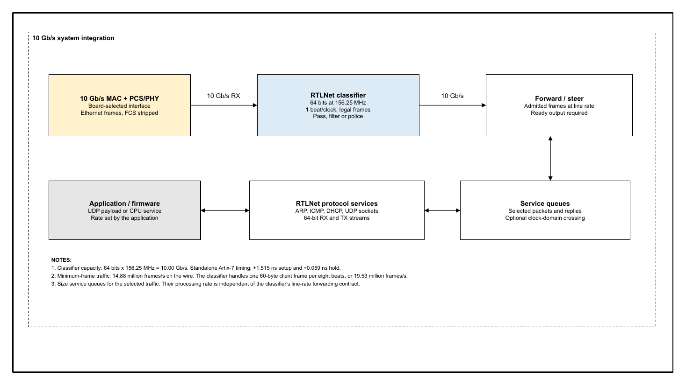
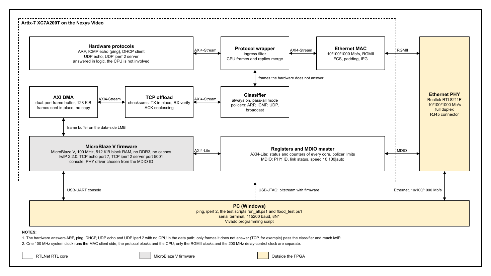
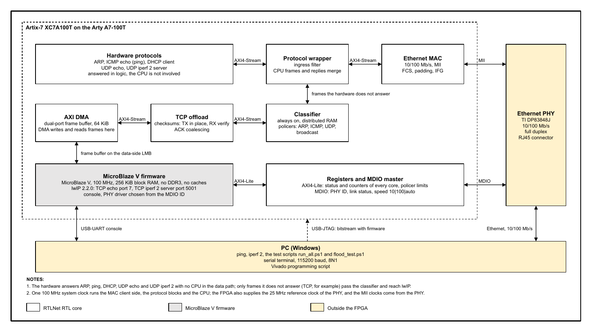
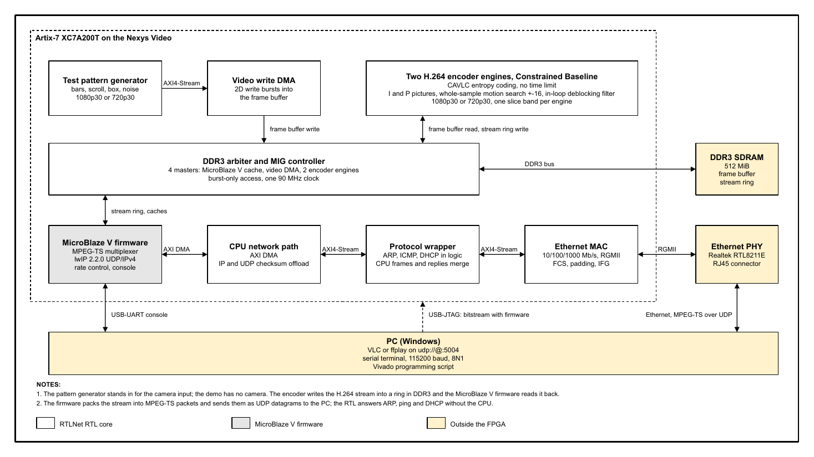
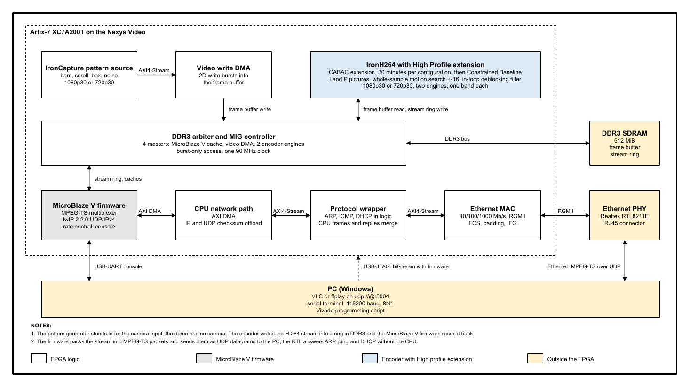
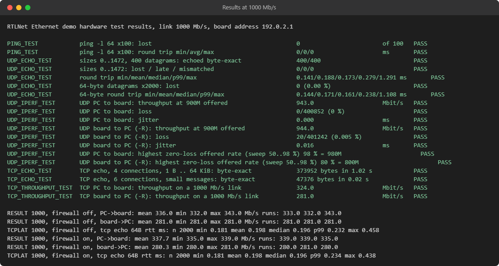

# RTLNet Specification

RTLNet handles ARP, ping, DHCP and UDP in FPGA logic. Its optional processor path adds TCP services, hardware checksum offload and a configurable firewall. Ethernet reference designs run on the Digilent Nexys Video and Arty A7-100T.

**Markdown design guide for AI-assisted integration.** Use the repository README with Claude or Codex to trace a packet from PHY to application, integrate the RTL and firmware, and select the matching board tests.

An FPGA application exchanges UDP payloads through AXI4-Stream. Protocol logic receives, classifies and answers traffic independently of firmware. Frames that need a software service reach lwIP through a protected DMA path. A serial console gives the operator access to link state, address configuration, service counters and classifier rules.

| Reference image | Nexys Video | Arty A7-100T |
|---|---|---|
| FPGA | AMD Artix-7 XC7A200T-1 | AMD Artix-7 XC7A100T-1 |
| PHY and interface | Realtek RTL8211E, RGMII | TI DP83848J, MII |
| Tested full-duplex links | 10, 100 and 1,000 Mb/s | 10 and 100 Mb/s |
| Ethernet firmware | 100 MHz MicroBlaze V, 512 KiB local RAM | 100 MHz MicroBlaze V, 256 KiB local RAM |
| CPU Ethernet packet RAM | 128 KiB | 64 KiB |
| Hardware services | ARP, ICMP echo, DHCP, UDP sockets, echo and iperf 2 UDP | Same network services |

**Measured at gigabit speed.** With the Nexys CPU-path firewall enabled, the wired test delivered 942 Mb/s of UDP from PC to board and 944 Mb/s from board to PC, with zero reported datagram loss in both runs. TCP averaged 337.7 and 280.3 Mb/s in the same directions.

## How packets move through RTLNet

**Figure 1.** The Nexys Video data path. The Arty design connects an MII MAC to the same protocol and application interfaces.

| Function | Behavior |
|---|---|
| Ethernet and PHY | The MAC handles frame checks, padding and the inter-frame gap. MDIO provides PHY discovery, link negotiation and diagnostics. |
| Receive dispatch | The wrapper checks the destination MAC and presents each frame to the protocol blocks. Traffic claimed in hardware stays on the hardware path. Unclaimed frames are candidates for the CPU. |
| Hardware UDP | Bound sockets expose payload streams with metadata. UDP echo and the iperf 2 server exercise receive and transmit independently of the CPU. |
| CPU protection | L2–L4 classification, policers and a configurable allow list govern traffic reaching the CPU. At boot firmware installs per-class policers, including broadcast limits. The optional default-deny firewall admits ARP and enabled TCP services. |
| Software TCP | MicroBlaze V runs lwIP TCP echo and iperf 2. Hardware patches outbound checksums and verifies received traffic. The wrapper arbitrates replies and outbound CPU frames at frame boundaries. |

The MAC client interface uses 64-bit AXI4-Stream. Byte zero occupies the low byte lane. TKEEP marks valid lanes on the final beat and TLAST ends the frame. The Ethernet-only images use on-chip RAM. The Nexys media demonstration streams encoded color bars using companion IronCapture and IronH264 IP. The networking interfaces also serve applications that generate their own payloads.

## Ethernet MAC and PHY management

### Ethernet MAC (rtlnet_eth_mac)

The MAC connects a full-duplex PHY to a 64-bit frame stream. Nexys Video uses RGMII at 10, 100 or 1,000 Mb/s. Arty uses the four-bit MII implementation at 10 or 100 Mb/s. Both accept a whole Ethernet frame from the client, pad a short transmission, append the FCS and enforce the inter-frame gap. On receive the MAC checks and strips the FCS. Store-and-forward queues cross from the PHY clocks to the client clock.

### PHY management (rtlnet_mdio)

Firmware uses MDC and MDIO to identify the PHY, manage negotiation and read link speed and duplex. The MDIO driver supports Clause 22 and Clause 45 accesses. In the Nexys design firmware programs the MAC speed from the RTL8211E status and the receive-clock detector qualifies it. On Arty the DP83848 supplies the MII clocks. Check link status, then MAC frame and error counters, before debugging an IP service.

### Protocol wrapper (rtlnet_eth_protocol)

The wrapper owns the local MAC and IPv4 configuration. It filters ingress by destination MAC and queues accepted frames across the MAC and protocol clocks. Each enabled protocol leaf sees the frame and can claim it. With the CPU path enabled, unclaimed frames enter its receive queue. On transmit the arbiter selects a source for a complete frame in fixed priority order, from UDP socket, ICMP, ARP, DHCP and iperf through to CPU traffic. A stalled CPU receiver and a stalled UDP application have separate queues and counters.

## Hardware UDP and IPv4 services

### UDP socket (rtlnet_udp_socket)

Bind an enabled socket to a local UDP port. A matching datagram reaches the application's receive stream as two 64-bit metadata beats followed by zero to 1,472 payload bytes. The metadata identifies the socket, peer MAC, IPv4 address, port, flags and length. Payload begins in the low byte lane. A reply supplies destination metadata and the declared number of payload bytes. The core constructs Ethernet, IPv4 and UDP headers.

A receive FIFO absorbs application stalls until its slots fill. Socket counters distinguish delivered datagrams from drops. The receiver checks the IPv4 header checksum and can optionally verify a nonzero UDP checksum. The transmitter uses the zero checksum permitted for UDP over IPv4. A transmit length mismatch increments the drop count.

### UDP echo and throughput (rtlnet_udp_echo and rtlnet_iperf)

UDP echo returns the socket payload to the sender. A byte-exact comparison exercises metadata, payload alignment and final byte enables. The iperf 2 UDP server counts received bytes, sequence gaps and jitter. Reverse mode generates a timed stream toward the peer, so the two directions can be measured separately.

### Address and reachability services

| Core | Hardware service |
|---|---|
| rtlnet_arp | Answers ARP requests for the local IPv4 address with the configured MAC. |
| rtlnet_icmp | Echoes local IPv4 ping payloads and updates the checksums. The reference accepts up to 1,472 payload bytes. |
| rtlnet_dhcp | Acquires and renews an IPv4 lease and withdraws it on expiry. Firmware can read lease state. |

## 10 Gb/s interconnect and line-rate classification

**The classifier is rated for lossless inspection at 100% of a 10 Gb/s Ethernet link.** Its 64-bit AXI4-Stream datapath accepts one beat per 156.25 MHz clock. With a ready downstream consumer, every legal frame admitted by policy can pass at the input rate. Firewall and policer drops are intentional and counted separately.

| Core or interface | Capacity and evidence |
|---|---|
| 64-bit AXI4-Stream | 64 bits × 156.25 million transfers/s = 10.00 Gb/s, or 1.25 GB/s per direction. One transfer takes 6.4 ns. |
| rtlnet_classifier | Back-to-back 60-byte MAC-client frames take eight beats each. The testbench passed 200 such frames in 1,600 beats with input ready continuously. The standalone default block-RAM design closed at 156.25 MHz on XC7A200T-1 with +1.515 ns setup and +0.059 ns hold slack. |
| Minimum Ethernet frames | 64 bytes including FCS, eight preamble/SFD bytes and 12 inter-frame-gap byte times give 84 byte times per frame. At 10 Gb/s that is 14.88 million frames/s. The eight-beat classifier cadence can service 19.53 million minimum client frames/s. |
| ARP, DHCP, ICMP, UDP socket, echo and iperf | These services can exchange their selected packets on a 10 Gb/s interconnect. Frame queues can cross to a service clock. A directly clocked instance needs timing closure at 156.25 MHz. Queue depth, per-frame processing and the application determine sustained service throughput. |
| TCP checksum offload | 64-bit CPU DMA streams. RX adds one trailer beat per admitted frame. DMA and lwIP determine endpoint throughput. The core timing result and trailer contract are in its integration guide. |
| Ethernet MAC | A 10 Gb/s integration supplies a suitable MAC and PCS/PHY. The released RTLNet RGMII and MII images reach 1 Gb/s and 100 Mb/s respectively. |

## Classifier (rtlnet_classifier)

The Ethernet references place the classifier between the CPU receive queue and checksum offload. It acts on whole frames before DMA consumes a descriptor or lwIP spends CPU time. Hardware-claimed ARP, ping and UDP service traffic bypasses this instance. This placement protects the processor during a flood. Traffic can still occupy the physical link.

| Match engine | What it can select |
|---|---|
| Field tables | MAC address, EtherType, VLAN ID, IPv4 address or transport port, with exact, masked or range comparisons. |
| IPv4 tuple ACL | IP protocol, masked source and destination addresses, and source and destination port ranges in one entry. Port matching requires a supported, unfragmented TCP or UDP header. |
| Positional rules | Masked byte comparisons within a configurable prefix, 64 bytes by default. A rule can recognize a header pattern for counting or policing. |

### Filtering and the CPU firewall

The core resets to drop-all. Gating tables participate in the admission decision. Classify-only entries can count or police a match independently. The global modes are drop-all, pass-all, pass-on-match and drop-on-match. The Ethernet firmware can enable a default-deny policy that admits ARP and configured IPv4 tuples. A TCP service needs both a listener and an allow entry. The reference designs have 16 tuple slots on Nexys and eight on Arty. The driver can add a live tuple by writing its fields before setting its valid bit.

### Storm protection and counters

Four fixed-window policers bound CPU arrivals in frames per interval. The Ethernet protection profile allows 10 broadcast, 10 UDP, 20 ARP and 10 ICMP frames per respective 100 ms window. A frame selects one policer when matches overlap. Enabling the firewall replaces the UDP and ICMP classification tuples with the allow list and retains ARP and broadcast policing. Use the classifier counters to distinguish policy drops, exhausted budgets and internal overruns.

In the recorded Nexys test at 100,000 offered flood frames/s, the classifier dropped all 1,000,000 flood frames. Both boards passed 21 of 21 firewall checks. These measurements apply to the CPU path in the released Ethernet images.

## TCP checksum offload (rtlnet_tcp_offload)

On transmit, the core accepts CPU DMA frames, computes the IPv4 header and TCP or UDP checksum and inserts the results before the CPU TX queue. On receive it checks frames admitted by the classifier and appends an eight-byte result trailer for the DMA driver. Firmware inspects the result and removes the trailer before passing the packet to lwIP. The trailer stays on the internal CPU path. lwIP retains TCP connection state, retransmission and flow control.

Both directions are pass-through after reset. Firmware can enable TX and RX offload separately. Build-time options include pure TCP ACK coalescing and receive batching. The driver and receive buffer layout must support the selected options.

### Shared primitives (rtlnet_common)

Packet FIFOs, register slices, synchronizers, reset release and AXI4-Lite helpers implement the queue and clock boundaries. Use the frame counters on each side of a boundary to separate a classifier decision from a stalled DMA consumer.

| Observation from the released images | What it tests |
|---|---|
| Firewall suite passed 21/21 checks on both boards | Admitted service traffic reaches the listener and disallowed traffic is discarded before CPU processing. |
| Byte-exact TCP echo remained available on Arty during the recorded protection test | Classifier drops and policers protect the CPU. Saturating the physical link can still increase end-to-end latency. |
| Nexys sustained 942 Mb/s receive and 944 Mb/s transmit in separate hardware UDP runs with the firewall enabled | The firewall governs CPU-bound traffic. The UDP test generator and responder run in fabric. |

**Control interface.** The Ethernet boards share 32-bit AXI4-Lite register windows for the system, MAC, MDIO, UDP echo and protocol wrapper. The classifier and checksum registers occupy subwindows of the protocol block. Read the MAC frame counters, then protocol claims, classifier drops, checksum status and DMA completion to locate where traffic stopped.

| Ethernet image register region | CPU byte address |
|---|---|
| System, MAC, MDIO, UDP echo | 0x44A00000, 0x44A01000, 0x44A02000, 0x44A03000 |
| Protocol wrapper and leaves | 0x44A10000, followed by ARP, ICMP, DHCP, iperf and UDP sockets at successive 4 KiB offsets |
| Classifier and checksum offload | 0x44A18000 and 0x44A19000 |

## Nexys Video Ethernet reference

The XC7A200T design connects the RTLNet RGMII MAC to a Realtek RTL8211E PHY. The 100 MHz MicroBlaze V uses 512 KiB of local program memory and 128 KiB of on-chip Ethernet packet RAM. Its firmware runs lwIP TCP echo and iperf 2 alongside the hardware UDP services.

**Figure 2.** Nexys Video Ethernet-only design. The released image is `eth_fw2`, hardware revision `2c2c686b` and firmware revision `f82d4f1`.

On the 1 Gb/s link, software TCP reached 336.0 Mb/s receive and 281.0 Mb/s transmit with the firewall off. Hardware UDP reached 943 and 944 Mb/s. With the firewall on, the 64-byte TCP echo averaged 0.198 ms round trip. Link negotiation, address assignment and enabled services are visible on the 115200-baud console.

## Arty A7-100T Ethernet reference

The XC7A100T uses a TI DP83848J PHY and the four-bit MII MAC. A 100 MHz MicroBlaze V runs the same Ethernet firmware in 256 KiB of local program memory with 64 KiB of Ethernet packet RAM. The PHY supports full-duplex 10 and 100 Mb/s operation.

**Figure 3.** Arty Ethernet-only design. The released image is `arty_fw2`, hardware revision `ab3e1d17` and firmware revision `f82d4f1`.

On the 100 Mb/s link, TCP averaged 94.5 Mb/s receive and 94.9 Mb/s transmit with the firewall off. UDP reached 94.0 and 94.4 Mb/s with zero reported loss. The measured 64-byte UDP echo averaged 0.165 ms round trip. On a 10 Mb/s link both TCP directions averaged 9.5 Mb/s.

## Throughput measured on hardware

A wired PC and unmanaged switch connected each board to the iperf 2 peer. The figures below come from the released Ethernet-only images. Columns report traffic directions separately. TCP figures are means of three runs.

| Board and negotiated link | Firewall | UDP PC → board | UDP board → PC | TCP PC → board | TCP board → PC |
|---|---|---:|---:|---:|---:|
| Nexys, 1,000 Mb/s | On | 942.0 | 944.0 | 337.7 | 280.3 |
| Nexys, 1,000 Mb/s | Off | 943.0 | 944.0 | 336.0 | 281.0 |
| Nexys, 100 Mb/s | On | 93.9 | 94.4 | 94.5 | 94.9 |
| Nexys, 100 Mb/s | Off | 94.0 | 94.4 | 94.7 | 94.9 |
| Nexys, 10 Mb/s | Off | 9.4 | 9.4 | 9.5 | 9.5 |
| Arty, 100 Mb/s | Off | 94.0 | 94.4 | 94.5 | 94.9 |
| Arty, 10 Mb/s | Off | 9.4 | 9.4 | 9.5 | 9.5 |

All throughput values are Mb/s of reported application traffic. UDP used the 90% offered-load setting. The gigabit firewall-off run reported 20 lost datagrams from board to PC and zero in the reverse direction. Both firewall-on gigabit runs and both Arty UDP directions shown reported zero loss.

**Latency.** On the Nexys gigabit link with the firewall enabled, a 64-byte UDP echo averaged 0.166 ms round trip (p99 0.213 ms). TCP echo averaged 0.198 ms (p99 0.234 ms). These are application round-trip measurements through the switch and host.

## FPGA resources

| Routed Ethernet design | LUTs | Flip-flops | Block RAM tiles | DSPs | Setup / hold slack |
|---|---:|---:|---:|---:|---:|
| Nexys Video | 23,891 | 33,968 | 228.5 | 6 | +0.154 / +0.012 ns |
| Arty A7-100T | 24,981 | 36,059 | 105.5 | 6 | +0.142 / +0.051 ns |

The Vivado 2026.1 build records include the processor, local memory, DMA, classifier, PHY management and protocol logic. These totals apply to the complete reference images.

## DDR and frame-management cores

The Nexys media image adds a 512 MiB DDR3L memory subsystem. The pattern source supplies a 32-bit stream of packed YUV422 pixel pairs. Frames move through DDR before encoding. The CPU receives completed bitstream records and sends MPEG transport packets over UDP.

| RTLNet core | Role in a memory-backed design |
|---|---|
| `rtlnet_vdma_s2mm` | Writes a two-dimensional pixel stream into a granted DDR slot. It packs pixel pairs into AXI beats, tracks line and frame boundaries, and reports completion to the slot manager. |
| `rtlnet_framebuf` | Tracks free, latest and held frame slots. It hands out DDR addresses, publishes completed-frame metadata and prevents reuse while a reader holds a slot. Pixel bytes reside in DDR. The Nexys design uses three 4 MiB slots. |
| `rtlnet_axi_arbiter` | Combines CPU, video writer and encoder memory masters onto the DDR port. The configurable high-priority group is served before round-robin clients. Burst guards and per-master counters expose memory service. |
| `rtlnet_ddr` | Wraps the board memory controller as an AXI4 slave and exposes its user clock, reset and calibration state. Nexys uses a 128-bit AXI interface at 90 MHz. |
| `rtlnet_axi_cdc` | Bridges independent AXI4 clocks using queues for address, data and response channels. It preserves transaction ordering when a board integration spans clock domains. |

### Companion cores and image boundaries

IronCapture supplies the receiver and pattern generator. IronH264 supplies the Baseline encoder. The optional IronH264 High Profile extension supplies CABAC in the timed Nexys image. The current RTLNet build binds the two companion core trees using a pinned manifest. The published media results on the next pages identify the bitstreams that produced them.

The media source in both Nexys images is the internal pattern. Their external camera input is tied off. Physical camera capture on Zybo is a separate IronForge Linux reference.

## Nexys Video H.264 Baseline reference

The `rel_base_dbk` image runs two IronH264 engines at 90 MHz. Each encodes one band of a 720p30 or 1080p30 picture. The encoder uses Constrained Baseline CAVLC, I and P pictures and in-loop deblocking. MicroBlaze firmware reads the encoded rings, multiplexes MPEG-TS and sends it through lwIP and the RTLNet MAC to UDP port 5004.

**Figure 4.** Nexys Baseline data path, released hardware revision `6fc46373`. The bitstream runs continuously.

| On-board test | Recorded result |
|---|---|
| 1080p30, combined moving pattern, QP 28, 10-minute soak | 18,002 pictures, zero dropped, 27.54 Mb/s and minimum measured PSNR of 44.28 dB |
| 1080p30 rate control, same pattern | 7.99–8.02 Mb/s at an 8 Mb/s target and 15.99–16.01 Mb/s at 16 Mb/s |
| 720p30, combined pattern, QP 28 | 18.17 Mb/s, zero pictures dropped |
| Routed image | 94,557 LUTs, 89,000 flip-flops, 292.5 BRAM tiles, 84 DSPs and +0.156 ns setup slack |

## Nexys Video H.264 High Profile evaluation

The evaluation image adds CABAC to the two encoder engines. Its tool mask selects CABAC with 4 × 4 transforms. The evaluation interval is 30 minutes from FPGA configuration. At expiry the encoder issues an IDR picture and continues the same UDP stream in Constrained Baseline.

**Figure 5.** Timed High Profile image, released hardware revision `f4f7d4b1`. The Ethernet and memory transport follow the Baseline reference.

| 1080p30 board measurement | Baseline CAVLC | High Profile CABAC |
|---|---:|---:|
| Combined motion/noise pattern, QP 28 | 27.23 Mb/s | 23.83 Mb/s |
| Scrolling bars, QP 28 | 0.52 Mb/s | 0.25 Mb/s |
| Ten-minute combined-pattern soak | 18,002 pictures, zero dropped | 18,002 pictures, zero dropped |
| Soak bitrate | 27.54 Mb/s | 24.02 Mb/s |

The recorded transition occurred 1,799.82 seconds after configuration. The receiver recorded 59,404 pictures over 1,980 seconds with zero drops. The routed image used 74.51% of LUTs and met setup timing by +0.167 ns. These bitrates describe the specified synthetic scenes and encoder settings.

## Checking the reference output

**Figure 6.** A frame decoded from the Nexys Baseline stream at 1080p30, QP 28. The bars expose color or packing errors, the moving checkerboard exercises inter prediction, and the noise band raises the bit demand. For the same geometry, scrolling bars alone required far fewer bits.

**Figure 7.** Nexys gigabit Ethernet release measurements. Use UDP loss counts as well as receive rate, and compare TCP in each direction. The soft CPU serves TCP even when hardware inserts and verifies its checksums.

## Reference designs and evaluation

| Application | Starting point |
|---|---|
| FPGA instrument or data source | Connect application logic to a hardware UDP socket. The socket supplies packet metadata and streams payloads over the 64-bit internal bus. |
| Networked control endpoint | Use the MicroBlaze V configuration for TCP, CLI and diagnostic services. Read hardware counters to distinguish protocol traffic from packets admitted to the CPU. |
| Board evaluation | Load the appropriate Nexys or Arty Ethernet image over JTAG. Inspect the negotiated link and DHCP address over the 115200-baud console, then exercise ping, UDP echo and bidirectional iperf 2. |
| Multimedia system | The Nexys media configuration adds DDR, frame management and companion video IP. Its resource and performance results belong to that configuration. |

Nexys Video supports a gigabit PHY. The Arty A7-100T reference uses a 10/100 PHY. The 64-bit internal packet stream is an integration interface. Measured link rates are those of the selected MAC, PHY and board.

### Running a released image

Program the selected board image over JTAG, open the UART at 115200 baud and read the negotiated link and DHCP address. For Ethernet, confirm ping and UDP echo before measuring each iperf 2 direction. For either Nexys media image, open `udp://@:5004` in VLC, then enter `enable`, select the picture mode and pattern, and issue `stream h264 <PC-address> 5004` on the board. Compare `show encoder` and `show stream` with the receiver’s picture count.

The RTLNet source-available license covers the network stack. The timed High Profile image has separate evaluation terms. Its package contains the configured demonstration bitstream. Contact IronKernel for source licensing or integration of the High Profile extension.

## Contact IronKernel

IronKernel provides FPGA network design, IP integration, hardware design review, board bring-up, embedded Linux and bare-metal firmware. For a reference design, source licensing or custom development, send your target board and project goal. Include the Ethernet PHY, required line rate and whether the application needs hardware UDP, software TCP or both.

[IronKernel.com](https://ironkernel.com/) · [support@ironkernel.com](mailto:support@ironkernel.com)

