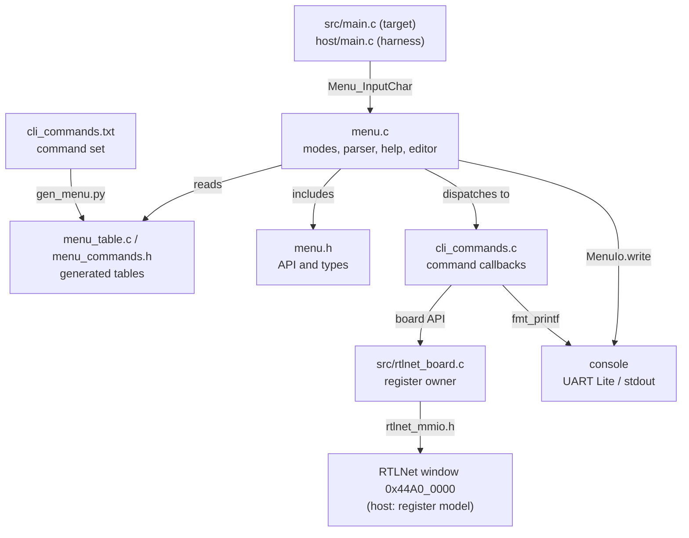
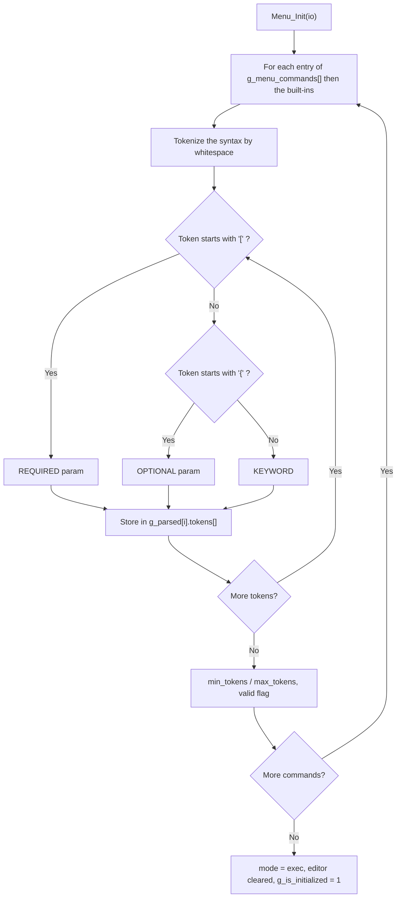
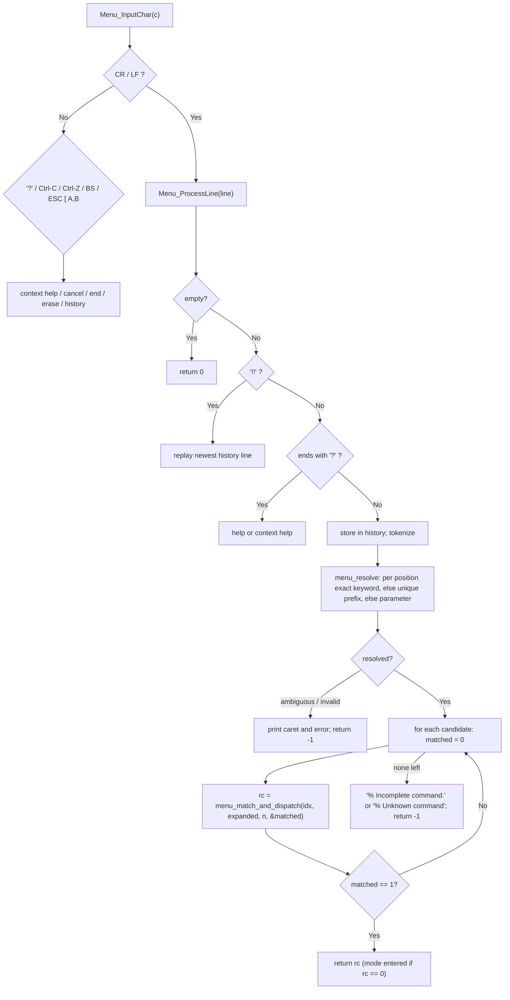
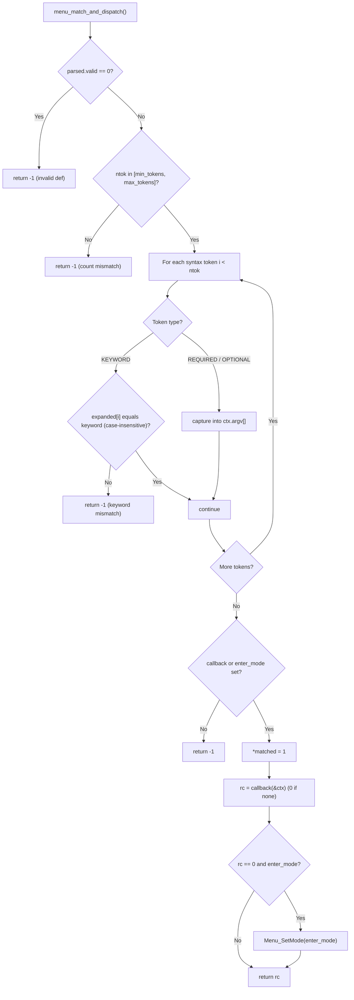
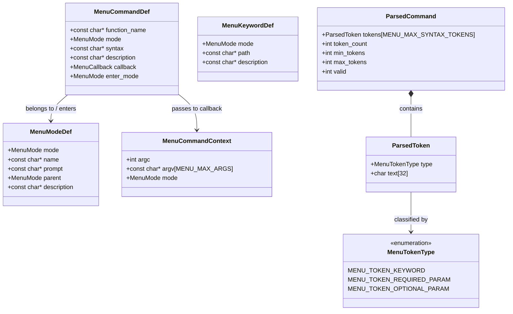
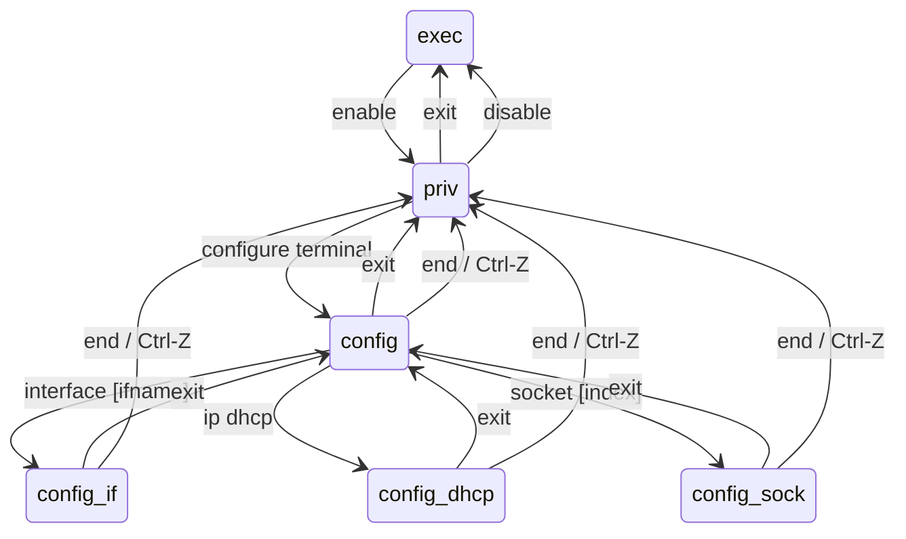

<!--
Copyright (C) 2026 — Generated by MenuBuilder AI, inspired by Steve Spano
                      (SteveSpano009@gmail.com)

This file is free software; you can redistribute it and/or
modify it under the terms of the GNU Lesser General Public
License as published by the Free Software Foundation; either
version 2.1 of the License, or (at your option) any later version.

This file is distributed in the hope that it will be useful,
but WITHOUT ANY WARRANTY; without even the implied warranty of
MERCHANTABILITY or FITNESS FOR A PARTICULAR PURPOSE.  See the GNU
Lesser General Public License for more details.

You should have received a copy of the GNU Lesser General Public
License along with this library; if not, write to the Free Software
Foundation, Inc., 51 Franklin Street, Fifth Floor, Boston, MA  02110-1301
USA

SPDX-License-Identifier: LGPL-2.1-or-later
-->

# RTLNet Nexys Video CLI — MenuDocumentation

| Item | Value |
|---|---|
| Revision | 10-22-2026 (newest row of the revision history in cli/cli_commands.txt) |
| Generated | 2026-10-22 00:00:00 -04:00 by cli/gen_menu.py from cli/cli_commands.txt |
| Commands | 42 table entries (5 mode-entry), 12 keyword groups, 3 built-ins (exit, end, help) |

## 1. Title and overview

The firmware console of the RTLNet Nexys Video board is a light-weight hierarchical command
line in the style of a network switch: user exec (`rtlnet>`), privileged exec (`rtlnet#`,
`enable`/`disable`), global configuration (`configure terminal`) and three configuration
sub-modes. It follows the MenuBuilder rules (explicit `matched` dispatch, aligned help, HELP
and `?` aliases, LGPL headers, revision table) extended by `MenuBuilder_hierarchical.md`:
modes and prompts, `exit`/`end`/Ctrl-Z, context-sensitive `?`, unique-prefix abbreviation,
backspace editing, history (`!!`, up/down arrow) and `no` forms.

The same engine and command callbacks build for the MicroBlaze target (UART console, no C
library) and for the desktop harness (stdin/stdout, register model), whose `--demo` session
checks the parser and the mode logic.

## 2. Architecture overview



## 3. Initialization flow



## 4. Command processing and dispatch flow



## 5. Token matching detail



## 6. Data structures



### 6.1 Mode tree



| Mode | Prompt | Entered by | `exit` returns to |
|---|---|---|---|
| exec | `rtlnet>` | start-up | — (stays) |
| priv | `rtlnet#` | `enable` in exec | exec |
| config | `rtlnet(config)#` | `configure terminal` in priv | priv |
| config-if | `rtlnet(config-if)#` | `interface [ifname]` in config | config |
| config-dhcp | `rtlnet(config-dhcp)#` | `ip dhcp` in config | config |
| config-sock | `rtlnet(config-sock)#` | `socket [index]` in config | config |

## 7. Command reference

One row per command line of cli/cli_commands.txt (MODE-ENTER lines included). Min/Max are
token counts; exec commands are also accepted in priv.

| # | Function | Mode | Command Syntax | Required | Optional | Min | Max | Enters | Description |
|---|---|---|---|---|---|---|---|---|---|
| 1 | - | exec | `ENABLE` | — | — | 1 | 1 | priv | Enter privileged exec mode |
| 2 | - | priv | `CONFIGURE TERMINAL` | — | — | 2 | 2 | config | Enter global configuration mode |
| 3 | cli_enter_interface | config | `INTERFACE [IFNAME]` | IFNAME | — | 2 | 2 | config-if | Configure an interface (eth0) |
| 4 | - | config | `IP DHCP` | — | — | 2 | 2 | config-dhcp | Configure the DHCP client |
| 5 | cli_enter_socket | config | `SOCKET [INDEX]` | INDEX | — | 2 | 2 | config-sock | Configure a UDP socket (index 0..3) |
| 6 | cli_show_version | exec | `SHOW VERSION` | — | — | 2 | 2 | — | Board, register map, build and firmware identity |
| 7 | cli_show_system | exec | `SHOW SYSTEM` | — | — | 2 | 2 | — | Clocks, uptime, switches, buttons and PHY pins |
| 8 | cli_show_interfaces | exec | `SHOW INTERFACES` | — | — | 2 | 2 | — | Ethernet interface status (MAC core) |
| 9 | cli_show_phy | exec | `SHOW PHY` | — | — | 2 | 2 | — | PHY link and registers (MDIO core) |
| 10 | cli_show_ip | exec | `SHOW IP` | — | — | 2 | 2 | — | IPv4 address, mask and gateway (protocol core) |
| 11 | cli_show_arp | exec | `SHOW ARP` | — | — | 2 | 2 | — | ARP responder status (ARP leaf) |
| 12 | cli_show_dhcp | exec | `SHOW DHCP` | — | — | 2 | 2 | — | DHCP client state and lease (DHCP leaf) |
| 13 | cli_show_iperf | exec | `SHOW IPERF` | — | — | 2 | 2 | — | iperf server statistics (iperf leaf) |
| 14 | cli_show_sockets | exec | `SHOW SOCKETS` | — | — | 2 | 2 | — | UDP socket table (UDP socket leaf) |
| 15 | cli_show_counters | exec | `SHOW COUNTERS` | — | — | 2 | 2 | — | MAC and protocol frame counters |
| 16 | cli_show_running | priv | `SHOW RUNNING-CONFIG` | — | — | 2 | 2 | — | Current configuration |
| 17 | cli_disable | priv | `DISABLE` | — | — | 1 | 1 | — | Leave privileged exec mode |
| 18 | cli_debug_read | priv | `DEBUG READ [ADDR]` | ADDR | — | 3 | 3 | — | Read a 32-bit word (hex 0x... or decimal address) |
| 19 | cli_debug_write | priv | `DEBUG WRITE [ADDR] [VALUE]` | ADDR, VALUE | — | 4 | 4 | — | Write a 32-bit word |
| 20 | cli_led_on | priv | `LED [N] ON` | N | — | 3 | 3 | — | Turn user LED n (2..7) on |
| 21 | cli_led_off | priv | `LED [N] OFF` | N | — | 3 | 3 | — | Turn user LED n (2..7) off |
| 22 | cli_reload | priv | `RELOAD` | — | — | 1 | 1 | — | Restart the firmware (soft restart) |
| 23 | cli_ip_gateway | config | `IP DEFAULT-GATEWAY [ADDR]` | ADDR | — | 3 | 3 | — | Set the IPv4 default gateway |
| 24 | cli_no_ip_gateway | config | `NO IP DEFAULT-GATEWAY` | — | — | 3 | 3 | — | Remove the IPv4 default gateway |
| 25 | cli_echo_enable | config | `ECHO ENABLE {SOCKET}` | — | SOCKET | 2 | 3 | — | Enable the UDP echo server (all sockets, or one) |
| 26 | cli_no_echo_enable | config | `NO ECHO ENABLE` | — | — | 3 | 3 | — | Disable the UDP echo server |
| 27 | cli_if_speed | config-if | `SPEED [MBPS]` | MBPS | — | 2 | 2 | — | Link speed: 10, 100, 1000 or auto |
| 28 | cli_if_autoneg | config-if | `AUTONEG` | — | — | 1 | 1 | — | Enable auto-negotiation |
| 29 | cli_if_no_autoneg | config-if | `NO AUTONEG` | — | — | 2 | 2 | — | Disable auto-negotiation (forced speed) |
| 30 | cli_if_shutdown | config-if | `SHUTDOWN` | — | — | 1 | 1 | — | Disable the interface |
| 31 | cli_if_no_shutdown | config-if | `NO SHUTDOWN` | — | — | 2 | 2 | — | Enable the interface |
| 32 | cli_if_ip_address | config-if | `IP ADDRESS [ADDR] [MASK]` | ADDR, MASK | — | 4 | 4 | — | Set the static IPv4 address and mask |
| 33 | cli_if_no_ip_address | config-if | `NO IP ADDRESS` | — | — | 3 | 3 | — | Remove the static IPv4 address |
| 34 | cli_dhcp_start | config-dhcp | `START` | — | — | 1 | 1 | — | Start DHCP discovery now |
| 35 | cli_dhcp_stop | config-dhcp | `STOP` | — | — | 1 | 1 | — | Stop the DHCP client and release the lease |
| 36 | cli_dhcp_auto | config-dhcp | `AUTO` | — | — | 1 | 1 | — | Start DHCP automatically on link up |
| 37 | cli_dhcp_no_auto | config-dhcp | `NO AUTO` | — | — | 2 | 2 | — | Do not start DHCP on link up |
| 38 | cli_sock_open | config-sock | `OPEN [PORT]` | PORT | — | 2 | 2 | — | Open the socket on a local UDP port |
| 39 | cli_sock_close | config-sock | `CLOSE` | — | — | 1 | 1 | — | Close the socket |
| 40 | cli_sock_remote | config-sock | `REMOTE [ADDR] [PORT]` | ADDR, PORT | — | 3 | 3 | — | Set the remote IPv4 address and UDP port |
| 41 | cli_sock_connect | config-sock | `CONNECT-ON-RECEIVE` | — | — | 1 | 1 | — | Follow the sender of the last datagram |
| 42 | cli_sock_no_connect | config-sock | `NO CONNECT-ON-RECEIVE` | — | — | 2 | 2 | — | Keep the configured remote address |

Built-ins (menu.c): `EXIT` (every mode), `END` (privileged and configuration modes), `HELP` and `?`
(every mode, identical listing), `!!` (repeat the previous line), Ctrl-C (cancel the line),
Ctrl-Z (`end`), Ctrl-U (erase the line), up/down arrow (history).

Keyword groups (help text when `?` lists a keyword shared by several commands):

| Mode | Keyword path | Description |
|---|---|---|
| exec | `SHOW` | Show running system information |
| priv | `DEBUG` | Raw register access |
| priv | `LED` | Set a user LED (2..7) |
| config | `IP` | Global IP configuration |
| config | `NO` | Negate a command or set its default |
| config | `NO ECHO` | UDP echo server |
| config | `ECHO` | UDP echo server |
| config-if | `IP` | Interface IP configuration |
| config-if | `NO` | Negate a command or set its default |
| config-if | `NO IP` | Interface IP configuration |
| config-dhcp | `NO` | Negate a command or set its default |
| config-sock | `NO` | Negate a command or set its default |

## 8. Build instructions

Desktop harness (host gcc), from `firmware/nexys_video`:

```
build.bat          REM compile and link build/menu.exe
build.bat run      REM build + interactive mode (stdin/stdout)
build.bat demo     REM build + scripted session, prints TEST PASS/FAIL
build.bat clean    REM remove build artifacts
build.bat firmware REM MicroBlaze firmware build/firmware.elf (mb-gcc)
```

```
make               # compile and link build/menu.exe
make run           # interactive
make demo          # scripted session
make clean
make firmware      # build/firmware.elf
```

PowerShell (both, plus the table check): `powershell -File build.ps1 [-Host] [-Demo] [-Check]`.
After editing cli/cli_commands.txt run `python cli/gen_menu.py`, then `python cli/check_menu.py`.
