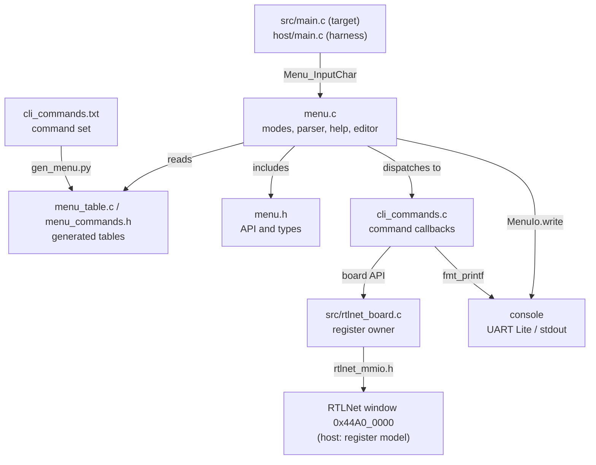
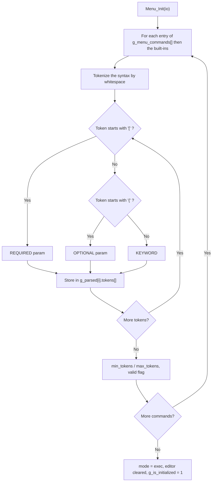
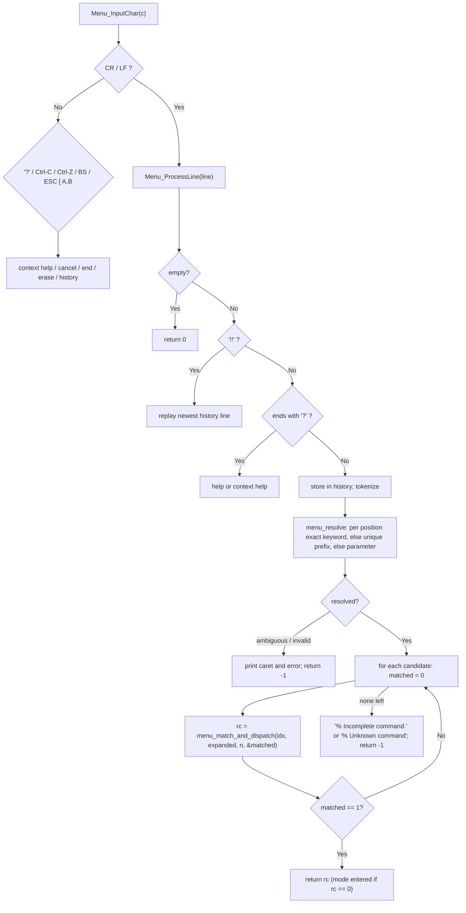
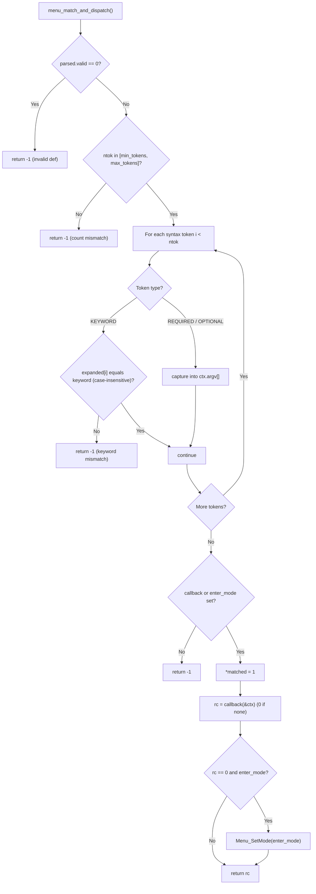
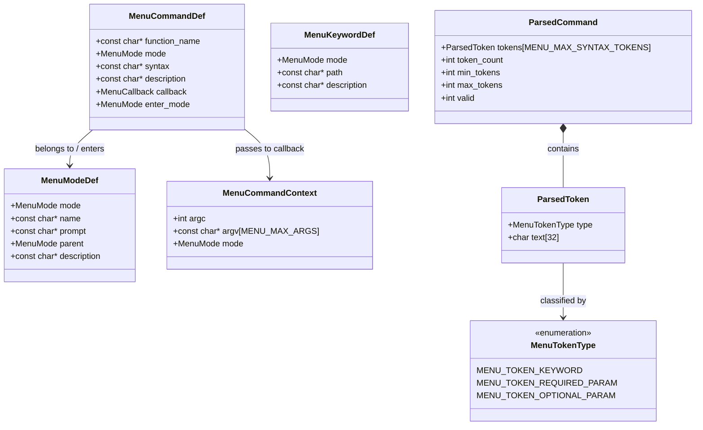
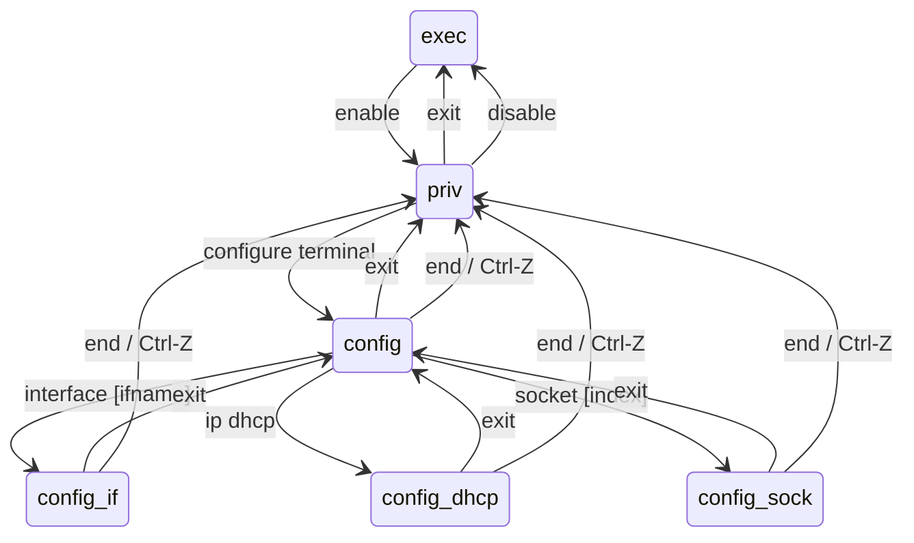

<!--
Copyright (C) 2026 — Generated by MenuBuilder AI, inspired by Steve Spano
                      (SteveSpano009@gmail.com)

This file is free software; you can redistribute it and/or
modify it under the terms of the GNU Lesser General Public
License as published by the Free Software Foundation; either
version 2.1 of the License, or (at your option) any later version.

This file is distributed in the hope that it will be useful,
but WITHOUT ANY WARRANTY; without even the implied warranty of
MERCHANTABILITY or FITNESS FOR A PARTICULAR PURPOSE.  See the GNU
Lesser General Public License for more details.

You should have received a copy of the GNU Lesser General Public
License along with this library; if not, write to the Free Software
Foundation, Inc., 51 Franklin Street, Fifth Floor, Boston, MA  02110-1301
USA

SPDX-License-Identifier: LGPL-2.1-or-later
-->

# RTLNet Nexys Video CLI — MenuDocumentation

| Item | Value |
|---|---|
| Revision | 11-10-2026 (newest row of the revision history in cli/cli_commands.txt) |
| Generated | 2026-11-10 00:00:00 -04:00 by cli/gen_menu.py from cli/cli_commands.txt |
| Commands | 99 table entries (5 mode-entry), 30 keyword groups, 3 built-ins (exit, end, help) |

## 1. Title and overview

The firmware console of the RTLNet Nexys Video board is a light-weight hierarchical command
line in the style of a network switch: user exec (`rtlnet>`), privileged exec (`rtlnet#`,
`enable`/`disable`), global configuration (`configure terminal`) and three configuration
sub-modes. It follows the MenuBuilder rules (explicit `matched` dispatch, aligned help, HELP
and `?` aliases, LGPL headers, revision table) extended by `MenuBuilder_hierarchical.md`:
modes and prompts, `exit`/`end`/Ctrl-Z, context-sensitive `?`, unique-prefix abbreviation,
backspace editing, history (`!!`, up/down arrow) and `no` forms.

The same engine and command callbacks build for the MicroBlaze target (UART console, no C
library) and for the desktop harness (stdin/stdout, register model), whose `--demo` session
checks the parser and the mode logic.

## 2. Architecture overview



## 3. Initialization flow



## 4. Command processing and dispatch flow



## 5. Token matching detail



## 6. Data structures



### 6.1 Mode tree



| Mode | Prompt | Entered by | `exit` returns to |
|---|---|---|---|
| exec | `rtlnet>` | start-up | — (stays) |
| priv | `rtlnet#` | `enable` in exec | exec |
| config | `rtlnet(config)#` | `configure terminal` in priv | priv |
| config-if | `rtlnet(config-if)#` | `interface [ifname]` in config | config |
| config-dhcp | `rtlnet(config-dhcp)#` | `ip dhcp` in config | config |
| config-sock | `rtlnet(config-sock)#` | `socket [index]` in config | config |

## 7. Command reference

One row per command line of cli/cli_commands.txt (MODE-ENTER lines included). Min/Max are
token counts; exec commands are also accepted in priv.

| # | Function | Mode | Command Syntax | Required | Optional | Min | Max | Enters | Description |
|---|---|---|---|---|---|---|---|---|---|
| 1 | - | exec | `ENABLE` | — | — | 1 | 1 | priv | Enter privileged exec mode |
| 2 | - | priv | `CONFIGURE TERMINAL` | — | — | 2 | 2 | config | Enter global configuration mode |
| 3 | cli_enter_interface | config | `INTERFACE [IFNAME]` | IFNAME | — | 2 | 2 | config-if | Configure an interface (eth0) |
| 4 | - | config | `IP DHCP` | — | — | 2 | 2 | config-dhcp | Configure the DHCP client |
| 5 | cli_enter_socket | config | `SOCKET [INDEX]` | INDEX | — | 2 | 2 | config-sock | Configure a UDP socket (index 0..3) |
| 6 | cli_show_version | exec | `SHOW VERSION` | — | — | 2 | 2 | — | Board, register map, build and firmware identity |
| 7 | cli_show_system | exec | `SHOW SYSTEM` | — | — | 2 | 2 | — | Clocks, uptime, switches, buttons and PHY pins |
| 8 | cli_show_interfaces | exec | `SHOW INTERFACES` | — | — | 2 | 2 | — | Ethernet link, MAC status and frame counters |
| 9 | cli_show_phy | exec | `SHOW PHY` | — | — | 2 | 2 | — | PHY identity, RX delay, link, advertisement and partner |
| 10 | cli_show_ip | exec | `SHOW IP` | — | — | 2 | 2 | — | Node MAC, static and effective IPv4 address, mask and gateway |
| 11 | cli_show_arp | exec | `SHOW ARP` | — | — | 2 | 2 | — | ARP responder counters |
| 12 | cli_show_dhcp | exec | `SHOW DHCP` | — | — | 2 | 2 | — | DHCP client state, lease and counters |
| 13 | cli_show_iperf | exec | `SHOW IPERF` | — | — | 2 | 2 | — | iperf servers: UDP (RTL core) and TCP (firmware, lwIP) |
| 14 | cli_show_sockets | exec | `SHOW SOCKETS` | — | — | 2 | 2 | — | UDP socket table, UDP echo and counters |
| 15 | cli_show_counters | exec | `SHOW COUNTERS` | — | — | 2 | 2 | — | Frame counters of every core |
| 16 | cli_show_tcp | exec | `SHOW TCP` | — | — | 2 | 2 | — | lwIP interface, TCP echo server, connections and counters |
| 17 | cli_show_cpu_path | exec | `SHOW CPU-PATH` | — | — | 2 | 2 | — | CPU network path: DMA frames and errors, wrapper CPU-path counters |
| 18 | cli_show_storm | exec | `SHOW STORM-CONTROL` | — | — | 2 | 2 | — | Broadcast storm limiter: policer 0 and its counters |
| 19 | cli_show_classifier | exec | `SHOW CLASSIFIER` | — | — | 2 | 2 | — | CPU-path classifier: mode, tables, ACL, policers, counters |
| 20 | cli_show_offload | exec | `SHOW OFFLOAD` | — | — | 2 | 2 | — | Checksum offload: discovery, CTRL, lwIP flags, counters, zero-copy options |
| 21 | cli_show_ddr | exec | `SHOW DDR` | — | — | 2 | 2 | — | DDR3 calibration, caches, arbiter identity, error status and counters |
| 22 | cli_show_camera | exec | `SHOW CAMERA` | — | — | 2 | 2 | — | Video source: mode, source switch, active source, frame rate and count |
| 23 | cli_show_framebuffer | exec | `SHOW FRAMEBUFFER` | — | — | 2 | 2 | — | Video frame buffer: slots, latest published frame, reference counts, write DMA |
| 24 | cli_show_stream | exec | `SHOW STREAM` | — | — | 2 | 2 | — | H.264 stream: pictures, bytes, bit rate, dropped pictures, TS packets and mux CPU load |
| 25 | cli_show_encoder | exec | `SHOW ENCODER` | — | — | 2 | 2 | — | H.264 encoder: QP, mode, status and per-engine cycle statistics |
| 26 | cli_show_running | priv | `SHOW RUNNING-CONFIG` | — | — | 2 | 2 | — | Current configuration |
| 27 | cli_disable | priv | `DISABLE` | — | — | 1 | 1 | — | Leave privileged exec mode |
| 28 | cli_ddr_test | priv | `DDR TEST {SIZE}` | — | SIZE | 2 | 3 | — | DDR3 memory test from 0x80000000: data bus, address bus, random fill and verify, with MB/s (SIZE in MiB, 1..512, default 16) |
| 29 | cli_camera_mode | priv | `CAMERA MODE [MODE]` | MODE | — | 3 | 3 | — | Video mode: 720p30 or 1080p30 (effective at the next frame) |
| 30 | cli_camera_source | priv | `CAMERA SOURCE [SOURCE]` | SOURCE | — | 3 | 3 | — | Video source: auto, camera or pattern |
| 31 | cli_camera_rate | priv | `CAMERA RATE [FPS]` | FPS | — | 3 | 3 | — | Frame rate in frames per second, 1..30 (30 is the reset value) |
| 32 | cli_framebuffer_crc | priv | `FRAMEBUFFER CRC` | — | — | 2 | 2 | — | CRC-32 of the latest published frame, read through the cache |
| 33 | cli_stream_h264 | priv | `STREAM H264 [IP] [PORT]` | IP, PORT | — | 4 | 4 | — | Start the H.264 MPEG-TS stream over UDP to a host (VLC: udp://@:PORT) |
| 34 | cli_stream_stop | priv | `STREAM STOP` | — | — | 2 | 2 | — | Stop the H.264 stream |
| 35 | cli_encoder_qp | priv | `ENCODER QP [QP]` | QP | — | 3 | 3 | — | H.264 quantizer 0..51, fixed (the driver raises values below 12 to 12; default 28) |
| 36 | cli_encoder_gop | priv | `ENCODER GOP [GOP]` | GOP | — | 3 | 3 | — | IDR picture every GOP pictures, P pictures between, 1..255 (1 = all IDR; default 30) |
| 37 | cli_debug_read | priv | `DEBUG READ [ADDR]` | ADDR | — | 3 | 3 | — | Read a 32-bit word (hex 0x... or decimal address) |
| 38 | cli_debug_write | priv | `DEBUG WRITE [ADDR] [VALUE]` | ADDR, VALUE | — | 4 | 4 | — | Write a 32-bit word |
| 39 | cli_phy_read | priv | `PHY READ [REG]` | REG | — | 3 | 3 | — | Read a PHY register (0..31) over MDIO |
| 40 | cli_phy_write | priv | `PHY WRITE [REG] [VALUE]` | REG, VALUE | — | 4 | 4 | — | Write a PHY register (0..31) over MDIO |
| 41 | cli_phy_dump | priv | `PHY DUMP` | — | — | 2 | 2 | — | Read PHY registers 0..31 |
| 42 | cli_phy_mmd_read | priv | `PHY MMD READ [DEVAD] [REG]` | DEVAD, REG | — | 5 | 5 | — | Read an MMD register (Clause 45 over Clause 22) |
| 43 | cli_phy_mmd_write | priv | `PHY MMD WRITE [DEVAD] [REG] [VALUE]` | DEVAD, REG, VALUE | — | 6 | 6 | — | Write an MMD register (Clause 45 over Clause 22) |
| 44 | cli_phy_c45_read | priv | `PHY C45 READ [DEVAD] [REG]` | DEVAD, REG | — | 5 | 5 | — | Native Clause 45 read (the RTL8211E answers only phy mmd) |
| 45 | cli_phy_c45_write | priv | `PHY C45 WRITE [DEVAD] [REG] [VALUE]` | DEVAD, REG, VALUE | — | 6 | 6 | — | Native Clause 45 write (the RTL8211E answers only phy mmd) |
| 46 | cli_phy_reset | priv | `PHY RESET` | — | — | 2 | 2 | — | Hardware PHY reset, then InitPHY (RX delay, LEDs, EEE, advertisement) |
| 47 | cli_clear_counters | priv | `CLEAR COUNTERS` | — | — | 2 | 2 | — | Clear the counters of every core |
| 48 | cli_led_on | priv | `LED [N] ON` | N | — | 3 | 3 | — | Turn user LED n (2..7) on |
| 49 | cli_led_off | priv | `LED [N] OFF` | N | — | 3 | 3 | — | Turn user LED n (2..7) off |
| 50 | cli_reload | priv | `RELOAD` | — | — | 1 | 1 | — | Restart the firmware (soft restart) |
| 51 | cli_ip_gateway | config | `IP DEFAULT-GATEWAY [ADDR]` | ADDR | — | 3 | 3 | — | Set the static IPv4 default gateway |
| 52 | cli_no_ip_gateway | config | `NO IP DEFAULT-GATEWAY` | — | — | 3 | 3 | — | Remove the static default gateway (0.0.0.0) |
| 53 | cli_echo_enable | config | `ECHO ENABLE {SOCKET}` | — | SOCKET | 2 | 3 | — | Enable the UDP echo server (configured socket, or the one given) |
| 54 | cli_no_echo_enable | config | `NO ECHO ENABLE` | — | — | 3 | 3 | — | Disable the UDP echo server |
| 55 | cli_echo_socket | config | `ECHO SOCKET [INDEX]` | INDEX | — | 3 | 3 | — | Echo on socket 0..3, or "any" |
| 56 | cli_iperf_port | config | `IPERF PORT [PORT]` | PORT | — | 3 | 3 | — | iperf server UDP port (default 5001) |
| 57 | cli_iperf_tcp_enable | config | `IPERF TCP ENABLE` | — | — | 3 | 3 | — | Enable the TCP iperf server |
| 58 | cli_iperf_tcp_disable | config | `IPERF TCP DISABLE` | — | — | 3 | 3 | — | Disable the TCP iperf server |
| 59 | cli_iperf_tcp_port | config | `IPERF TCP PORT [PORT]` | PORT | — | 4 | 4 | — | TCP iperf server port (default 5001) |
| 60 | cli_tcp_echo_enable | config | `TCP ECHO ENABLE` | — | — | 3 | 3 | — | Enable the TCP echo server |
| 61 | cli_tcp_echo_disable | config | `TCP ECHO DISABLE` | — | — | 3 | 3 | — | Disable the TCP echo server (open connections stay) |
| 62 | cli_tcp_echo_port | config | `TCP ECHO PORT [PORT]` | PORT | — | 4 | 4 | — | TCP echo server port (default 7) |
| 63 | cli_offload | config | `OFFLOAD [WHAT] [STATE]` | WHAT, STATE | — | 3 | 3 | — | Checksum offload: tx-ip, tx-l4, rx or all, on or off (as far as the build has it; lwIP follows) |
| 64 | cli_cls_mode | config | `CLASSIFIER MODE [MODE]` | MODE | — | 3 | 3 | — | Mode: drop-all, pass-all, pass-on-match or drop-on-match |
| 65 | cli_cls_policer | config | `CLASSIFIER POLICER [INDEX] [PKTS] [MS] {DISABLE}` | INDEX, PKTS, MS | DISABLE | 5 | 6 | — | Policer 0..3: frames per window in ms (or disable) |
| 66 | cli_cls_mac | config | `CLASSIFIER MAC [ENTRY] [WHICH] [MAC] {W1} {W2} {W3} {W4}` | ENTRY, WHICH, MAC | W1, W2, W3, W4 | 5 | 9 | — | MAC entry (0..15): dst\|src <mac> gate\|classify\|police <p> |
| 67 | cli_cls_ethertype | config | `CLASSIFIER ETHERTYPE [ENTRY] [TYPE] {W1} {W2} {W3} {W4}` | ENTRY, TYPE | W1, W2, W3, W4 | 4 | 8 | — | EtherType entry (0..7): <type> [to <type>] gate\|classify\|police <p> |
| 68 | cli_cls_acl | config | `CLASSIFIER ACL [ENTRY] [PROTO] {W1} {W2} {W3} {W4} {W5} {W6} {W7} {W8} {W9} {W10}` | ENTRY, PROTO | W1, W2, W3, W4, W5, W6, W7, W8, W9, W10 | 4 | 14 | — | ACL entry: tcp\|udp\|any src <ip>/<len> dst <ip>/<len> [sport <lo>[-<hi>]] [dport <lo>[-<hi>]] gate\|classify\|police <p> |
| 69 | cli_cls_defaults | config | `CLASSIFIER DEFAULTS` | — | — | 2 | 2 | — | Broadcast storm default (pass-all, broadcast 10 per 100 ms) |
| 70 | cli_no_cls_mac | config | `NO CLASSIFIER MAC [ENTRY]` | ENTRY | — | 4 | 4 | — | Clear a MAC entry |
| 71 | cli_no_cls_ethertype | config | `NO CLASSIFIER ETHERTYPE [ENTRY]` | ENTRY | — | 4 | 4 | — | Clear an EtherType entry |
| 72 | cli_no_cls_acl | config | `NO CLASSIFIER ACL [ENTRY]` | ENTRY | — | 4 | 4 | — | Clear an ACL entry |
| 73 | cli_no_cls_policer | config | `NO CLASSIFIER POLICER [INDEX]` | INDEX | — | 4 | 4 | — | Disable a policer |
| 74 | cli_if_speed | config-if | `SPEED [MBPS]` | MBPS | — | 2 | 2 | — | Link speed: 10, 100, 1000 or auto |
| 75 | cli_if_duplex | config-if | `DUPLEX [MODE]` | MODE | — | 2 | 2 | — | Duplex: full, half or auto (the MAC is full duplex only) |
| 76 | cli_if_autoneg | config-if | `AUTONEG` | — | — | 1 | 1 | — | Enable auto-negotiation (speed/duplex limit the advertisement) |
| 77 | cli_if_no_autoneg | config-if | `NO AUTONEG` | — | — | 2 | 2 | — | Disable auto-negotiation (forced 10 or 100 Mb/s) |
| 78 | cli_if_advertise | config-if | `ADVERTISE [MODES]` | MODES | — | 2 | 2 | — | Advertise modes, e.g. 10f,100f,1000f or all |
| 79 | cli_if_no_advertise | config-if | `NO ADVERTISE` | — | — | 2 | 2 | — | Advertisement from speed and duplex again |
| 80 | cli_if_shutdown | config-if | `SHUTDOWN` | — | — | 1 | 1 | — | Disable the interface (MAC receive and transmit) |
| 81 | cli_if_no_shutdown | config-if | `NO SHUTDOWN` | — | — | 2 | 2 | — | Enable the interface |
| 82 | cli_if_ip_address | config-if | `IP ADDRESS [ADDR] [MASK]` | ADDR, MASK | — | 4 | 4 | — | Set the static IPv4 address and mask |
| 83 | cli_if_no_ip_address | config-if | `NO IP ADDRESS` | — | — | 3 | 3 | — | Remove the static IPv4 address (0.0.0.0) |
| 84 | cli_if_ip_netmask | config-if | `IP NETMASK [MASK]` | MASK | — | 3 | 3 | — | Set the static netmask |
| 85 | cli_if_mac | config-if | `MAC-ADDRESS [MAC]` | MAC | — | 2 | 2 | — | Set the node MAC address (aa:bb:cc:dd:ee:ff) |
| 86 | cli_if_storm | config-if | `STORM-CONTROL BROADCAST [PKTS] [MS]` | PKTS, MS | — | 4 | 4 | — | Pass at most PKTS broadcast frames per MS milliseconds to the CPU |
| 87 | cli_if_storm_enable | config-if | `STORM-CONTROL BROADCAST ENABLE` | — | — | 3 | 3 | — | Enable the broadcast storm limiter |
| 88 | cli_if_storm_disable | config-if | `STORM-CONTROL BROADCAST DISABLE` | — | — | 3 | 3 | — | Disable the broadcast storm limiter (every broadcast passes) |
| 89 | cli_if_no_storm | config-if | `NO STORM-CONTROL BROADCAST` | — | — | 3 | 3 | — | Disable the broadcast storm limiter |
| 90 | cli_dhcp_start | config-dhcp | `START` | — | — | 1 | 1 | — | Start DHCP discovery now |
| 91 | cli_dhcp_stop | config-dhcp | `STOP` | — | — | 1 | 1 | — | Stop the DHCP client and release the lease |
| 92 | cli_dhcp_renew | config-dhcp | `RENEW` | — | — | 1 | 1 | — | Renew the lease now |
| 93 | cli_dhcp_auto | config-dhcp | `AUTO` | — | — | 1 | 1 | — | Start DHCP automatically on link up |
| 94 | cli_dhcp_no_auto | config-dhcp | `NO AUTO` | — | — | 2 | 2 | — | Do not start DHCP on link up |
| 95 | cli_sock_open | config-sock | `OPEN [PORT]` | PORT | — | 2 | 2 | — | Open the socket on a local UDP port |
| 96 | cli_sock_close | config-sock | `CLOSE` | — | — | 1 | 1 | — | Close the socket |
| 97 | cli_sock_remote | config-sock | `REMOTE [ADDR] [PORT] {MAC}` | ADDR, PORT | MAC | 3 | 4 | — | Remote IPv4 address, UDP port and next-hop MAC |
| 98 | cli_sock_connect | config-sock | `CONNECT-ON-RECEIVE` | — | — | 1 | 1 | — | Follow the sender of the last datagram |
| 99 | cli_sock_no_connect | config-sock | `NO CONNECT-ON-RECEIVE` | — | — | 2 | 2 | — | Keep the configured remote address |

Built-ins (menu.c): `EXIT` (every mode), `END` (privileged and configuration modes), `HELP` and `?`
(every mode, identical listing), `!!` (repeat the previous line), Ctrl-C (cancel the line),
Ctrl-Z (`end`), Ctrl-U (erase the line), up/down arrow (history).

Keyword groups (help text when `?` lists a keyword shared by several commands):

| Mode | Keyword path | Description |
|---|---|---|
| exec | `SHOW` | Show running system information |
| priv | `DEBUG` | Raw register access |
| priv | `DDR` | DDR3 memory |
| priv | `CAMERA` | Video source: mode, source switch, frame rate |
| priv | `FRAMEBUFFER` | Video frame buffer in DDR3 |
| priv | `STREAM` | H.264 MPEG-TS stream over UDP |
| priv | `ENCODER` | H.264 encoder settings |
| priv | `LED` | Set a user LED (2..7) |
| priv | `PHY` | PHY registers over MDIO |
| priv | `PHY MMD` | MMD registers, Clause 45 over Clause 22 (registers 13/14) |
| priv | `PHY C45` | Native Clause 45 frames (the RTL8211E answers only phy mmd) |
| config | `IP` | Global IP configuration |
| config | `NO` | Negate a command or set its default |
| config | `NO ECHO` | UDP echo server |
| config | `ECHO` | UDP echo server |
| config | `TCP` | TCP applications on lwIP (CPU network path) |
| config | `IPERF` | iperf servers (UDP in RTL, TCP in firmware) |
| config | `IPERF TCP` | TCP iperf server (lwIP lwiperf, default port 5001) |
| config | `TCP ECHO` | TCP echo server (lwIP, default port 7) |
| config | `OFFLOAD` | Checksum offload on the CPU path (hardware IPv4/TCP/UDP checksums) |
| config | `CLASSIFIER` | CPU-path classifier (filter tables, policers, mode) |
| config | `NO CLASSIFIER` | Clear a classifier entry or disable a policer |
| config-if | `STORM-CONTROL` | Broadcast storm limiter (classifier policer 0) |
| config-if | `STORM-CONTROL BROADCAST` | Broadcast frames to the CPU: rate limit, enable, disable |
| config-if | `NO STORM-CONTROL` | Disable the broadcast storm limiter |
| config-if | `IP` | Interface IP configuration |
| config-if | `NO` | Negate a command or set its default |
| config-if | `NO IP` | Interface IP configuration |
| config-dhcp | `NO` | Negate a command or set its default |
| config-sock | `NO` | Negate a command or set its default |

## 8. Build instructions

Desktop harness (host gcc), from `microblaze/firmware`:

```
build.bat          REM compile and link build/menu.exe
build.bat run      REM build + interactive mode (stdin/stdout)
build.bat demo     REM build + scripted session, prints TEST PASS/FAIL
build.bat clean    REM remove build artifacts
build.bat firmware REM MicroBlaze firmware build/firmware.elf (mb-gcc)
```

```
make               # compile and link build/menu.exe
make run           # interactive
make demo          # scripted session
make clean
make firmware      # build/firmware.elf
```

PowerShell (both, plus the table check): `powershell -File build.ps1 [-Host] [-Demo] [-Check]`.
After editing cli/cli_commands.txt run `python cli/gen_menu.py`, then `python cli/check_menu.py`.
